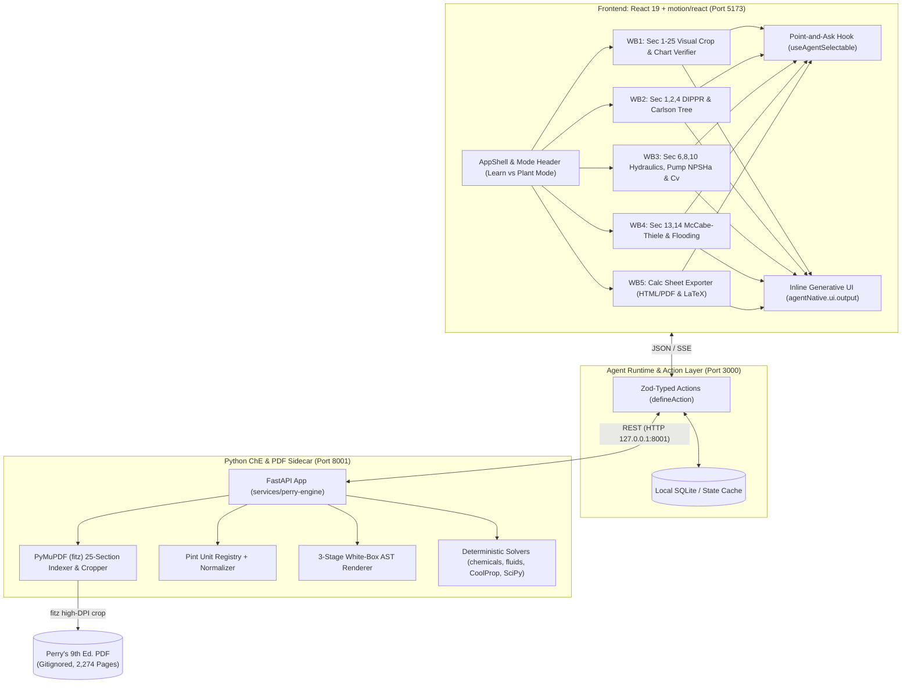

# System Architecture — ai4UCheE

## Architecture Overview

## Two-Tier AI Co-Pilot (`POST /api/copilot`)

The Express host (`src/server/copilot-route.ts`) fronts a two-tier answering pipeline:

1. **Tier 2 — `gateway.ai4u.now` LLM gateway (`gemini-4-argon-low`)**: when `GATEWAY_API_KEY` is configured (and outside Vitest), the route POSTs the `<current-screen>` state, selected chips, Tier-1 baseline, and user prompt to `https://gateway.ai4u.now/v1/chat/completions` with `model: gemini-4-argon-low` and a hard `AbortSignal.timeout(4500)` (4.5 s) budget.
2. **Tier 1 — deterministic ChE Tutor fallback (`src/actions/copilot-responder.ts`)**: when no key is present, under `VITEST`, or on any upstream error/timeout, the route serves intent-matched tutoring (WB1 charts / WB2 DIPPR / WB3 hydraulics / WB4 distillation) grounded in exact Perry's 9th Ed. citations with white-box GenUI proof cards. On this fallback path `emitUi: false` — `genUiCards` travel only in the JSON response, never re-rendered client-side.

- `GET /api/copilot/status` reports the active `{ gatewayUrl, model, tier2 }` state.
- The browser drawer (`AgentChatDrawer`) runs Tier-1 locally first (emitting GenUI cards into the inline stream), then enriches the reply via `POST /api/copilot`; the vite dev proxy forwards `/api` to `http://127.0.0.1:3000` so `npm run dev` reaches the same Express route.
- **Live-state grounding & What-If control (Phase 9, 2026-10-30)**: `CopilotRequestSchema` carries the live `payload` snapshot; Tier-2 user content embeds `Live inputs`/`Live metrics` and the system prompt instructs the model to close with a `{"actionMutations": ...}` JSON line, which `callGeminiGateway` extracts defensively. Tier-1 runs `parseCopilotScenario` (`src/actions/copilot-scenario-parser.ts`) — a deterministic natural-language What-If parser that overlays matched params (gpm / inches / psig / compound / Kelvin / reflux / alpha / rescue intents) onto the live payload, recomputes before/after diagnostics with the pure solver modules, and returns `actionMutations` + citations. The drawer dispatches `actionMutations` via `dispatchWorkbenchMutation` and renders a `copilot-mutation-pill`.

## Bi-Directional `<current-screen>` Payload & Mutation Bus (`src/actions/view-screen.ts`)

The screen store is a two-way bus, not a read-only serializer:

1. **Publish (workbench → store)**: every workbench calls `syncWorkbenchPayload(workbenchId, { summary, inputs, metrics, equations, statusBanner })` on mount and on every slider change. Snapshots are cached per workbench; the active workbench's snapshot is exposed as `ClientScreenState.payload`, and tab switches swap in the cached snapshot of the newly active workbench.
2. **Serialize (store → LLM)**: `serializeCurrentScreenTag()` emits `<payload live="true">` with `
/<inputs>/<metrics>/<equations>/<raw>` whenever inputs/metrics exist — the copilot and `view-screen` agent action reason over exact live numbers.
3. **Mutate (missions/copilot → workbench)**: `dispatchWorkbenchMutation({ targetWorkbench, params, reason })` synchronously notifies all `subscribeWorkbenchMutation` listeners; each workbench applies matched keys to its React state (sliders animate immediately). Guided Missions preset trap scenarios this way (`mission-scenarios.ts`), and the `MissionChecklistBanner` watches the payload via `subscribeClientAppState` to auto-check the 3-step Observe → Scrub → Verify walkthrough.

## Core Subsystems
1. **Agent-Native Host**: Bridges the interactive web UI and LLM agent using typed schema actions and live UI state synchronization.
2. **Deterministic ChE Solvers**: Replaces LLM numerical calculations with verified open-source engineering packages.
3. **PyMuPDF Document Resolver**: Extracts exact section pages, tables, figures, and empirical equations to ground answers in Perry's handbook text.
4. **White-Box Proof Generator**: Generates transparent mathematical derivations with unit cancellations for engineering review.
