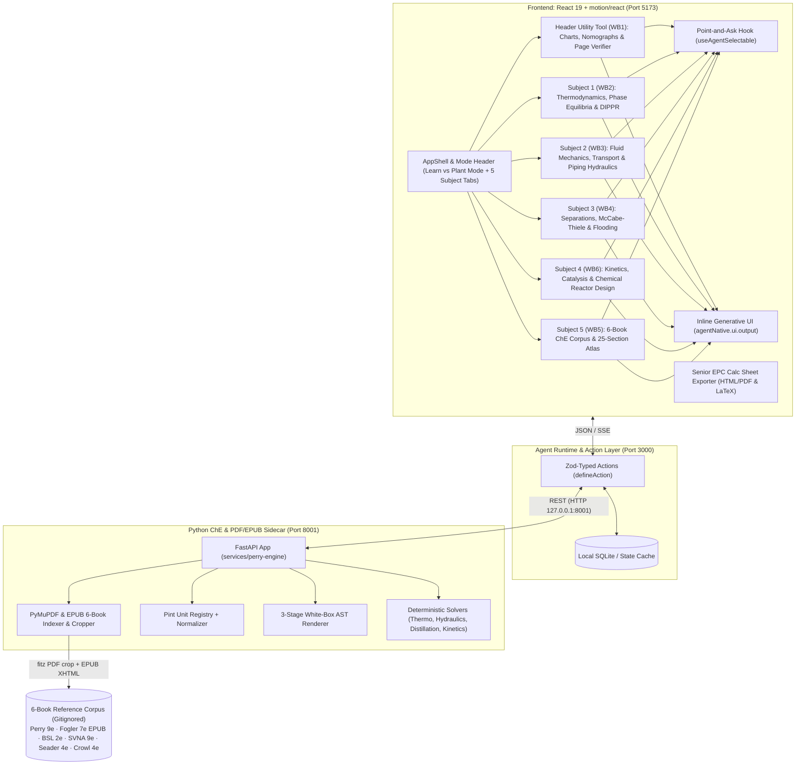

# System Architecture — ai4UCheE

## Architecture Overview

## Two-Tier AI Co-Pilot (`POST /api/copilot`)

The Express host (`src/server/copilot-route.ts`) fronts a two-tier answering pipeline:

1. **Tier 2 — `gateway.ai4u.now` LLM gateway (`gemini-4-argon-low`)**: when `GATEWAY_API_KEY` is configured (and outside Vitest), the route POSTs the `<current-screen>` state, selected chips, Tier-1 baseline, and user prompt to `https://gateway.ai4u.now/v1/chat/completions` with `model: gemini-4-argon-low` and a hard `AbortSignal.timeout(4500)` (4.5 s) budget.
2. **Tier 1 — deterministic ChE Tutor fallback (`src/actions/copilot-responder.ts`)**: when no key is present, under `VITEST`, or on any upstream error/timeout, the route serves intent-matched tutoring (WB1 charts / WB2 DIPPR / WB3 hydraulics / WB4 distillation) grounded in exact Perry's 9th Ed. citations with white-box GenUI proof cards. On this fallback path `emitUi: false` — `genUiCards` travel only in the JSON response, never re-rendered client-side.

- `GET /api/copilot/status` reports the active `{ gatewayUrl, model, tier2 }` state.
- The browser drawer (`AgentChatDrawer`) runs Tier-1 locally first (emitting GenUI cards into the inline stream), then enriches the reply via `POST /api/copilot`; the vite dev proxy forwards `/api` to `http://127.0.0.1:3000` so `npm run dev` reaches the same Express route.
- **Live-state grounding & What-If control (Phase 9, 2026-10-30)**: `CopilotRequestSchema` carries the live `payload` snapshot; Tier-2 user content embeds `Live inputs`/`Live metrics` and the system prompt instructs the model to close with a `{"actionMutations": ...}` JSON line, which `callGeminiGateway` extracts defensively. Tier-1 runs `parseCopilotScenario` (`src/actions/copilot-scenario-parser.ts`) — a deterministic natural-language What-If parser that overlays matched params (gpm / inches / psig / compound / Kelvin / reflux / alpha / rescue intents) onto the live payload, recomputes before/after diagnostics with the pure solver modules, and returns `actionMutations` + citations. The drawer dispatches `actionMutations` via `dispatchWorkbenchMutation` and renders a `copilot-mutation-pill`.

## Bi-Directional `<current-screen>` Payload & Mutation Bus (`src/actions/view-screen.ts`)

The screen store is a two-way bus, not a read-only serializer:

1. **Publish (workbench → store)**: every workbench calls `syncWorkbenchPayload(workbenchId, { summary, inputs, metrics, equations, statusBanner })` on mount and on every slider change. Snapshots are cached per workbench; the active workbench's snapshot is exposed as `ClientScreenState.payload`, and tab switches swap in the cached snapshot of the newly active workbench.
2. **Serialize (store → LLM)**: `serializeCurrentScreenTag()` emits `<payload live="true">` with `
/<inputs>/<metrics>/<equations>/<raw>` whenever inputs/metrics exist — the copilot and `view-screen` agent action reason over exact live numbers.
3. **Mutate (missions/copilot → workbench)**: `dispatchWorkbenchMutation({ targetWorkbench, params, reason })` synchronously notifies all `subscribeWorkbenchMutation` listeners; each workbench applies matched keys to its React state (sliders animate immediately). Guided Missions preset trap scenarios this way (`mission-scenarios.ts`), and the `MissionChecklistBanner` watches the payload via `subscribeClientAppState` to auto-check the 3-step Observe → Scrub → Verify walkthrough.

## Core Subsystems
1. **Agent-Native Host**: Bridges the interactive web UI and LLM agent using typed schema actions and live UI state synchronization.
2. **Deterministic ChE Solvers**: Replaces LLM numerical calculations with verified open-source engineering packages.
3. **PyMuPDF Document Resolver**: Extracts exact section pages, tables, figures, and empirical equations to ground answers in Perry's handbook text.
4. **White-Box Proof Generator**: Generates transparent mathematical derivations with unit cancellations for engineering review.
5. **Bi-Directionally Interactive Engineering Charts & Diagrams (`src/lib/svg-drag-math.ts`, `src/components/sketches/*`)**: Every SVG chart, phase diagram, PFD equipment schematic, column tray stack, and Copilot inline sparkline across WB1–WB6 supports direct pointer scrubbing, draggable operating handles, clickable landmark snap points, and inverse domain solvers that mutate workbench React state and the `<current-screen>` bus at 60 fps.
6. **Whole 25-Section *Perry's 9th Ed.* Interactive Atlas & Index (`WB5`, `src/lib/perry-sections/`)**: Covers all 25 sections (`Sec 1` through `Sec 25`) across 5 modular solver clusters (`sec-01-05-solvers.ts`..`sec-21-25-solvers.ts`), a universal bi-directional SVG curve & pointer-drag surface (`perry-section-interactive-svg.tsx`), a Back-of-Book Index (`pp. 2244–2274`) search & live PDF cropper (`perry-atlas-pdf-explorer.tsx`), a 25-section Copilot What-If router (`perry-atlas-copilot-router.ts`), and full QA/QC Calc Sheet generation (`perry-atlas-registry.ts`).
7. **Subject-First 6-Textbook Corpus, 5 Pure ChE Subject Tabs & Cross-Subject Charts Verifier (`src/lib/textbook-corpus-registry.ts`, `services/perry-engine/pdf/textbook_corpus.py`, `src/components/shell/app-shell.tsx`)**: The main navigation bar contains 5 pure Chemical Engineering subjects (`Thermodynamics & Phase`, `Fluid & Transport Hydraulics`, `Separations & Distillation`, `Kinetics & Reactor Design`, `6-Book & 25-Sec ChE Atlas`), while `Charts & Page Verifier` (`wb1-visual-verifier`) sits in the header utility bar as a cross-subject tool that pre-selects the chart relevant to the active subject and toggles back to the subject on second click. All workbenches blend *Perry's 9th Ed.* (PDF), *Fogler 7th Ed.* (EPUB), *Bird-Stewart-Lightfoot 2nd Ed.* (PDF), *Smith-Van Ness-Abbott 9th Ed.* (PDF), *Seader-Henley-Roper 4th Ed.* (PDF), and *Crowl & Louvar 4th Ed.* (PDF).
8. **Multi-Book Companion SVG Diagrams & 10-Nomograph Verifier (`Phase 13`)**:
   - **WB1 (`📐 Charts & Page Verifier`)**: 10 calibrated multi-book nomographs (`6-10`, `14-37`, `14-57`, `2-53`, `19-6`, `6-52`, `4-18`, `15-10`, `14-15`, `23-42`).
   - **WB2 (Thermo)**: Binary Non-Ideal VLE $T\text{-}x\text{-}y$ / $y\text{-}x$ Azeotrope Explorer (`binary-vle-txy-svg.tsx`) + Peng-Robinson Cubic EOS $Z(P_r, T_r)$ & $P_r\text{-}V_r$ Dome (`peng-robinson-eos-svg.tsx`).
   - **WB3 (Hydraulics)**: BSL Power-Law Pipe Velocity Profile & Boundary Layer $\delta_v, \delta_T, \delta_c$ (`bsl-pipe-velocity-boundary-svg.tsx`) + ISA-75.01 Choked Control Valve $Q(\sqrt{\Delta P})$ Curve (`isa-control-valve-choked-svg.tsx`).
   - **WB4 (Separations)**: Kremser Absorption Operating/Equilibrium & $N_{OG}(A)$ Chart (`kremser-absorption-svg.tsx`) + Ternary LLE Equilateral Triangle & Adsorption Breakthrough $C/C_0(t/\tau)$ (`ternary-lle-breakthrough-svg.tsx`).
   - **WB6 (Kinetics & Reactors)**: Semenov $G(T)/R(T)$ Thermal Runaway S-Curve (`semenov-thermal-runaway-svg.tsx`), Series Selectivity $C_A, C_B, C_C(\tau)$ & RTD Tanks-in-Series $E(\Theta; N)$ (`series-selectivity-rtd-svg.tsx`), and Electrochemical Butler-Volmer / Koutecký-Levich Polarization Curve $i(\eta)$ (`butler-volmer-polarization-svg.tsx`).
9. **Diagram Mode Switcher & 8 Advanced ChE Interactive Diagrams (`Phase 14`)**:
   - **Shared Switcher (`diagram-mode-bar.tsx`)**: Renders `wb2-diagram-mode-bar`, `wb3-diagram-mode-bar`, `wb4-diagram-mode-bar`, and `wb6-diagram-mode-bar` defaulting to `'all'` and filtering to focused diagram groups on click.
   - **WB2 (`rankine-rxn-equilibrium-svg.tsx`)**: Rankine / Vapor-Compression $T\text{-}S$ Cycle Dome + Van 't Hoff Reaction Equilibrium $X_{\text{eq}}(T)$ with Adiabatic Line (*SVNAS Ch. 8, 9, 14 · Fogler Ch. 11 · Perry's Sec. 4 & 24*).
   - **WB3 (`heat-exchanger-boiling-svg.tsx`, `process-safety-flammability-plume-svg.tsx`)**: Shell-and-Tube Heat Exchanger $T\text{-}Q$ Temperature Cross (Bowman $F_T$) + Nukiyama Pool Boiling Curve $q''(\Delta T_{\text{excess}})$ (*BSL Ch. 10, 12, 14 · Perry's Sec. 5 & 11*) and Crowl & Louvar Ternary Flammability Triangle (LOC) + Pasquill-Gifford Plume Dispersion $C(x)$ (*Crowl & Louvar Ch. 5 & 6 · Perry's Sec. 23*).
   - **WB4 (`psychrometric-membrane-svg.tsx`)**: Psychrometric Humidification Chart ($T_{db}, T_{wb}, \phi$) + Membrane Gas Permeation Stage Cut $\theta$ vs. Enrichment $y_P(\theta)$ (*Perry's Sec. 12 & 20 · Seader Ch. 14 & 18*).
   - **WB6 (`lhhw-bioreactor-svg.tsx`)**: LHHW Dual-Site Catalytic Rate Roof $-r'_A(P_A)$ & Decay $a(t)$ + Monod Chemostat Bioreactor Productivity $D\cdot C_X(D)$ with Washout Cliff $D_{\text{wash}}$ (*Fogler Ch. 9 & 10 · Perry's Sec. 7, 19, 20*).
