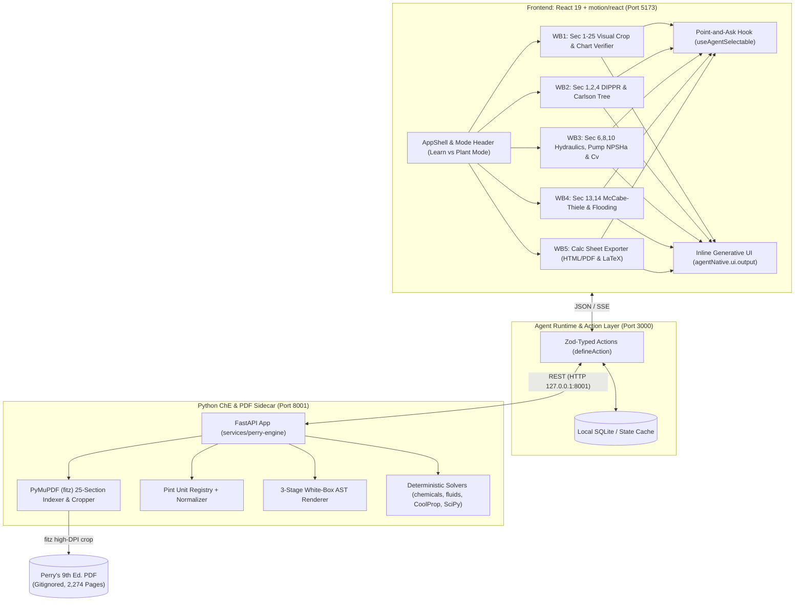

# System Architecture — ai4UCheE

## Architecture Overview

## Core Subsystems
1. **Agent-Native Host**: Bridges the interactive web UI and LLM agent using typed schema actions and live UI state synchronization.
2. **Deterministic ChE Solvers**: Replaces LLM numerical calculations with verified open-source engineering packages.
3. **PyMuPDF Document Resolver**: Extracts exact section pages, tables, figures, and empirical equations to ground answers in Perry's handbook text.
4. **White-Box Proof Generator**: Generates transparent mathematical derivations with unit cancellations for engineering review.
