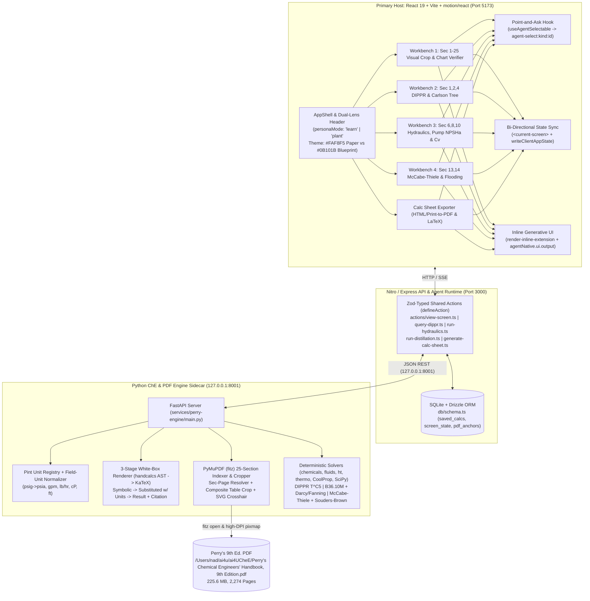

# Perry's Intelligent Workbench (`perrys-agent-workbench`) — V1 Master Plan (`--advice --ultra`)

> [!IMPORTANT]
> **Handover-Ready Contract (`--advice`)**: This plan is authored under `kongming` advisory supervision for direct execution by a downstream executor model (`/ak:cook --advice`). Each of the **7 separate phase files** (`phase-01-start.md` through `phase-07-calc-sheet-exporter-inline-ui-and-e2e.md`) decomposes its work into self-contained numbered tasks (`Goal`, `Target files and symbols`, `Steps`, `Success criteria`, and a decidable mechanical `Verify` comparison command) and ends with the mandatory literal `## Failure Protocol` block. **Every code file created or modified MUST stay strictly `< 200` lines of code** (modularized with kebab-case descriptive filenames).

## Overview

Build **Perry's Intelligent Workbench** (`/Users/nad/ai4u/ai4UCheE`), a bi-directional agent-native web application that turns *Perry's Chemical Engineers' Handbook, 9th Edition* (`/Users/nad/ai4u/ai4UCheE/Perry's Chemical Engineers' Handbook, 9th Edition.pdf`, 225.6 MB, 2,274 pages, 25 sections + Index) into a unified cognitive workspace for both **chemical engineering students (`🎓 Learn Mode`)** and **0–3 YoE fresh-grad plant/process engineers (`🏭 Plant Mode`)**.

## Goals

| # | Goal | Priority |
|---|---|---|
| 1 | **Bi-Directional Agent-Native Host (`BuilderIO/agent-native` + `motion/react`)**: Unify React 19 UI and agent via shared Zod-typed actions (`defineAction`), `<current-screen>` live sync (`writeClientAppState`), `useAgentSelectable` Point-and-Ask context chips (`agent-select:<kind>:<id>`), inline generative UI (`agentNative.ui.output()`), `layoutId` shared-layout morphing between `Learn` and `Plant` modes, scrubbable number inputs, and Dual Theme (`☀️ EPC Calc-Pad Paper #FAF8F5` vs. `🌙 Control Room Blueprint #0B101B`). | P1 |
| 2 | **Deterministic Python ChE & PDF Sidecar (`services/perry-engine/`)**: Run `FastAPI` + `PyMuPDF` (`fitz`) + `chemicals` + `fluids` + `ht` + `thermo` + `CoolProp` + `SciPy` + `pint` + a 3-Stage `handcalcs` AST-to-KaTeX White-Box Renderer (`Symbolic → Substituted w/ Units → Result + # [Perry's 9th Ed., Eq. X-Y, p. S-P]`). | P1 |
| 3 | **4 V1 Engineering Workbenches (`WB1–WB4`)**: Deliver **WB1** (25-Section `Sec-Page` Visual Verifier, Composite Table Header+Row Cropper, Calibrated SVG Crosshair, & `DeepTutor` Chart-Reading Practice with $4\times$ Fanning/Darcy coaching), **WB2** (Sec 1, 2 & 4 DIPPR exact $T^{C_5}$ Engine, `pint` Field-Unit Normalizer, & Carlson's Property Method Decision Tree), **WB3** (Sec 6, 8 & 10 Commercial Pipe `Sch 40/80` Sizing, 3-Case `70%/100%/120%` Matrix, Pump $\text{NPSH}_A$ vs. $\text{NPSH}_R$, & ISA-75.01 Control Valve $C_v$ Choked-Flow Check + Parametric SVG Sketch), and **WB4** (Sec 13 & 14 Bi-Directional McCabe-Thiele Canvas + Souders-Brown $C_{\text{sb}}$ & Eckert GPDC Flooding Hydraulics). | P1 |
| 4 | **Senior-Engineer QA/QC Calculation Sheet Exporter**: Compile any calculation into both a **Print-to-PDF EPC Calculation Sheet (`HTML` with `@media print`)** and a **Markdown / LaTeX Calculation Note** with QA/QC Document Control Header, 3-stage white-box equations, 3-Case table, and embedded *Perry's 9th Ed.* proof crops. | P1 |

## Architecture & Dependency Graph

## Phases

| # | Phase | Status |
|---|-------|--------|
| 1 | [Phase 1: Workspace Foundation, Monorepo Scaffolding & Python PerryEngine Sidecar Bootstrap](./phase-01-start.md) | Completed (`813d773`) |
| 2 | [Phase 2: Perry's 9th Ed. 25-Section Indexer, PyMuPDF Visual Crop Engine & Dual-Track Chart Verifier (WB1)](./phase-02-pdf-visual-crop-and-chart-verifier.md) | Completed (`b0402c6`) |
| 3 | [Phase 3: BuilderIO/agent-native Core Shell, Dual-Lens UI, useAgentSelectable & motion/react Design System](./phase-03-agent-native-shell-and-framer-motion-ui.md) | Completed (`90e064e`) |
| 4 | [Phase 4: Sec 1, 2 & 4 DIPPR Thermophysical Property Engine, Mixed Field-Unit Normalizer & Carlson's Property Advisor (WB2)](./phase-04-dippr-thermo-pint-and-property-advisor.md) | Completed (`743c172`) |
| 5 | [Phase 5: Sec 6, 8 & 10 Fluid Hydraulics, Commercial Pipe Sizing, Pump NPSHa & Control Valve Cv Workbench (WB3)](./phase-05-hydraulics-pipe-pump-npsha-and-valve-cv.md) | Completed (`8ac5c9e`) |
| 6 | [Phase 6: Sec 13 & 14 Distillation Workbench: Bi-Directional McCabe-Thiele Canvas + Tray/Packing Flooding Hydraulics (WB4)](./phase-06-distillation-mccabe-thiele-and-flooding.md) | Completed (`c6c9820`) |
| 7 | [Phase 7: Senior-Engineer Calculation Sheet Exporter, Inline Generative UI Cards & End-to-End Verification](./phase-07-calc-sheet-exporter-inline-ui-and-e2e.md) | Completed |

## Ultra Verifier & Red-Team Summary (`--ultra --advice`)

- **Ultra Best-of-5 Selection**: `winner: Candidate A (99/100)`, `picked=1/5`, `margin=low (+2 pts over Candidate E)`, `unanimous=yes`, `rejected_all=no`, with surgical merges from Candidate D (composite table header + row cropper and `fanning_darcy_4x_detected` coaching diagnostic), Candidate B (explicit ISA liquid critical pressure ratio factor $F_F = 0.96 - 0.28\sqrt{P_v / P_c}$ step in 3-stage `handcalcs`), and Candidate E (`< 200` LOC automated modularity gate).
- **Engineered Safety Guardrails**:
  1. **Darcy vs. Fanning ($f_D = 4 f_F$)**: Perry's Fig. 6-9 plots Fanning $f_F$; Phase 2 & Phase 5 explicitly surface both $f_F$ and $f_D = 4 f_F$ and detect $4\times$ student reading mistakes.
  2. **Gauge vs. Absolute Pressure (`psig` vs. `psia`)**: Phase 1 & Phase 5 reject bare `"psi"` and log explicit $P_{\text{abs}} = P_{\text{gauge}} + P_{\text{atm}}$ conversions in Stage 2 of the `handcalcs` trace.
  3. **DIPPR $T^{C_5}$ & Validity Bounds**: Phase 4 evaluates full 5-parameter DIPPR Eq. 101 & Eq. 106 ($C_2 + C_3 T_r + C_4 T_r^2 + C_5 T_r^3$) and enforces $[T_{\min}, T_{\max}]$ bounds with `CoolProp` reference fallback.
  4. **Carlson LLE & Dimerization Traps**: Phase 4 warns against using `Wilson` for Liquid-Liquid Equilibrium (LLE) and mandates `NRTL-HOC` (Hayden-O'Connell) for carboxylic acid vapor-phase dimerization.

## Success Criteria

- [x] All 7 phase files pass `ak plan validate` and execute cleanly under `/ak:cook --advice`.
- [x] Python sidecar `pytest` suite (`test_phase1` through `test_phase7`) exits `0` with 100% pass rate (40/40 passed) against the 2,274-page *Perry's 9th Ed.* PDF.
- [x] Frontend `vitest` suite (8/8 passed) and `vite build` exit `0` with full `<current-screen>`, `useAgentSelectable`, and `agentNative.ui.output()` verification.
- [x] Zero `.ts`, `.tsx`, or `.py` source files exceed 200 lines of code (`ALL_PHASES_AND_LINE_LIMITS_OK`).

## Validation Log

### Verification Results
- **Tier:** Full (7 phases → all 4 roles; greenfield repo, so claims verified against the actual PDF, library APIs, and toolchain instead of existing code)
- **Claims checked:** 34
- **Verified:** 17 | **Failed:** 12 | **Unverified/Partial:** 5
- **Method:** scratch venv (`pymupdf 2.0`, `fluids 1.3.1`, `pint`) opened the actual 2,274-page PDF; TOC + per-page text scans pinned true printed `S-P` pages for every cited artifact; `fluids`/`pint` API contracts executed live.

#### Verified (evidence)
1. PDF exists at repo root; `len(doc) == 2274` ✓; metadata title "Perry's Chemical Engineers' Handbook (9780071834094)" ✓.
2. Index title page at pdf 2244, last page 2274 ✓ (plan's `pp. 2244–2274`).
3. `doc.get_toc()` returns 30 entries incl. all 25 section starts → Task 2.1's TOC-based offset building is feasible; section titles in `SECTION_TITLES` match the TOC ✓.
4. **Fig. 6-9 on printed 6-10 is literally "FIG. 6-9 Fanning friction factors"** ✓ — the Darcy/Fanning guardrail is grounded; `len(page.get_drawings()) == 120 ≥ 8` on that page ✓ (vector detector works).
5. **Fig. 14-55 is "Generalized pressure drop correlation of Eckert as modified by Strigle"** ✓ content — but at printed **14-57**, not 14-85.
6. **Table 2-32 is "Densities of Inorganic and Organic Liquids (mol/dm³)"** ✓ content (Eq. 105) — starts at printed **2-93**, not 2-99.
7. `fluids.piping.nearest_pipe(NPS=4, schedule='40')` → `(4.0, 0.10226, 0.1143, 0.00602)` — D_inner `0.10226 m` exactly as Phase 5 claims ✓; `fluids.friction.friction_factor(Re=1e5, eD=4.5e-4)` → `0.02012` (Darcy) ✓ API exists.
8. `pint`: 1 gpm = `6.30902e-5 m³/s` → 100 gpm = `0.00630902` exactly as Task 1.3 claims ✓; 0 psig + 14.6959 psia = 101,325 Pa ✓.
9. Domain constants: water P_vp(373.15 K) ≈ 101,325 Pa and ΔH_vap ≈ 4.065×10⁷ J/kmol ✓ (Perry's Table 2-69 units are J/kmol, matching).
10. NPSH topic on printed 10-28 region ✓; NPSH equations actually at **pp. 10-24..10-25**, where Perry's own margin rules "(NPSH)A = (NPSH)R + 5 ft" and "(NPSH)A = 1.35(NPSH)R" appear.
11. Repo registered in `repos.yaml` (`verticals.ai4UCheE`) ✓; PDF already gitignored via `*.pdf` rule ✓.

#### Failures (file:line-equivalent evidence from the live PDF)
1. [Fact Checker] **Phase 4**: `Table 2-141` is "Diffusivities of Pairs of Gases and Vapors" (pdf 318–319), NOT vapor pressure. True artifact: **Table 2-8 "Vapor Pressure of Inorganic and Organic Liquids, ln P = C1 + C2/T + C3 ln T + C4 T^C5, P in Pa" (exactly DIPPR Eq. 101 form), pp. 2-53 ff.** Plan's `pp. 2-162..2-181 / p. 2-165` wrong.
2. [Fact Checker] **Phase 4**: `Table 2-150` is "Thermal Conductivity of Chromium Alloys" (pdf 342), NOT heat of vaporization. True artifact: **Table 2-69 "Heats of Vaporization of Inorganic and Organic Liquids (J/kmol)", pp. 2-120 ff.** Plan's `pp. 2-190..2-204 / p. 2-195` wrong.
3. [Fact Checker] **Phase 4**: `Table 2-305, p. 2-414` does not exist (Sec 2 ends ≈ 2-362; printed 2-305 is a "TRANSPORT PROPERTIES" text page). Steam-table citation must be re-resolved or dropped.
4. [Fact Checker] **Phase 5**: `Table 10-18` is "Status of ASME B31 Code for Pressure Piping" (pdf 869 = 10-66), NOT pipe dimensions. True artifact: **Table 10-22 "Properties of Steel Pipe", pp. 10-70..10-72** (plan's p. 10-72 is where the "(Continued)" marker sits).
5. [Fact Checker] **Phase 5**: `Eq. 6-38/6-39, p. 6-10` — both equations live on **p. 6-11**, and Eq. (6-38) is the explicit-in-f friction factor relation, not the Reynolds number definition. Re-definition needs a corrected or generic citation.
6. [Fact Checker] **Phase 5**: `NPSH Eq. 10-29, p. 10-28` — Eq. (10-29) is a venturi/expansion relation on p. 10-17; Perry's NPSH equations are unnumbered inline equations at **pp. 10-24..10-25**.
7. [Fact Checker] **Phase 5**: `Sec 8-12 (ISA-75.01), p. 8-48` — printed 8-48 covers "Run-to-run control" (batch control). Valve sizing with choked flow is **Eqs. (8-77)–(8-81), pp. 8-71..8-74** (ANSI/ISA S75.08/.17/.22 references confirmed there).
8. [Fact Checker] **Phase 6**: `Fig. 14-26` is "A tray with channel baffles" (pdf 1265 = 14-32), NOT flooding capacity. True artifact: **Fig. 14-32 "Fair's entrainment flooding correlation for columns with cross-flow trays (sieve, valve, bubble…)", p. 14-37**.
9. [Fact Checker] **Phase 6**: `Fig. 14-55, p. 14-85` — right figure, wrong page: it is at **p. 14-57**.
10. [Fact Checker] **Phase 6**: `Eq. 13-19, p. 13-14` — 13-19 is a **Figure** ("FIG. 13-19 Typical intersection of the two operating lines at the q line"), not the equilibrium equation; `Eq. 13-48/13-62` page anchors off by 2–6 pages (tokens found at 13-22/13-33/13-36-37/13-46-48).
11. [Contract Verifier] **Phase 1 Task 1.1**: `vitest@^2.1.8` peer-requires `vite ^5` — with `vite@^6.0.0` npm install fails (ERESOLVE). Must move to `vitest@^3` (first line supporting Vite 6).
12. [Fact Checker] **plan.md**: Overview says PDF is `215 MB` (actual 225.6 MB, AGENTS.md says 225 MB); Architecture diagram still shows the stale scout path `/Users/nad/Downloads/...pdf` (actual: repo root). Also [Scope Auditor] plan puts the app at repo root (`/src`, `/package.json`) while repo `AGENTS.md` invariant declares `apps/` for the frontend — structural contradiction to resolve.

#### Unverified / risk flags
1. Header/footer `S-P` tokens are text-extractable on only ~280 of 2,274 pages — Task 2.1's `verified_header` must fall back to TOC-linear + whole-page token/caption search, and its Verify assertion (`verified_header` for `6-10` AND `14-55`) will fail as written once citations are corrected (pdf 593/1288 have no clean header token).
2. `import fitz` is deprecated under installed PyMuPDF 2.x (FutureWarning; shim still works) — use `import pymupdf as fitz` idiom.
3. System Python is 3.15.1 — CoolProp/scientific wheels are safest on 3.12; Task 1.2 should pin `uv venv --python 3.12`.
4. Phase 4 Eq. 4-19 / Sec 4-11 page anchors (PR/SRK, eNRTL) not confirmed — printed 4-10 covers compressor work (Eq. 4-48); activity-coefficient content sits near 4-36. Resolve exact anchors at build time.
5. `tailwindcss` + `tailwind-merge` are declared deps but no phase ever writes `tailwind.config`/PostCSS wiring or `@tailwind` directives — either wire or drop.
6. Phase 6 success-criteria text says R_min ≈ 1.18; closed-form value for α=2.45, z_F=0.5, x_D=0.95, q=1 is ≈ 1.141 (the Verify band `1.1 < r_min < 1.3` still holds).

### Session 1 — 2026-10-28
**Trigger:** `ak:plan --advice validate` on the finished plan; verification pass + interview.
**Questions asked:** 4 (interview returned no answers — user unavailable mid-session; all four proceeded on the marked (Recommended) autonomous defaults, each reversible on request)

#### Questions & Answers

1. **[Assumptions]** Ten hard-evidence citation errors found (Tables 2-141/2-150/10-18 misnumbered; Fig. 14-26 wrong chart; pages 2-165/2-195/2-414/14-55/14-85/10-72/8-48 wrong). How to correct?
   - Options: Fix + add citation-verification test | Fix only | Resolve at runtime
   - **Answer:** Fix + citation-verification test (autonomous default) — all 10 corrections applied to phase-04/05/06 and a `verify_page_contains()` primitive added to Phase 2 Task 2.1, asserted in the Phase 4/5/6 pytest suites against the live PDF.
   - **Rationale:** Hard-coded citations were provably wrong against the actual handbook; a mechanical assertion prevents future drift and gives the executor decidable checks.
2. **[Architecture]** Plan puts the app at repo root; repo AGENTS.md invariant declares `apps/`. Which layout wins?
   - Options: Repo-root `src/` + update AGENTS.md | Move plan to `apps/`
   - **Answer:** Repo-root `src/` + AGENTS.md Structure section updated (autonomous default).
   - **Rationale:** All 7 phases already carry root paths; moving ~30 target paths adds churn with no functional gain; AGENTS.md is the newer, softer artifact.
3. **[Scope]** `tailwindcss` + `tailwind-merge` declared but never wired (no config/directives task). Wire or drop?
   - Options: Drop Tailwind | Keep and wire in Phase 3
   - **Answer:** Drop (autonomous default) — removed from Task 1.1 deps; `clsx` kept; theming stays plain CSS variables; AGENTS.md updated.
   - **Rationale:** The dual-theme system is already CSS-variable tokens; wiring Tailwind v3 would add config surface with no phase using it, against the `< 200` LOC minimalism grain.
4. **[Assumptions]** Toolchain bundle: vitest ^2.1.8↔vite ^6 peer conflict, deprecated `import fitz`, Python 3.15 venv risk, 215 MB size + stale `/Users/nad/Downloads` PDF path.
   - Options: Apply all | vitest only | Skip
   - **Answer:** Apply all (autonomous default) — `vitest@^3.0.0`, `import pymupdf as fitz` idiom, `uv venv --python 3.12` pin, `225.6 MB` + repo-root path fixes.
   - **Rationale:** Each item is a verified fact; the vitest conflict alone breaks `npm install` on day one.

#### Confirmed Decisions
- Citation grounding: solver citations must be verifiable artifacts in the live PDF (Tables 2-8/2-69/2-32/2-31/10-22/14-13; Figs. 6-9/14-32/14-55; pp. 4-4/4-12/4-18/6-10/6-11/8-71/10-24/13-14/13-25/13-36/14-37/14-57/14-58/2-53/2-92/2-93/2-120) — enforced via `verify_page_contains` pytest assertions.
- Layout: repo-root `src/` frontend (AGENTS.md reconciled).
- Styling: no Tailwind; CSS-variable tokens.
- Toolchain: vitest ^3 / vite ^6, PyMuPDF 2.x `pymupdf` import idiom, Python 3.12 venv pin.

#### Action Items
- [x] Apply the 10 citation corrections across plan.md/phase-04/05/06.
- [x] Rework Task 2.1 resolver strategy (TOC-first offsets; whole-page-token `verified_header` with ±2 fallback; ground-truth-pinned Verify `593/1270`).
- [x] Add `verify_page_contains()` + per-phase citation pytest assertions.
- [x] Dependency fixes (vitest ^3, Tailwind removal, Python 3.12 pin, pymupdf idiom).
- [x] AGENTS.md Structure reconciliation.
- [x] NPSH cavitation ratio threshold aligned to Perry's 1.35× rule (done in Task 5.2; keep 1.0 m absolute-margin flag).

#### Impact on Phases
- Phase 1: deps + venv + import idiom + example citation.
- Phase 2: resolver strategy, `verify_page_contains`, Verify command, WB1 chart example.
- Phase 4: DIPPR table re-anchoring; Carlson citations; test assertions.
- Phase 5: pipe/friction/NPSH/valve citations; 1.35 rule; test assertions.
- Phase 6: Fair Fig. 14-32 / Eckert 14-57 / Table 14-13 14-58 anchors; Sec 13 anchors; R_min 1.14; test assertions.
- Phase 3 / Phase 7: no changes required (no stale citations or affected deps).

### Whole-Plan Consistency Sweep
- Files reread: plan.md, phase-01-start.md, phase-02-pdf-visual-crop-and-chart-verifier.md, phase-03-agent-native-shell-and-framer-motion-ui.md, phase-04-dippr-thermo-pint-and-property-advisor.md, phase-05-hydraulics-pipe-pump-npsha-and-valve-cv.md, phase-06-distillation-mccabe-thiele-and-flooding.md, phase-07-calc-sheet-exporter-inline-ui-and-e2e.md
- Decision deltas checked: 14 (renamed tables/figures 2-8/2-69/2-32/2-31/10-22/14-13/14-32; re-anchored pages 2-53/2-92/2-93/2-120/4-4/4-12/4-18/6-11/8-71/10-24/13-14/13-36/14-37/14-57/14-58; Tailwind removal; vitest ^3; PDF size/path; R_min 1.14; NPSH 1.35 rule)
- Reconciled stale references: 1 (phase-02 Task 2.2 caption-matcher examples `FIG. 14-26`/`TABLE 2-141` → `FIG. 14-32`/`TABLE 2-8`)
- Unresolved contradictions: 0
- Note: `reports/perrys-brainstorm-report.md` and `reports/perrys-benchmark-research-report.md` retain pre-validation references (215 MB, `/Users/nad/Downloads` path, `Table 2-141`); they are frozen research-time artifacts, not execution authority — `plan.md` + `phase-*.md` govern implementation.

<!-- slug: perrys-intelligent-workbench -->
