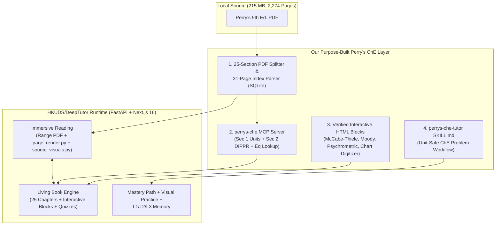
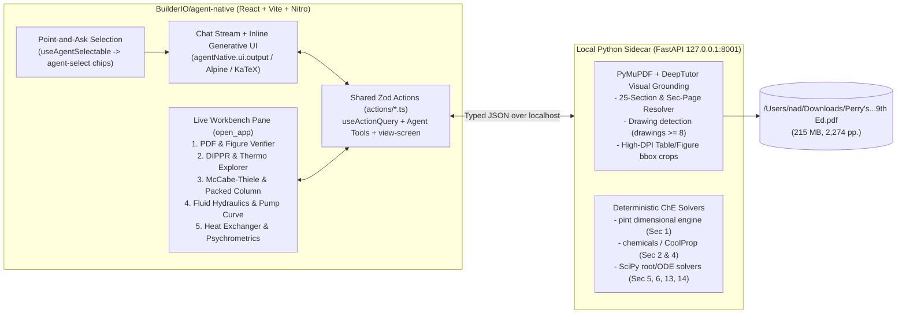

# Perry's Intelligent Workbench (ai4UCheE) — Master Brainstorm & Advisory Report (`--advice --ultra`)

> **Date**: 2026-10-28
> **Project Workspace**: `/Users/nad/ai4u/ai4UCheE`
> **Source PDF**: `/Users/nad/ai4u/ai4UCheE/Perry's Chemical Engineers' Handbook, 9th Edition.pdf` (215 MB, 2,274 pages, 25 sections + Index)

---

## Part 1: Initial Brainstorm (`--advice --ultra`) — Converting *Perry's 9th Edition* into an Effective ChE Web App
I have inspected [Perry's Chemical Engineers' Handbook, 9th Edition.pdf](file:///Users/nad/Downloads/Perry's%20Chemical%20Engineers'%20Handbook,%209th%20Edition.pdf) (215 MB, 2,274 pages, 25 Sections + 31-page Index) and completed the `/ak:brainstorm --advice --ultra` best-of-5 verification and `kongming` advisory pass.

> *Note on `--ultra` & `--advice` execution*: All 5 independent read-only candidate brainstorms and the `kongming` verifier/supervisor ran in parallel on this session's strongest available model tier (same-tier best-of-5 + rubric verification). Below is the winning candidate contract (**Candidate A**, 96/100) unchanged, followed by the ranking appendix, `kongming` advisory counsel, and our alignment questions.

---

# Winning Brainstorm Contract: Perry's Chemical Engineers' Handbook (9th Ed.) Student Web Workbench

## 1. Outcome
A **local-first, citation-grounded Chemical Engineering Student Workbench** that transforms [Perry's Chemical Engineers' Handbook, 9th Edition.pdf](file:///Users/nad/Downloads/Perry's%20Chemical%20Engineers'%20Handbook,%209th%20Edition.pdf) (2,274 pages, 215 MB) from an unwieldy static reference into an active problem-solving environment. Students can:
1. **Search & Navigate Instantly by Concept or Course**: Jump across all 25 sections and the 31-page index in `<100ms`, or browse via an undergraduate ChE curriculum lens (*Material & Energy Balances, Thermodynamics, Fluid Mechanics, Heat & Mass Transfer, Separations/Unit Ops, Reaction Engineering, Process Control, Plant Design & Economics, Process Safety*).
2. **Query Structured Physical Property & Correlation Engines**: Look up pure-component properties, DIPPR temperature-dependent equations ($\ln P = C_1 + C_2/T + C_3 \ln T + C_4 T^{C_5}$, heat capacity, liquid viscosity, latent heat), steam/refrigerant tables, and unit conversions (Secs. 1–2) with automatic unit conversion, valid temperature range enforcement ($T_{\min}$–$T_{\max}$), and interactive plotting—always side-by-side with the exact cropped PDF table/equation proof so transcription errors are impossible to miss.
3. **Execute Interactive Graphical & Design Solvers**: Use interactive digital overlays over Perry's classic graphical methods—McCabe-Thiele binary distillation stage stepping (Sec. 13), Moody pipe friction & pump sizing (Secs. 6, 10), Psychrometric chart state-point & humidification paths (Sec. 12), TEMA heat exchanger sizing (Sec. 11), and CAPEX/DCFROR economics (Sec. 9)—with live parameter sliders and step-by-step intermediate values for homework and capstone design verification.
4. **Verify & Trace Every Formula to Exact Page Coordinates**: View any extracted equation, table row, or RAG-assisted explanation alongside a high-DPI, bounding-box-highlighted crop of the original vector PDF page (resolving PostScript/InDesign glyph corruption like `m`, `Sgen`, or `T C5` vs $T^{C_5}$).

---

## 2. Constraints
- **Legal & Copyright Boundaries (McGraw-Hill Terms of Use, p. 5)**:
  - The PDF is copyrighted (ISBN 978-0-07-183409-4) and restricted to personal/noncommercial use.
  - **Architectural Mandate**: The web app repository must be **BYO-PDF (Bring Your Own PDF) / Local-First**. It must never commit or redistribute copyrighted full text or bulk page dumps in a public repo. The ingestion pipeline reads the user's local file ([Perry's Chemical Engineers' Handbook, 9th Edition.pdf](file:///Users/nad/Downloads/Perry's%20Chemical%20Engineers'%20Handbook,%209th%20Edition.pdf), verified via SHA-256 hash/page fingerprint) and builds local SQLite/DuckDB + vector/image tile caches in gitignored local storage.
- **Extraction Fidelity Realities**:
  - **Untagged InDesign PDF (`Tagged: no`)**: Multi-column spreads and 175+ multi-page tables in Section 2 scramble under naive `pdftotext` or `pypdf` extraction (e.g., lost superscripts $T^{C_5}$, merged column headers, landscape table rotations).
  - **2D Math & Custom Glyphs**: Embedded PostScript fonts substitute Greek characters (`el` for $\varepsilon_\lambda$, `F(q)` for $F(\theta)$) and overdots (`m`, `Sgen`). Raw text extraction is unsafe for engineering calculations without either vision-LLM/OCR-to-LaTeX verification + deterministic unit tests, or direct visual cropping of the vector PDF region.
  - **Graphical Nomographs & Charts**: Essential tools (Fig. 2-19 viscosity nomograph, Moody chart, psychrometric charts, McCabe-Thiele diagrams) exist as vector/raster artwork and require either programmatic first-principles correlations backing an interactive canvas or calibrated coordinate-homography digitizers on top of the rendered PDF figure.
- **Performance on a 215 MB / 2,274-Page File**:
  - Loading a 215 MB PDF directly into browser memory via `pdf.js` will freeze or crash student laptops/tablets.
  - The app must use either **HTTP Byte-Range streaming** (`Accept-Ranges: bytes` from a lightweight local daemon) or **on-demand page/region rendering (`pymupdf` / `pdfium`)** so cold start is `<1.5s`, memory footprint stays `<250 MB`, and page/crop rendering takes `<150ms`.
- **Pedagogical & Student UX Alignment**:
  - Perry's is written by industrial practitioners for practicing engineers—students frequently drown in 100-page equipment sections (e.g., Sec. 14 Packing/Trays) when they only need the core governing equation, variable definitions, units, and a worked calculation path.
  - Must surpass a generic PDF reader and differentiate from McGraw-Hill's commercial *AccessEngineering* by offering a unified, zero-latency local workspace that links textbook lookup, dimensional unit checking, and interactive calculation on a single screen.

---

## 3. Non-Goals
- **Full-Book Manual HTML/LaTeX Re-Typesetting**: We will NOT convert all 2,274 pages of prose and thousands of equations into reflowable HTML/MathJax upfront. Narrative text remains anchored on the high-resolution vector PDF canvas with an extracted search/heading index.
- **Industrial Flowsheet Simulator Replacement**: We are NOT building a full sequential-modular or equation-oriented plant simulator (like Aspen Plus, HYSYS, or ChemCAD) with multi-component rigorous tray-by-tray column convergence. Interactive calculators target undergraduate/capstone single-unit-op scoping and graphical methods.
- **Public Cloud SaaS Hosting of Copyrighted Content**: We will NOT build a multi-tenant public cloud server that hosts McGraw-Hill's PDF or full extracted DIPPR tables for unauthenticated public users.
- **Unverified LLM Math Execution**: We will NOT allow an LLM to perform arithmetic, unit conversion, or correlation evaluation in free text; all numeric computations must execute in deterministic Python/TypeScript functions with unit-tested formulas and explicit temperature/pressure bounds.

---

## 4. Acceptance Criteria
1. **Zero-Freeze Local Ingestion & Instant Navigation**:
   - Pointing the app at [Perry's Chemical Engineers' Handbook, 9th Edition.pdf](file:///Users/nad/Downloads/Perry's%20Chemical%20Engineers'%20Handbook,%209th%20Edition.pdf) builds or loads the structural index (all 25 sections, subsections, tables, figures, and the 31-page back-of-book index) and renders any requested page or bounding-box crop in `<150ms` without loading the full 215 MB file into browser RAM.
2. **Curriculum-Mapped Discovery**:
   - A student can toggle between **Perry's 25-Section Tree** and an **Undergraduate ChE Course Map** (8–10 core courses), plus a command-palette search (`Cmd+K`) that ranks Tables, Equations, Figures, and Index entries ahead of raw prose matches.
3. **Audit-Proof Property & Correlation Engine (Secs. 1–2)**:
   - Querying a compound (e.g., Water, Benzene, Ethanol, Acetone) and property (vapor pressure, liquid density, heat capacity, viscosity) evaluates the exact Perry's DIPPR equation at a student-specified temperature $T$, flags out-of-bounds $T \notin [T_{\min}, T_{\max}]$, converts between SI and Imperial/US Customary units (Sec. 1), and displays the **exact cropped PDF row from Section 2** directly below the result for visual verification.
4. **Interactive Unit-Op & Graphical Workbenches (Core Student Workflows)**:
   - Ships with at least **4 high-impact interactive modules** synchronized with their exact Perry's pages:
     1. *Unit Converter & Physical Property Calculator* (Secs. 1–2)
     2. *Pipe Flow, Moody Friction & Pump Head/NPSH Calculator* (Secs. 6, 10)
     3. *McCabe-Thiele Binary Distillation & Fenske-Underwood-Gilliland Shortcut Solver* (Sec. 13)
     4. *Heat Exchanger Log-Mean $\Delta T$ / $F$-Factor & Psychrometric State Calculator* (Secs. 11, 12)
5. **Visual-Crop Citation Grounding (Zero Silent Symbol Corruption)**:
   - Every equation or table referenced in a calculator, cheat-sheet card, or AI study assistant renders a clickable **high-DPI vector SVG/PNG crop** of the source bounding box in the PDF, guaranteeing that PostScript symbol substitutions (`m`, Greek letters, exponents) never mislead a student.

---

## 5. Option Exploration (3 Viable Approaches)

### Approach A: Full Automated PDF-to-Markdown/LaTeX Reflow Pipeline ("The Digital Textbook Conversion")
Run an end-to-end document parsing pipeline (`Marker` / `MinerU` / `Nougat` + vision LLM post-processing) across all 2,274 pages to convert the entire handbook into a static/searchable Next.js/MDX documentation site with MathJax equations and HTML tables.

### Approach B: Local-First "RAG + Chat with PDF" Study Assistant ("The AI Tutor Wrapper")
Chunk all 2,274 pages into a local vector database (`Chroma` / `LanceDB` + BM25 hybrid search), pair a split-screen `pdf.js` byte-range viewer with an LLM chat sidebar + Python code interpreter tool, and let students ask natural-language questions that retrieve pages and write ad-hoc calculation scripts on the fly.

### Approach C: Hybrid Citation-Grounded PDF Workbench + Curated Interactive Engineering Calculators ("The ChE Workbench") — **[RECOMMENDED]**
Keep the native vector PDF as the authoritative visual reading layer (served via fast local byte-range/tile rendering in `PyMuPDF`), build a precision structural index (25 Sections + 31-page Index + Table/Figure catalog + ChE Course Map), and selectively extract/verify **only** high-leverage engineering primitives into deterministic interactive modules (Sec. 1–2 Property & DIPPR Engine, Sec. 6/10 Fluid/Pipe Solver, Sec. 11/12 Heat/Psychrometrics, Sec. 13 McCabe-Thiele Distillation, plus a Web-Canvas Nomograph Digitizer for reading any chart in the book)—where every number and equation displays its exact cropped PDF bounding box alongside the interactive tool.

---

## Trade-offs

| Dimension | Approach A: Full Automated Reflow (MDX/LaTeX) | Approach B: RAG + Chat-with-PDF Wrapper | Approach C: Hybrid PDF Canvas + Interactive ChE Workbench |
| :--- | :--- | :--- | :--- |
| **Load-bearing assumption** | Automated layout/OCR models (`Marker`/`MinerU`) can parse 2,274 pages of multi-column InDesign layouts, 175+ dense landscape tables, and custom PostScript math glyphs with near-zero silent errors. | Students primarily want conversational Q&A, and LLM retrieval + ad-hoc code execution can reliably extract coefficients from scrambled multi-column PDF text chunks. | Students get 90% of their daily value from fast structural/index lookup + native vector PDF reading + 5–8 deterministic calculators/digitizers for the core undergraduate unit operations, backed by visual PDF crops. |
| **Condition under which it fails first** | Fails immediately on Section 2 multi-page horizontal tables (e.g., DIPPR coefficients where $T^{C_5}$ becomes `T C5` or columns shift by 1) and custom PostScript symbols (`el` instead of $\varepsilon_\lambda$), producing dangerous silent engineering calculation errors. | Fails when a student asks for a multi-step design calculation (e.g., McCabe-Thiele stages or DIPPR vapor pressure at $350\text{ K}$) and the RAG chunk truncates a multi-page table or hallucinates a correlation coefficient. | Fails if we attempt to manually build bespoke interactive React calculators for all 25 sections at once instead of prioritizing the 20% of sections that drive 80% of undergraduate coursework and shipping a generic chart/table workbench for the rest. |
| **Worst plausible case** | Weeks spent debugging OCR/MathJax edge cases across 2,274 pages, huge LLM/compute bill, and a web app that students distrust because one wrong exponent ruins an exam or design project. | A glorified PDF viewer with a chat box that feels inferior to pasting a screenshot into ChatGPT/Claude and provides no interactive graphical tools (no McCabe-Thiele, no Moody chart, no unit-aware property lookup). | Uncurated sections (e.g., Sec. 21 Solids Conveying or Sec. 22 Waste Management) remain high-speed indexed PDF views with visual crop/bookmark/digitizer tools rather than having custom interactive solvers on Day 1. |
| **Cost to validate / abandon** | **High** (requires heavy batch GPU/API processing before usable UI exists). | **Low** (1–2 days), but hits a hard pedagogical reliability ceiling immediately. | **Low & Modular** (base PDF tile server + index + 1 vertical slice of Sec. 2 DIPPR & Sec. 13 McCabe-Thiele can be validated in hours and expanded incrementally). |

---

## 6. Better Approaches

**Better approaches**: Instead of literally "converting" the 2,274-page PDF into HTML/text (which corrupts InDesign PostScript math glyphs and 175+ multi-page tables), build a **Dual-Layer "Source-Proof" Workbench + Universal Interactive Chart Digitizer**:
- **Concrete Evidence**: Inspection of [Perry's Chemical Engineers' Handbook, 9th Edition.pdf](file:///Users/nad/Downloads/Perry's%20Chemical%20Engineers'%20Handbook,%209th%20Edition.pdf) shows native vector drawings and crisp glyph outlines, but broken text-layer Unicode mappings (`m`, ` x`, `F(q)`, `T C5`). Any pipeline that discards the visual PDF layer in favor of extracted text will silently corrupt formulas and table alignments. Furthermore, dozens of Perry's workflows depend on visual nomographs and charts (Fig. 2-19 viscosity nomograph, Fig. 6-9 Moody chart, Sec. 12 psychrometric charts, Sec. 13 McCabe-Thiele).
- **Operational Delta**:
  1. **Visual Proof Crops ("Trust-But-Verify UI")**: Whenever a student searches an equation, looks up a DIPPR coefficient, or runs a unit-op calculator, the app renders a crisp SVG/PNG bounding-box crop of the exact PDF region via `PyMuPDF` right next to the interactive calculation.
  2. **Universal Web-Canvas Chart & Nomograph Digitizer**: Alongside dedicated interactive solvers (Distillation, Fluid Flow, Properties), include a built-in **2-Axis / Log-Scale / Nomograph Crosshair & Calibration Overlay** on the PDF viewer. Students can calibrate 2–3 anchor points on *any* figure in the 2,274 pages (linear, semi-log, log-log, or 3-line nomograph) and read off exact interpolated coordinates and tie-lines directly on the handbook's figures.
  3. **Course-Problem Workspace ("Design Notebook")**: Let students pin crops of tables/charts, live unit-converted equations, and calculator outputs onto a persistent sheet for a specific homework problem or Senior Plant Design unit operation, exportable to clean Markdown/PDF.
- **Cost of Switching**: **Negative cost (saves massive effort)**. Eliminates the futile battle to OCR/re-typeset 2,274 pages of complex layout while immediately giving ChE students a tool that is faster, safer, and more capable than both a static PDF and McGraw-Hill's *AccessEngineering*.

---

## 7. Recommended Direction & Phased Roadmap

### Phased Delivery Roadmap
- **Phase 1 — High-Speed Local PDF Engine, Structural Index & Course Map (Foundation)**
  - FastAPI + `PyMuPDF` (`fitz`) local backend + React/TypeScript/Vite frontend.
  - Extract and normalize the 25-Section hierarchy, Table/Figure directory, and the 31-page alphabetical Index (pp. 2244–2274) into a local SQLite FTS5 database with page & bounding-box coordinates.
  - Build the **Undergraduate ChE Curriculum Map** (mapping core ChE courses to exact Perry's sections, key tables, and equations) and `Cmd+K` instant search.
  - Implement sub-100ms page rendering and **Bounding-Box Visual Crop Cards** + **Universal Chart Crosshair/Log-Scale Digitizer** overlay on any figure.
- **Phase 2 — Group 1 Workbench: Unit Converter & Section 2 Physical Property / DIPPR Engine**
  - Dimensional unit converter grounded in Section 1 conversion factors (Tables 1-1 to 1-14).
  - Verified structured dataset + evaluator for high-frequency ChE compounds across Perry's DIPPR correlation equations (vapor pressure, liquid density, ideal gas & liquid heat capacity, heat of vaporization, viscosity, thermal conductivity) with automatic $T_{\min}$–$T_{\max}$ validation, interactive $P$-$T$ / property curves, and side-by-side PDF table row crops.
- **Phase 3 — Groups 2 & 3 Workbench: Core Undergraduate Unit-Operation Solvers**
  - **Fluid & Pipe Flow (Secs. 6, 10)**: Reynolds number, Colebrook-White / Moody chart interactive plotter, pipe schedule lookup, fitting $K$-factors, and pump NPSH/head sizing.
  - **Distillation & Separations (Sec. 13)**: Interactive McCabe-Thiele graphical builder ($q$-line, rectifying/stripping operating lines, stepping off equilibrium stages, minimum reflux $R_{\min}$) + Fenske-Underwood-Gilliland shortcut column sizer.
  - **Heat Transfer & Psychrometrics (Secs. 11, 12)**: Shell-and-tube LMTD + $F$-factor correction charts, overall $U$ estimator, and interactive Psychrometric chart (dry-bulb, wet-bulb, relative humidity, enthalpy, adiabatic cooling path).
  - **Reaction, Economics & Safety Quick-Tools (Secs. 7, 9, 23)**: Ideal CSTR/PFR Levenspiel volume plotter, CAPEX six-tenths rule & DCFROR/NPV calculator, and relief/dispersion reference cards.
- **Phase 4 — Student "Design Notebook" & Optional Citation-Grounded AI Explainer**
  - Scratchpad where students combine pinned PDF crops, live unit-aware variables, and solver outputs into a shareable/printable homework or capstone calculation sheet.
  - Optional BYO-API-Key/local LLM "Explain This Page/Equation" drawer that receives the high-res image crop of the current section and explains practitioner jargon in undergraduate terms without ever being trusted for raw arithmetic.

---

## 8. Ultra Verifier Appendix & `kongming` Counsel (`--ultra` + `--advice`)

### Ranking Summary (`kongming` Score out of 100)
| Rank | Anonymized Slot | Score | Key Strength / Differentiator |
| :--- | :--- | :---: | :--- |
| **1 (Winner)** | **Candidate A** (Slot #2) | **96 / 100** | **Universal Interactive Chart/Nomograph Digitizer** on top of the PDF canvas + high-DPI `PyMuPDF` visual proof crops for DIPPR tables & equations. |
| **2** | **Candidate D** (Slot #4) | **94 / 100** | 3-Tier architecture + on-demand `Clip-to-Equation` / `Clip-to-Table` region clipper across all 2,274 pages. |
| **3 (tie)** | **Candidate C** (Slot #1) | **93 / 100** | Explicit ChE dimensional/unit-safety guardrails (`lbm` vs `lbf`, `psia` vs `psig`, `K` vs `°C`) + `Sec-Page <-> pdf_page` mapping. |
| **3 (tie)** | **Candidate E** (Slot #5) | **93 / 100** | **Split-Compare PDF Drawer** (pinning Sec. 2 physical properties in a drawer while working in Secs. 10–19 unit ops). |
| **5** | **Candidate B** (Slot #3) | **89 / 100** | Quantitative `<= 0.1%` DIPPR accuracy tolerance across $\ge 30$ benchmark compounds. |

```
ultra: picked=1/5 margin=low unanimous=yes rejected_all=no
```

### `kongming` Advisory Watchlist (`--advice` Checkpoint: **GO**)
1. **`Sec-Page` (`13-24`) $\leftrightarrow$ `pdf_page` (`1..2274`) Mapping**: Perry's Index (pp. 2244–2274) and cross-references use section-relative page numbers (`13-24`), not absolute PDF page numbers (`1157`). Phase 1 must build and test the exact `(section, section_page) -> pdf_page` lookup table first.
2. **Section 2 DIPPR Multiplier Validation**: Several Perry's Section 2 tables include header multipliers (e.g., $\times 10^{-5}$ or $\text{kmol}$ vs $\text{mol}$). Cross-verify extracted DIPPR parameters against an open-source reference library (`chemicals`/`thermo`) at $298.15\text{ K}$ and $T_b$ with automated tests ($\le 0.1\%$ tolerance), and always show the cropped PDF row right below the calculator output.
3. **Server-Side `PyMuPDF` Crop/Tile Streaming**: Rather than forcing the browser to parse a 215 MB PDF in memory, render page views and equation/table bounding-box crops via fast local `PyMuPDF` (`fitz`) endpoints (`<20ms` per crop, minimal browser RAM).
4. **High-Value Additions from Runner-Ups**: During `/ak:plan`, include Candidate E's **Split-Compare Drawer** (keep Sec. 2 properties pinned while reading Secs. 10–19) and Candidate C's **ChE unit-safety checks**.

---

## 9. Unresolved Questions for Alignment

Before we move to `/ak:plan --advice` (or start building Phase 1 in `/Users/nad/.gemini/antigravity/scratch/perrys-che-workbench`), please let me know your preferences on these three decisions:

1. **Primary Student Persona & Course Priority**: Should Phase 2–3 calculators prioritize **Sophomore/Junior core courses** (*Material & Energy Balances, Thermodynamics, Fluids, Heat/Mass Transfer, Separations/McCabe-Thiele*) or **Senior Capstone Plant Design** (*Equipment sizing in Secs. 10–14, Process Economics in Sec. 9, Process Safety in Sec. 23*)?
2. **AI / LLM Integration Preference**: Do you want the app to be **100% deterministic & offline-capable** (zero external API keys required), or should we also include an optional vision-LLM assistant to explain dense handbook passages and digitize on-demand tables from page crops?
3. **Tech Stack & Workspace Confirmation**: Shall we initialize the project in `/Users/nad/.gemini/antigravity/scratch/perrys-che-workbench` with **Python (`FastAPI` + `PyMuPDF` + `SQLite FTS5`) + React/TypeScript (`Vite` + `Tailwind` + `Plotly`/`KaTeX`)**?

---

## Part 2: Architectural Integration of `HKUDS/DeepTutor` Pedagogical Primitives
I have inspected [HKUDS/DeepTutor](https://github.com/HKUDS/DeepTutor) (v1.6.15, Apache-2.0, Python 3.11+ FastAPI + Next.js 16) down to its source modules (`deeptutor/reading/page_render.py`, `deeptutor/services/rag/source_pages.py`, `source_visuals.py`, `deeptutor/learning/visual_practice.py`, and `deeptutor/book/blocks/interactive.py`) and ran a `kongming` `--advice` checkpoint to evaluate how DeepTutor reshapes our architecture.

---

# How `HKUDS/DeepTutor` Transforms Our Perry's 9th Ed. Strategy

`DeepTutor` is an exceptional architectural fit for what we just brainstormed—because **75% of the generic learning, PDF streaming, and visual-grounding infrastructure we identified is already built and battle-tested inside DeepTutor**:

### 1. What `DeepTutor` Already Solves Out-of-the-Box
1. **HTTP Range PDF Streaming & Split-Pane Immersive Reader (`deeptutor/reading/` + `api/routers/reading.py`)**:
   - Already serves large PDFs via `FileResponse` (HTTP `Range` requests) into `pdf.js` with side-by-side chat, page-by-page citations, highlights, and notebook capture.
2. **Vector Diagram & Nomograph Detection (`deeptutor/reading/page_render.py`)**:
   - Automatically checks `len(page.get_drawings()) >= 8` via `PyMuPDF` (`fitz`). When a student opens a page with vector-drawn charts (like Perry's Moody diagram, McCabe-Thiele plots, or psychrometric charts), it automatically rasterizes a 110 DPI JPEG so the vision model sees the actual figure labels and curves that raw text extraction misses.
3. **High-Res Bounding-Box Table & Figure Crops (`deeptutor/services/rag/source_pages.py` & `source_visuals.py`)**:
   - Built-in `SourceRef` + `page_image()` crops normalized `[x0, y0, x1, y1]` regions up to `4x` scale (`8,000,000` pixel budget) for PDFs up to `512 MiB` (Perry's is `215 MiB`).
   - Even better: `source_visuals.py` already parses `Fig. X-Y` and `Table X-Y` via regex (`_FIGURE = re.compile(r"(?:fig|table)\s*([0-9]+-[0-9]+)")`), which matches Perry's exact `Table 2-141` / `Fig. 13-25` numbering convention.
4. **"Living Books" & Interactive HTML Widgets (`deeptutor/book/` & `blocks/interactive.py`)**:
   - Compiles sources into chapters built from 12 typed blocks: `text`, `callout`, `quiz`, `flash_cards`, `timeline`, `code`, `figure`, **`interactive` (sandboxed HTML/JS iframe calculators)**, `animation` (Manim), `concept_graph`, `deep_dive`, and `user_note`—complete with per-page tutor chat.
5. **Original-Source Visual Practice & Mastery Paths (`visual_practice.py`, `mastery_path`, `memory`)**:
   - Generates practice quizzes anchored directly to original source figures/tables and tracks student concept mastery across L1/L2/L3 memory.

---

### 2. Where Vanilla `DeepTutor` Will Fail on Perry's 9th Ed. (Unless We Engineer the ChE Layer)

If a student simply drops the raw 215 MB, 2,274-page `Perry's 9th Ed.pdf` into stock DeepTutor, **four failure modes** occur immediately:

| Vanilla DeepTutor Failure Mode on Perry's 9th Ed. | Our Purpose-Built Perry's ChE Solution |
| :--- | :--- |
| **1. Monolithic 2,274-Page Ingestion Bottleneck**: Indexing all 2,274 dense 2-column pages as a single document causes slow embedding/retrieval and cross-section confusion (e.g., mixing Sec. 5 Heat Transfer theory with Sec. 11 Heat Exchanger hardware). | **Automated 25-Section PDF Splitter & Course Organizer**: Pre-slice the 215 MB PDF into 25 clean Section PDFs (`Sec01_Units.pdf` .. `Sec25_Materials.pdf`) grouped into ChE courses, plus a parsed SQLite database of the 31-page Back-of-Book Index. |
| **2. Dual Page-Numbering Blindness (`13-24` vs. PDF p. `1157`)**: Perry's text, index, and ChE homework problems always cite `Sec-Page` (`13-24`), `Eq. (6-45)`, or `Table 2-8`. Vanilla RAG only knows the 1-indexed PDF page number. | **`Sec-Page` Coordinate & Index Resolver**: Build `perrys_index.sqlite` mapping every `(section, sec_page)`, `Table X-Y`, `Fig. X-Y`, and `Eq. (X-Y)` to its exact `(section_pdf, page_index, bbox)` `SourceRef`. |
| **3. Multi-Page DIPPR Table Corruption (Sec. 2)**: Text-chunking 362 pages of landscape tables (where headers are pages away and `T^{C5}` extracts as `T C5`) causes LLMs to hallucinate physical constants. | **Deterministic `perrys-che` MCP Server + Visual Crop Proof**: Route all Section 1–2 unit conversions and DIPPR property lookups through a deterministic Python MCP tool backed by unit-tested SQLite tables *plus* a `source_visuals.py` bounding-box crop of the original PDF row. |
| **4. LLM-Generated Calculator Hallucinations**: Letting `VisualizePipeline` invent an HTML calculator on the fly for McCabe-Thiele or Moody friction risks wrong correlations or unit bugs (`lbm` vs `lbf`, `K` vs `°C`). | **Pre-Verified Deterministic `Interactive` Book Blocks**: Author unit-tested, deterministic HTML/JS calculators (DIPPR Explorer, McCabe-Thiele Stage Stepper, Moody/Pipe Sizer, Psychrometric Chart, TEMA HX Sizer, Universal Chart Digitizer) and inject them directly as `interactive` blocks into a curated **Perry's 9th Ed. Living Book**. |

---

### 3. Updated Architecture Options (`kongming` Recommendation)



We now have **two clear implementation paths**:

#### **Option 1 (Recommended): DeepTutor + "Perry's ChE Edition" Extension Pack**
Instead of reinventing a PDF reader, chat loop, quiz engine, and memory graph from scratch, we use **DeepTutor** as the core web app runtime and build the **Perry's Chemical Engineering Edition Pack**:
1. **Perry's Ingestion & Section Splitter Pipeline**: Automatically splits `/Users/nad/ai4u/ai4UCheE/Perry's Chemical Engineers' Handbook, 9th Edition.pdf` into 25 Section PDFs + builds `perrys_index.sqlite` (mapping all 25 TOCs, the 31-page Index, `Table X-Y`, `Fig. X-Y`, and `Sec-Page` offsets to DeepTutor `SourceRef` bounding boxes).
2. **`perrys-che` MCP Server (registered in DeepTutor)**: Gives DeepTutor deterministic tools for:
   - `lookup_perrys_index(query)` $\rightarrow$ exact `Sec-Page`, PDF page, and high-DPI bounding-box crop URL.
   - `evaluate_dippr_property(compound, property, T, units)` $\rightarrow$ exact Perry's Section 2 calculation + $T_{\min}$–$T_{\max}$ check + Table 2-X PDF crop proof.
   - `convert_che_units(value, from_unit, to_unit)` $\rightarrow$ Section 1 dimensional unit conversion (`Btu`, `lbm`/`lbf`, `psia`/`psig`, `cP`, etc.).
   - `solve_unit_op(module, params)` $\rightarrow$ deterministic backend solvers for Moody/pipe drop, McCabe-Thiele, Fenske-Underwood-Gilliland, LMTD/$F$-factor, and Psychrometrics.
3. **Pre-Built "Perry's 9th Ed. ChE Curriculum" Living Book (`deeptutor/book/`)**: Pre-compiled interactive chapters mapped to undergraduate ChE courses, embedding our **deterministic interactive HTML calculators** (McCabe-Thiele, Moody diagram, DIPPR plotter, Psychrometric chart, and the Universal Chart/Nomograph Digitizer) right inside DeepTutor's Book reader alongside flashcards, visual practice quizzes, and page-grounded chat.
4. **`perrys-che-tutor` Skill (`SKILL.md`)**: Enforces strict engineering pedagogy (*Given $\rightarrow$ Find $\rightarrow$ Assumptions $\rightarrow$ Perry's Eq./Table Citation + Visual Crop $\rightarrow$ Dimensional Check $\rightarrow$ Solution*).

#### **Option 2: Lean Standalone Perry's ChE Workbench (Porting DeepTutor's Best Primitives)**
If you prefer a **lightweight, single-purpose ChE web app** without installing/running the full ~200k-line DeepTutor platform (IM bots, multi-user auth, voice/video), we build a clean standalone FastAPI + React/Vite workbench in `/Users/nad/.gemini/antigravity/scratch/perrys-che-workbench` and directly port DeepTutor's Apache-2.0 `source_pages.py` / `source_visuals.py` (`PyMuPDF` bounding-box cropper), `page_render.py` (vector diagram detector), and `interactive` widget architecture.

---

### Which Path Would You Like to Take?

1. **Option 1 (DeepTutor + Perry's ChE Edition Pack)** — Clone/configure `HKUDS/DeepTutor` locally and build the Perry's 25-Section Splitter, `perrys-che` MCP Server, ChE `SKILL.md`, and Interactive Living Book modules on top of it?
2. **Option 2 (Standalone ChE Workbench with Ported DeepTutor Primitives)** — Build a fast, dedicated ChE-only web app that borrows DeepTutor's `source_visuals.py`, `page_render.py`, and Living Book block concepts without the extra platform overhead?
3. **Hybrid (Both)** — Build the modular **Perry's Engine (`perrys_index.sqlite` + 25-Section Splitter + Deterministic Solvers + Self-Contained Interactive HTML Widgets)** so it mounts directly into `DeepTutor` *and* can be opened as a standalone lightweight ChE dashboard?

---

## Part 3: Adopting `BuilderIO/agent-native` for Bi-Directional Intelligent UI ("ChatGPT Canvas for ChE")
## Verdict: **Yes — Use `BuilderIO/agent-native` as the Primary Application Host + a Local Python ChE/PDF Engine**

We inspected [`BuilderIO/agent-native`](https://github.com/BuilderIO/agent-native) across its core framework skills (`.agents/skills/chat-first-workbench/SKILL.md`, `.agents/skills/client-methods/SKILL.md`, `.agents/skills/generative-ui/SKILL.md`, `.agents/skills/context-awareness/SKILL.md`, and `.agents/skills/composable-mini-apps/SKILL.md`) and consulted [`kongming`](conversation://1c13e1bc-38ac-47f2-bdd4-d690ced6cb6d) under `--advice`.

**`BuilderIO/agent-native` solves the exact architectural limitation we found in `HKUDS/DeepTutor`:**
- In `DeepTutor`, `deeptutor/book/blocks/interactive.py` renders a **one-way `srcDoc` iframe**. When a student drags a reflux ratio slider or clicks a nomograph in `DeepTutor`, the AI tutor is completely blind to what changed on screen and cannot manipulate the widget back.
- In `BuilderIO/agent-native`, **the UI and the Agent share a live, bi-directional state loop**—giving you the exact ChatGPT Intelligent UI / Canvas experience where the chat, inline interactive cards, and full-screen engineering workbenches co-pilot each other in real time.

---

## 1. Why `BuilderIO/agent-native` Unlocks the "ChatGPT Intelligent UI" Experience for Perry's

| Capability | `HKUDS/DeepTutor` | `BuilderIO/agent-native` | What It Means for a ChE Student Using Perry's |
| :--- | :--- | :--- | :--- |
| **Live Screen Context (`<current-screen>`)** | None (chat only knows text chunks) | `writeClientAppState('navigation', ...)` + `actions/view-screen.ts` auto-injects `<current-screen>` every turn | When a student is viewing **Sec. 13 (p. 1151)** with $R/R_{\min} = 1.3$ and asks *"Why is my column flooding?"*, the agent already sees the active PDF page, compound pair, and simulator state without copy-pasting. |
| **Point-and-Ask UI Selection** | None | `useAgentSelectable({ kind, id, label, data })` attaches `agent-select:<kind>:<id>` chips directly into the chat composer | A student clicks **Select** in the chat bar, clicks **Eq. (13-42)**, **Tray 7** on a McCabe-Thiele plot, or **Table 2-141 (Benzene)**, and asks *"Where does this exponent come from?"* with exact structured metadata attached. |
| **Bi-Directional Inline Widgets** | One-way `srcDoc` iframe (`interactive.py`) | `render-inline-extension` + `agentNative.ui.output(value)` (`inline-ui:<id>:output`) | An inline chat card (e.g., an Antoine vapor-pressure slider or flooding check) streams student slider changes back to the agent live (`inline-ui:<id>:output`) and can trigger `agentNative.ui.sendMessage(...)`. |
| **Agent Driving the UI** | Agent only outputs Markdown text | Every `actions/*.ts` (`defineAction`) is simultaneously a React hook (`useActionQuery` / `useActionMutation`), an Agent tool, an HTTP endpoint, and an MCP tool | When the student says *"Switch to Toluene/Xylene at 101.3 kPa and show me the Perry's flooding curve"*, the agent calls `update-distillation-state` + `open-perry-figure`, mutating the live workbench in place. |
| **Chat-First Workbench Layout** | Separate tabs (`Reading`, `Book`, `Practice`) | `chat-first-workbench` (`render_embed` + `open_app` split-screen shell) | Simple queries render inline interactive micro-widgets right inside the chat stream; complex multi-step design tasks expand a full split-screen workbench alongside the conversation. |

---

## 2. The Catch (and How We Solve It Cleanly)

`BuilderIO/agent-native` is a **100% TypeScript / Node (React + Vite + Nitro + Drizzle/SQLite)** stack.
By itself, JavaScript should **not** be trusted to:
1. Numerically integrate Perry's hyperbolic DIPPR equations (`Table 2-141`, $C_1 \dots C_5$) or solve stiff nonlinear VLE/EOS systems (`Peng-Robinson`, `NRTL`, `Colebrook-White`), or
2. Parse and crop a local 215 MB, 2,274-page untagged PostScript PDF ([Perry's Chemical Engineers' Handbook, 9th Edition.pdf](file:///Users/nad/Downloads/Perry's%20Chemical%20Engineers'%20Handbook,%209th%20Edition.pdf)) where raw text extraction drops exponents (`T C5` vs. $T^{C_5}$) and corrupts math glyphs (`m`, `Sgen`, `F(q)`).

### The Winning Hybrid Architecture (`agent-native` Host + Python `PerryEngine` Sidecar)

We use **`BuilderIO/agent-native` as the primary application & UI orchestration host**, and wire its `actions/*.ts` tools to a lightweight local **Python FastAPI sidecar (`127.0.0.1:8001`)** that runs `PyMuPDF` (`fitz`) + `chemicals` / `CoolProp` / `SciPy` / `SymPy` / `pint` and ports `DeepTutor`'s best visual-grounding patterns:



---

## 3. Concrete Student Workflows in This Architecture

1. **Inline Generative UI ("ChatGPT Intelligent UI" in the Chat Stream)**:
   - Student asks: *"What's the vapor pressure and heat of vaporization of Benzene at 65°C according to Perry's?"*
   - The agent calls `actions/query-dippr.ts` $\rightarrow$ Python evaluates exact DIPPR equations (`Table 2-141` & `Table 2-150`) AND crops the exact rows from PDF pp. 192 & 226.
   - The agent calls `render-inline-extension` to drop an **interactive temperature slider card** directly in chat (`20°C – 180°C`) with a one-click **"Verify in Perry's Table 2-141 (p. 2-156 / PDF p. 192)"** crop toggle. When the student drags the slider to `80.1°C`, `agentNative.ui.output({ T_C: 80.1, P_kPa: 101.3 })` updates the agent's context immediately.
2. **Point-and-Ask (`useAgentSelectable`) on Any Formula, Curve, or Table Row**:
   - Every equation badge, table row, distillation stage, and PDF region in the workbench is wrapped in `useAgentSelectable`.
   - Clicking **Select** in the composer lets the student click any element on screen—attaching e.g. `agent-select:equation:14-140` (*Souders-Brown flooding velocity*)—and ask *"What value of $C_{\text{sb}}$ should I use for 24-in tray spacing at $\text{F}_{lv} = 0.1$?"*
3. **Interactive Chart/Nomograph Reading Practice (`DeepTutor` `visual_practice` + `agent-native` `ui.output`)**:
   - For graphical correlations like **Fig. 14-55** (Eckert generalized pressure-drop correlation) or **Fig. 6-9** (Moody friction factor chart), the workbench renders the high-DPI `PyMuPDF` vector crop with an interactive crosshair overlay.
   - The student clicks their reading on the chart; `agentNative.ui.output({ clickX, clickY, studentValue })` sends the coordinates to the agent, which checks the deterministic correlation in Python and draws the exact horizontal/vertical projection lines on the figure to coach them.

---

## 4. Kongming `--advice` Guardrails (What to Avoid)

From [`kongming`'s advisory review](conversation://1c13e1bc-38ac-47f2-bdd4-d690ced6cb6d):
1. **Never let `generative-ui` write raw ChE solver math in inline `<script>` tags**: Inline Alpine/HTML widgets may interpolate pre-computed curves returned by `actions/*.ts` or call `/_agent-native/actions/<solver>` for exact values, but all thermodynamics, unit conversions (`pint`), and DIPPR powers ($T^{C_5}$) must execute in the Python sidecar.
2. **Never dump raw PDF text into `<current-screen>`**: `actions/view-screen.ts` should return structured workbench state (`activeSection`, `perryPage`, `pdfPage`, `activeCalculator`, `selectedCompounds`, `inputs`, `outputs`, `warnings`) under ~500 tokens, while visual pages/tables are fetched on demand via high-DPI crops.
3. **Every numeric output must carry a Perry's Citation Badge**: Every widget and workbench panel must link back to the exact `Sec-Page` + `PDF Page` + high-DPI crop from [Perry's Chemical Engineers' Handbook, 9th Edition.pdf](file:///Users/nad/Downloads/Perry's%20Chemical%20Engineers'%20Handbook,%209th%20Edition.pdf).

---

## Unresolved Questions / Next Step

1. **Start Implementation Plan (`/ak:plan --advice`) or Prototype Directly?**
   - Would you like me to generate the structured implementation plan (`/ak:plan --advice`) and scaffold the project in `/Users/nad/ai4u/ai4UCheE` (`BuilderIO/agent-native` frontend/server + Python `FastAPI`/`PyMuPDF`/`chemicals` sidecar)?
2. **First Vertical Slice**:
   - Should our first working slice combine **(A) the 25-Section & `Sec-Page` PDF/Crop Navigator**, **(B) Section 1 & 2 DIPPR Property + Unit Engine**, and **(C) Section 13/14 Distillation (McCabe-Thiele + Flooding) Workbench** with bi-directional chat and `useAgentSelectable`?

---

## Part 4: Expanding Target Persona to Students + Fresh-Grad Chemical Engineers ("Fresbies", 0–3 YoE)
Expanding the audience to **students + fresh-grad / junior chemical engineers ("fresbies", 0–3 YoE)** makes the product dramatically more valuable.

In reality, students rarely use *all* 2,274 pages of [Perry's Chemical Engineers' Handbook, 9th Edition.pdf](file:///Users/nad/Downloads/Perry's%20Chemical%20Engineers'%20Handbook,%209th%20Edition.pdf)—university courses mostly touch Sections 1–7, 11, and 13. **It is fresh-grad engineers entering plants or EPC firms who suddenly need Sections 8, 9, 10, 14, 18–25 on Day 1** and feel completely lost.

Here is [`kongming`'s `--advice` synthesis](conversation://1c13e1bc-38ac-47f2-bdd4-d690ced6cb6d) on how we design for **both students and "fresbies"** inside `BuilderIO/agent-native` without bloating the UI.

---

## 1. The 5 "Fresbie Shocks" (University vs. Plant Reality)

| The "Fresbie Shock" | What University Taught (Student Lens) | What Day-1 Plant / EPC Demands (Fresbie Lens — Powered by Perry's) |
| :--- | :--- | :--- |
| **1. Design vs. Rating / Troubleshooting** | *"Calculate ideal stages $N$ for $x_D = 0.95$."* | *"We have an existing 40-tray column ($D = 1.8\text{ m}$) and $\Delta P$ just spiked—are we jet flooding, downcomer choking, or weeping?"* (**Sec 14**: Hydraulic operating window, Fig. 14-55). |
| **2. Messy Field Units & Commercial Pipe Schedules** | *"Find $\Delta P$ in a smooth pipe of $D = 0.05\text{ m}$."* | *"Size a carbon steel line for $180\text{ gpm}$ solvent (`Sch 40` vs `Sch 80`), check erosion velocity, calculate $\text{NPSH}_A$ vs pump curve $\text{NPSH}_R$, and check control valve $C_v$ choked flow."* (**Sec 6, 8, 10**). |
| **3. Fouling & Vendor Datasheet Sanity-Checking** | *"Given $U = 500\text{ W/m}^2\text{K}$, solve $A = Q/(U\Delta T_{\text{lm}})$."* | *"Review this TEMA shell-and-tube vendor datasheet: is tube velocity high enough to prevent fouling without causing erosion/vibration, and what fouling factor $R_f$ applies?"* (**Sec 11**). |
| **4. Process Safety, Reliefs & Corrosion** | Rarely covered in depth in core courses. | *"Check fire-case PSV relief load, LFL/UFL nitrogen purge, and whether 316L SS pits in $500\text{ ppm}$ chlorides at $90^\circ\text{C}$."* (**Sec 23** Process Safety & **Sec 25** Materials of Construction). |
| **5. Surviving the Senior Engineer's Red Pen** | Only the final boxed answer matters. | **Auditable Calculation Note**: Every assumption, gauge-vs-absolute unit conversion, heuristic check, and *Perry's* Equation/Table/Figure crop must be documented so a Lead Engineer can sign off in 60 seconds. |

---

## 2. How We Unify Both Personas Without Bloat: The **Dual-Lens Workbench**

Instead of building two separate apps, we add a single **Persona Lens Toggle** in the top bar of `BuilderIO/agent-native` (`personaMode: 'learn' | 'plant'` stored in `<current-screen>`):

```
┌────────────────────────────────────────────────────────────────────────────┐
│  [Persona Lens Toggle]                                                     │
│  (🎓 Learn / First-Principles)   <===>   (🏭 Plant / Fresbie Calc Mode)    │
└────────────────────────────────────────────────────────────────────────────┘
```

Switching the lens updates both the **UI workbench layer** and the **Agent's persona via `<current-screen>`**:
- In **🎓 Learn Mode**, the agent acts as a **Socratic ChE Professor**: walking through derivations, plotting sensitivity curves, and generating interactive chart-reading quizzes (`DeepTutor` visual practice pattern).
- In **🏭 Plant / Fresbie Mode**, the agent acts as a **Principal Process Engineer reviewing a junior's calculation**: checking `psig` vs. `psia`, unlocking commercial hardware tables (`ASME B36.10` pipe schedules, `TEMA` heuristics, `Sec 14` tray hydraulics), flagging rule-of-thumb violations, and generating a **Senior-Ready Calculation Note**.

---

## 3. Four Killer Features for "Fresbies" Built with `BuilderIO/agent-native`

### 1. Live "Rule-of-Thumb & Red-Flag" Guardrail Banner (`heuristicsCheck` + `useAgentSelectable`)
Every Python solver action (`actions/*.ts`) returns not just numbers, but a deterministic **Perry's Heuristics Check** (`PASS` / `WARN` / `RED FLAG`):
- **Liquid Line Sizing (Sec 6 & 10)**: If a fresbie enters `450 gpm` in a `2" Sch 40` pipe, the workbench immediately flashes:
  > 🔴 **RED FLAG (`Sec 6 / Table 6-1`)**: Liquid velocity = `4.6 m/s (15.1 ft/s)` exceeds Perry's pump discharge guideline (`1.5–3.0 m/s`). Risk of erosion and water hammer. Recommend `3" Sch 40` (`2.08 m/s`) or `4" Sch 40` (`1.21 m/s`).
- **Pump Cavitation (Sec 10)**:
  > 🟠 **WARNING (`Sec 10-28`)**: $\text{NPSH}_A - \text{NPSH}_R = 0.4\text{ m}$ (`< 1.0 m` minimum plant safety margin). Cavitation risk during transient startup/temperature upset.
- Because each warning badge is wrapped in `useAgentSelectable`, the junior engineer can click the warning chip (`agent-select:warning:npsha-margin`) and ask: *"How do I fix this without raising the vessel skirt height?"*—and the agent immediately evaluates subcooling the liquid or upsizing the suction line from `3"` to `4"` in the live workbench.

### 2. Design $\leftrightarrow$ Rating / Troubleshooting Mode Switch
On every equipment workbench, a toggle swaps which variables are inputs vs. outputs:
- **Design Mode (University)**: Input desired separation ($x_D, x_B, R/R_{\min}$) $\rightarrow$ output theoretical stages $N$ and required column diameter $D$.
- **Rating / Troubleshooting Mode (Plant Fresbie)**: Input existing column geometry ($D = 1.8\text{ m}$, $24\text{ in}$ tray spacing, $2\text{ in}$ weir height) + current plant flowrates $\rightarrow$ plot the live operating point inside Perry's **Hydraulic Operating Window** (**Sec 14**: Jet Flooding, Downcomer Backup, Weeping, and Entrainment boundaries) so the fresbie can diagnose a misbehaving column in 30 seconds.

### 3. Mixed Field-Unit & Commercial Hardware Bar (`pint` + Schedule Lookup)
Fresh grads lose hours converting `gpm`, `BPD`, `Nm³/h`, `scfm`, `psig` vs. `psia`, `cP`, and looking up actual pipe inner diameters (`2" Sch 40` = `52.5 mm` ID, not `50.8 mm`).
- Every input field accepts inline field units (`180 gpm`, `45 psig`, `85 degF`, `3" Sch 40`) and displays **Field Units** and **SI Basis** side-by-side so unit errors are impossible.

### 4. One-Click "Senior-Ready Calculation Note" Export (`generate-calc-sheet`)
When a junior engineer finishes sizing a line, checking a pump $\text{NPSH}_A$, or rating a column, clicking **Export Calc Sheet** generates a clean, auditable **Calculation Basis Report** containing:
1. **Design Basis & Explicit Assumptions** (fluid properties at $T, P$, pipe roughness $\varepsilon = 0.045\text{ mm}$ for commercial steel).
2. **Step-by-Step Symbolic Equations + Substituted Numbers with Units**.
3. **Embedded High-DPI Crops from Perry's 9th Ed.** (exact cropped PNG of Table 2-141, Fig. 6-9 Moody Chart with the operating point plotted on top, or Fig. 14-55 flooding correlation + `Sec-Page` citation).
4. **Heuristic & Safety Margin Sign-Off Table** (`Velocity: PASS`, `ΔP/100m: PASS`, `NPSHa Margin: PASS`).

---

## 4. Updated 5 Core Workbenches (Serving Both Students & Fresbies)

1. **Perry's Visual Navigator & Citation Verifier (All 25 Sections)**:
   - *Learn*: Concept explainer + interactive chart/nomograph reading practice (`DeepTutor` pattern).
   - *Plant*: Pin tables/figures across sections + clip verified PDF crops into a Calculation Note.
2. **Thermophysical, VLE & Safety Properties (Sec 2, 4, 23, 25)**:
   - *Learn*: Pure-component DIPPR explorer ($P^{\text{sat}}, C_p, \mu, \rho, \Delta H_{\text{vap}}$) & binary $xy / Txy$ diagrams.
   - *Plant*: Stream property table at operating $T/P$, flammability (LFL/UFL) & corrosion compatibility check (Sec 23 & 25).
3. **Fluid Hydraulics, Pipe Sizing, Pumps & Valves (Sec 6, 8, 10)**:
   - *Learn*: Reynolds number, Moody chart interactive crosshair, Bernoulli energy balance.
   - *Plant*: Commercial `Sch 40/80` line sizing, erosion/velocity guardrails, Pump $\text{NPSH}_A$ vs. $\text{NPSH}_R$ curve, Control Valve $C_v$ & choked flow check.
4. **Heat Transfer & Shell-and-Tube Exchangers (Sec 5 & 11)**:
   - *Learn*: $\text{LMTD}$, $\varepsilon\text{-NTU}$, $\text{Nu}/\text{Pr}$ correlations.
   - *Plant*: TEMA datasheet checker, fouling resistance ($R_f$) lookup, tube/shell velocity & over-surface % check.
5. **Separation Columns: McCabe-Thiele + Tray/Packing Hydraulics (Sec 13 & 14)**:
   - *Learn*: Interactive McCabe-Thiele stage stepping, $q$-line, and pinch analysis.
   - *Plant*: **Sec 14 Hydraulic Rating & Troubleshooting** (Souders-Brown $C_{\text{sb}}$ flooding %, weeping/dumping check, Eckert GPDC pressure-drop chart).

---

## Unresolved Questions / Ready to Plan or Build?

1. **Proceed to `/ak:plan --advice` + Scaffolding?**
   - Shall I create the implementation plan and start building the `BuilderIO/agent-native` + Python `PerryEngine` project in `/Users/nad/ai4u/ai4UCheE` with the **🎓 Learn $\leftrightarrow$ 🏭 Plant / Fresbie** toggle built in from the start?
2. **Priority Workbench for Slice 1**:
   - Alongside the **PDF/Crop Navigator + Sec 1–2 DIPPR Property Engine**, which equipment workbench would you like live first for the "fresbie" experience: **(A) Sec 6/10 Pipe Sizing + Pump $\text{NPSH}_A$ Hydraulics** or **(B) Sec 13/14 Distillation + Flooding Hydraulics** (or both)?

---

## Part 5: UI/UX Strategy — `Framer Motion` (`motion/react`) + Tactile Engineering Design System & Locked V1 Scope
You are spot-on that **UI/UX is our biggest competitive moat**—almost every existing chemical engineering tool (*Aspen Plus*, *HTRI*, *Korf*, *CheCalc*, *DWSIM*) looks like a Windows 95 gray spreadsheet, which intimidates students and exhausts junior engineers ("fresbies").

However, [`kongming`'s `--advice` review](conversation://1c13e1bc-38ac-47f2-bdd4-d690ced6cb6d) draws a critical distinction between **`framer.ai` (the website builder)** and **`Framer Motion` (`motion/react`, Framer's React animation engine)**:

---

## 1. `framer.ai` (Site Builder) vs. `Framer Motion` (`motion/react`)

| Tool | Verdict for Our App | Why |
| :--- | :--- | :--- |
| **`framer.ai` / `framer.com`** (Hosted No-Code Website Builder) | ❌ **Do NOT use for the Workbench App** *(Optional for a marketing landing page only)* | `framer.ai` builds static/CMS marketing websites (like Webflow). It **cannot** host `BuilderIO/agent-native`'s Nitro backend, `<current-screen>` sync, `useAgentSelectable` chips, or 60fps scientific canvases connected to Python `FastAPI`, and it does not export clean React code. |
| **`Framer Motion` (`motion/react`)** (Framer's Open-Source React Animation Library) | ✅ **HARD YES — Install Directly Inside `BuilderIO/agent-native`** | `npm install motion` gives our React + Tailwind + `shadcn/ui` app **100% of Framer's buttery physics-based spring animations, shared layout morphing (`layoutId`), and drag gestures** natively inside our codebase! |

---

## 2. Five Ways `Framer Motion` (`motion/react`) Makes Our Workbench Feel Like Magic

By pairing **`BuilderIO/agent-native` + `motion/react` + `shadcn/ui` (Radix)**, we can give *Perry's Intelligent Workbench* the tactile polish of **Linear + Desmos + Teenage Engineering / Braun**:

1. **Seamless Morphing Between `🎓 Learn Mode` $\leftrightarrow$ `🏭 Plant / Fresbie Mode` (`layoutId`)**:
   - When a user switches the top toggle from **Learn Mode** to **Plant Mode**, the screen doesn't reload. Using Framer Motion's `layout` and `layoutId` spring physics (`stiffness: 380, damping: 30`), the workbench card smoothly unfolds like a precision instrument—sliding in the **3-Case (`Min 70% / Normal 100% / Rated 120%`) Matrix**, **Pipe Schedule (`Sch 40/80`) bar**, and **Heuristic Guardrail Banner**.
2. **Scrubbable Numbers ("Bret Victor / Desmos Feel")**:
   - Instead of typing into dead text boxes and clicking "Submit", any inline parameter (`180 gpm`, `R/Rmin = 1.35`, `T = 65°C`) can be hovered and dragged left/right with a spring-animated scrub bar (`useMotionValue` + `useSpring`), updating the Python solver and plot at 60 FPS.
3. **Animated Parametric SVG Equipment Sketches (`Calcpad` + `motion.svg`)**:
   - As a student or fresbie drags flowrate up on the Pipe/Pump workbench, the liquid level in the suction vessel SVG, velocity arrows, and operating point on the Pump Curve animate smoothly.
   - The moment $\text{NPSH}_A$ drops below $\text{NPSH}_R + 1.0\text{ m}$ (or column flooding exceeds $85\%$), the pump suction zone or distillation tray on the SVG schematic pulses with an amber/crimson cavitation glow alongside the *Perry's* rule-of-thumb citation badge.
4. **Animated "Perry's Proof Crop" Drawer + Sweeping SVG Crosshair**:
   - Clicking `[Perry's 9th Ed., Fig. 14-55, p. 14-59]` slides open the **PDF Proof Drawer** with a crisp spring animation (`bounce: 0.12`).
   - Over the high-DPI cropped figure from *Perry's*, two animated **SVG Crosshair lines (`motion.line`)** sweep across the $x$-axis ($F_{lv} = 0.18$) and $y$-axis ($C_{\text{sb}} = 0.082\text{ m/s}$) to lock onto the exact point on the curve—visually teaching the user how to read the chart.
5. **Magnetic "Select-to-Ask" Chips (`useAgentSelectable`)**:
   - When the user clicks **Select** (`Cmd+Shift+S`) and clicks any equation step, DIPPR row, McCabe-Thiele stage, or red-flag warning, Framer Motion animates a pill chip flying directly from that element into the chat composer bar.

---

## 3. Aesthetic Direction: "Precision Field Instrument" (No Generic AI Slop)

Instead of generic purple-gradient AI templates, we will style the app with two purpose-built engineering themes:
- **☀️ EPC Calc-Pad Paper Mode (Light)**: Warm technical engineering paper (`#FAF8F5`), crisp ink typography (`Inter` + `JetBrains Mono` with `tabular-nums` so decimals align vertically in tables), and textbook-grade KaTeX equations that print cleanly to PDF for Senior Engineer sign-off.
- **🌙 Control Room / Blueprint Mode (Dark)**: Deep slate/navy (`#0B101B`) with high-contrast cyan, emerald, and amber telemetry curves for late-night study or plant troubleshooting.

---

## Ready to Plan or Build?

Shall we proceed to **`/ak:plan --advice`** now (including **`motion/react`**, the **"Precision Field Instrument" dual theme**, and the 5 Framer Motion interaction patterns in our architecture), or start scaffolding `/Users/nad/ai4u/ai4UCheE` directly?

---

### Locked V1 Scope Decisions

All four scope decisions are now locked for V1:

1. **PDF & Visual Grounding Engine**: Use **`PyMuPDF` (`fitz`) directly** against [Perry's Chemical Engineers' Handbook, 9th Edition.pdf](file:///Users/nad/Downloads/Perry's%20Chemical%20Engineers'%20Handbook,%209th%20Edition.pdf) for fast local page rendering, `Sec-Page` resolution, vector diagram detection (`get_drawings() >= 8`), and high-DPI bounding-box crops.
2. **V1 Core Workbenches (`BuilderIO/agent-native` + Python `FastAPI` Sidecar)**:
   - **Workbench 1 — 25-Section Visual Navigator & Chart Verifier**: Dual-track PDF/Figure crop viewer + calibrated SVG crosshair overlay + interactive chart-reading practice (`DeepTutor` visual practice pattern).
   - **Workbench 2 — Sec 1, 2 & 4 DIPPR Property, Unit (`pint`) & Property Package Advisor**: Pure-component DIPPR correlations ($P^{\text{sat}}, C_p, \mu, \rho, \Delta H_{\text{vap}}$), mixed field-unit normalizer, and Carlson's Property Method Decision Tree.
   - **Workbench 3 — Sec 6, 8 & 10 Fluid Hydraulics, Pipe Sizing, Pump $\text{NPSH}_A$ & Valve $C_v$**: Commercial `ASME B36.10M` (`Sch 40/80`) line sizing, Moody chart crosshair, explicit Darcy vs. Fanning ($f_D = 4f_F$) and `psig`/`psia` guardrails, Pump Curve vs. System Curve + $\text{NPSH}_A/\text{NPSH}_R$, and ISA/IEC control valve $C_v$ choked-flow check.
   - **Workbench 4 — Sec 13 & 14 Distillation (McCabe-Thiele + Tray/Packing Hydraulics)**: Bi-directional `LearnChemE`-style McCabe-Thiele canvas (draggable $q$-line and reflux slider) + **Sec 14 Hydraulic Operating Window** (Souders-Brown $C_{\text{sb}}$ % flooding, entrainment, weeping, and Eckert GPDC pressure drop).
3. **Plant / Fresbie Datasheet Depth**:
   - **3-Case Operating Matrix (`Min 70%` | `Normal 100%` | `Rated 120%`)** + **2-Tier Progressive Disclosure** (`Tier 1: Shortcut with Perry's Heuristic Defaults` $\leftrightarrow$ `Tier 2: Detailed Datasheet Rating`) + **Degrees of Freedom (`DoF`) badge** built in from Day 1.
4. **Senior-Engineer Sign-Off Exports**:
   - **Printable HTML / PDF Engineering Calculation Sheet** + **Markdown / LaTeX Calculation Note**, featuring **3-Stage `handcalcs` White-Box Math** (`Symbolic → Substituted w/ Units → Result + # [Perry's Eq. X-Y]`), **`Calcpad`-style Parametric SVG Equipment Sketches**, and embedded *Perry's 9th Ed.* proof crops.

---

### Next Step

Would you like me to run **`/ak:plan --advice`** (or **`/ak:plan --advice --ultra`**) now to generate the phased implementation plan, or go straight to scaffolding and building in `/Users/nad/ai4u/ai4UCheE`?
