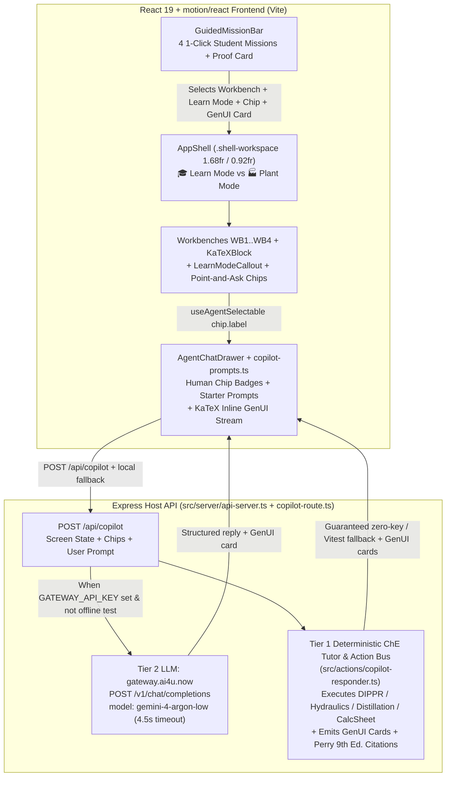

# Master Plan: Chemie.ai4U.now UX Overhaul & `gemini-4-argon-low` AI Co-Pilot (`--advice --ultra`)

## 1. Executive Summary & Root-Cause Diagnosis

`Chemie.ai4U.now` (`ai4UCheE`) already has a solid deterministic engine (Perry's 9th Ed. Sec 1–25 cropper, DIPPR Eq. 101/106, Pipe/NPSHa/Cv hydraulics, McCabe-Thiele + Fair/Eckert distillation, and SQLite QA/QC sheet export). However, for students and newcomers it currently feels unpolished and intimidating due to four root causes verified directly in the repository:

1. **Missing Component CSS & Nested Grid Cramping (`src/styles/theme-tokens.css` at 181 LOC):**
   - `18+` core UI classes (`.scrubbable-input`, `.scrubbable-header`, `.scrubbable-handle`, `.scrubbable-chip-btn`, `.scrubbable-row`, `.scrubbable-unit`, `.motion-pill`, `.composer-chip`, `.chip-tray`, `.genui-stream`, `.genui-card`, `.chat-messages`, `.chat-msg`, `.wb-verdict`, `.wb-coaching`, `.wb-chip`, `.wb-crop-placeholder`, `.modal-backdrop`) have **zero CSS rules**, rendering as raw browser inputs and unstyled inline spans.
   - `.wb-split` (`1.4fr 1fr`) is used for both the outer `AppShell` `<main>` and inner workbench splits, crushing inner panels into narrow columns.
   - `katex/dist/katex.min.css` is imported at line 5 of `src/styles/theme-tokens.css`, yet `katex.renderToString` is never called anywhere in `src/` — equations render as plain monospace ASCII strings.
   - `CalcSheetPreviewModal` renders inline at the bottom of `<App />` (`src/App.tsx:53-57`) without a `.modal-backdrop` overlay.
2. **Cryptic Jargon & Zero Student Onboarding (`src/components/shell/app-shell.tsx`, WB1–WB4):**
   - Tabs read like an EPC spec sheet (`WB2: Sec 1/2/4 DIPPR & Thermo`, `DoF = 0 · Fully Specified`).
   - Newcomers have no guided entry point, no 1-click problem missions, and no plain-English explanations when switching to `🎓 Learn Mode`.
3. **Echo-Stub AI Co-Pilot (`src/components/shell/agent-chat-drawer.tsx:51-66`):**
   - `handleSend` is a 15-line echo stub (`Synced with <current-screen...>`). It never calls an LLM or executes any registered `ActionRegistry` tool.
   - Point-and-Ask chips display raw internal IDs (`<code>agent-select:equation:dippr-eq-101</code>`) instead of human-readable labels (`chip.label`), and there are no 1-click starter prompt pills.
4. **Near-200-LOC File Ceilings (`AGENTS.md` Invariant #2):**
   - `src/styles/theme-tokens.css` (181 LOC), `src/components/workbenches/thermo-dippr-workbench.tsx` (189 LOC), and `src/components/workbenches/visual-verifier-workbench.tsx` (182 LOC) are within 11–19 lines of the hard 200-LOC limit and **must** be modularized in Phase 01 before adding new features.

---

## 2. System Architecture & Two-Tier `gateway.ai4u.now` Co-Pilot Flow

---

## 3. File Budget & `<200` LOC Modularity Matrix

Every created or modified file is budgeted with a wide safety margin below 200 lines:

| File Path | Action | Current LOC | Target LOC | Responsibility |
| :--- | :--- | :---: | :---: | :--- |
| `src/styles/theme-tokens.css` | Modify | 181 | ~140 | Core palette tokens (`paper` `#fbf6ec` / `blueprint` `#071a33`), typography, `.app-shell`, `.shell-header`, `.shell-workspace`, `@import './workbench-components.css'` |
| `src/styles/workbench-components.css` | Create | 0 | ~165 | Tactile `.scrubbable-*`, `.motion-pill`, `.mission-*`, `.learn-callout`, `.chat-drawer`, `.chip-tray`, `.composer-chip`, `.genui-*`, `.wb-verdict`, `.modal-backdrop`, `.katex-block` |
| `src/components/ui/katex-block.tsx` | Create | 0 | ~55 | Safe `katex.renderToString` wrapper (`throwOnError: false`) for inline & display equations |
| `src/components/workbenches/carlson-advisor-card.tsx` | Create | 0 | ~85 | Extracted Carlson (1996) / Perry Sec 4 decision tree + Learn Mode callout (frees LOC from WB2) |
| `src/components/workbenches/thermo-dippr-workbench.tsx` | Modify | 189 | ~145 | WB2 DIPPR Eq. 101 & 106 with `<KaTeXBlock />`, `<LearnModeCallout />`, and `<CarlsonAdvisorCard />` |
| `src/components/workbenches/visual-verifier-tutor-card.tsx` | Create | 0 | ~95 | Extracted WB1 DeepTutor chart-reading challenge & Fanning 4x trap coaching card (frees LOC from WB1) |
| `src/components/workbenches/visual-verifier-workbench.tsx` | Modify | 182 | ~130 | WB1 25-Section visual crop canvas + preset anchors + `<LearnModeCallout />` + `<VisualVerifierTutorCard />` |
| `src/components/workbenches/calc-sheet-preview-modal.tsx` | Modify | 128 | ~145 | Wrapped in `.modal-backdrop` overlay with Escape-key & backdrop-click close + `<KaTeXBlock />` |
| `src/components/ui/learn-mode-callout.tsx` | Create | 0 | ~65 | Plain-English student intuition card visible when `personaMode === 'learn'` |
| `src/components/shell/guided-mission-bar.tsx` | Create | 0 | ~118 | 4 1-click student missions (with collapse toggle + instant GenUI proof card emission) |
| `src/components/shell/app-shell.tsx` | Modify | 139 | ~160 | Friendly workbench tab titles + subtitles, `<GuidedMissionBar />`, outer `<main className="shell-workspace wb-split">` |
| `src/components/workbenches/hydraulics-workbench.tsx` | Modify | 164 | ~180 | WB3 with `<LearnModeCallout />` and `<KaTeXBlock />` Darcy-Fanning formula |
| `src/components/workbenches/distillation-workbench.tsx` | Modify | 130 | ~155 | WB4 with `<LearnModeCallout />` and `<KaTeXBlock />` Fenske-Underwood equation |
| `src/actions/copilot-responder.ts` | Create | 0 | ~160 | Tier-1 deterministic ChE Tutor & Action Responder: inspects `<current-screen>`, chips, and prompt; runs DIPPR/Hydraulics/Distillation/CalcSheet actions; emits `GenUiPayload` cards |
| `src/server/copilot-route.ts` | Create | 0 | ~145 | Express `registerCopilotRoute(app)` (`POST /api/copilot`): calls `gateway.ai4u.now/v1/chat/completions` (`model: gemini-4-argon-low`, 4.5s timeout) and merges/falls back to Tier-1 `runCopilotResponder` |
| `src/server/api-server.ts` | Modify | 137 | ~148 | Wires `registerCopilotRoute(app)` before static catch-all |
| `vite.config.ts` | Modify | 22 | ~26 | Dev `/api` proxy → `http://127.0.0.1:3000` so `npm run dev` reaches Tier-2 (Validation Session 1) |
| `src/actions/index.ts` | Modify | 9 | ~12 | Exports `./copilot-responder` |
| `src/components/gen-ui/render-inline-extension.tsx` | Modify | 74 | ~95 | Renders `equation-proof-card` with `<KaTeXBlock />` and `hydraulics-summary-card` / `calc-sheet-card` |
| `src/components/shell/copilot-prompts.ts` | Create | 0 | ~70 | Contextual 1-click starter prompt catalog per workbench (`WB1`..`WB4`) + chip label formatter |
| `src/components/shell/agent-chat-drawer.tsx` | Modify | 129 | ~165 | Human-readable `chip.label` badges, 1-click starter prompt pills, async `/api/copilot` + local Tier-1 fallback, emits inline GenUI cards |
| `src/__tests__/phase8-ux-copilot.test.tsx` | Create | 0 | ~165 | End-to-end Vitest coverage for Guided Missions, KaTeX rendering, Learn Mode callouts, human chip labels, `/api/copilot` (`gemini-4-argon-low` + Tier-1 fallback), and `<200` LOC gate |

---

## 4. Phase Index & Handover Contract Summary

> [!IMPORTANT]
> **Handover Notice (`--advice` Contract):** This plan is authored for direct execution by a downstream executor model (`references/advice-handover-plan.md`). Every phase file (`phase-01` through `phase-05`) contains self-contained numbered tasks (`### Task N.M`) with explicit **Goal**, **Target files and symbols**, **Steps**, **Success criteria**, a decidable mechanical **Verify** comparison command, and a literal `## Failure Protocol` escalation block that halts execution and escalates to `kongming` on any check mismatch. Stopping on a failed `Verify` check is required behavior.

| Phase | File | Focus | Key Deliverable | Status |
| :---: | :--- | :--- | :--- | :---: |
| **01** | [`phase-01-sovereign-css-and-katex-math.md`](./phase-01-sovereign-css-and-katex-math.md) | Sovereign CSS Split, Tactile Controls, Modal Overlay & Real KaTeX Math | `<200` LOC CSS split (`theme-tokens.css` + `workbench-components.css`), `<KaTeXBlock />`, WB1/WB2 subcomponent extraction, fixed `.modal-backdrop` | Pending |
| **02** | [`phase-02-student-guided-missions-and-learn-ux.md`](./phase-02-student-guided-missions-and-learn-ux.md) | Guided Student Missions, Friendly Navigation & Learn-Mode Callouts | `<GuidedMissionBar />` (4 missions + instant proof card), approachable tab titles, `<LearnModeCallout />` across WB1–WB4 | Pending |
| **03** | [`phase-03-gemini-gateway-and-copilot-responder.md`](./phase-03-gemini-gateway-and-copilot-responder.md) | Two-Tier AI Co-Pilot (`gateway.ai4u.now` `gemini-4-argon-low` + Tier-1 Tutor) | `src/actions/copilot-responder.ts` + `src/server/copilot-route.ts` (`POST /api/copilot`) + `.env.example` + vite `/api` dev proxy | Pending |
| **04** | [`phase-04-point-and-ask-drawer-and-inline-genui.md`](./phase-04-point-and-ask-drawer-and-inline-genui.md) | Upgraded `AgentChatDrawer`, Human Chip Badges, Starter Prompts & KaTeX GenUI | `src/components/shell/copilot-prompts.ts`, live Co-Pilot chat, `chip.label` badges, contextual starter prompts, KaTeX `equation-proof-card` | Pending |
| **05** | [`phase-05-e2e-verification-and-docs-sync.md`](./phase-05-e2e-verification-and-docs-sync.md) | E2E Vitest Suite, `<200` LOC Gate, Production Build & `./docs/` Sync | `src/__tests__/phase8-ux-copilot.test.tsx`, 100% test pass, `<200` LOC audit, updated `./docs/` | Pending |

---

## 5. Non-Negotiable Regression Guardrails (Locked Test Contracts)

Downstream executors **MUST NOT** break any of the following existing test contracts verified in `src/__tests__/phase3-shell.test.tsx` and `src/__tests__/phase7-e2e.test.tsx`:
- `PersonaThemeProvider` default props in `src/context/persona-theme-context.tsx` remain `initialPersona = 'plant'`, `initialTheme = 'paper'`, `initialWorkbench = 'wb1-visual-verifier'`.
- `data-testid="theme-toggle"` button text contains `#FBF6EC` in `paper` mode and `#071A33` in `blueprint` mode.
- `data-testid="dippr-vp-result"` text contains `'373.15 K'`, `'101,325 Pa'`, and `'0.00 psig (14.70 psia)'` when `Temperature unit` = `degC`, `Temperature` = `100`, `Pressure unit` = `psig`.
- All existing `data-testid` and `aria-label` selectors remain intact: `app-shell`, `ai4u-logo`, `dof-badge`, `persona-learn`, `persona-plant`, `theme-toggle`, `export-calc-sheet-btn`, `tab-wb1-visual-verifier`..`tab-wb4-distillation`, `wb1-visual-verifier`..`wb4-distillation`, `load-pdf-crop-btn`, `calibrated-crosshair`, `chart-verdict`, `fanning-4x-coaching`, `dippr-vp-result`, `carlson-advisor-panel`, `carlson-recommended`, `carlson-lle-warning`, `darcy-fanning-banner`, `sketch-pump-node`, `hydraulics-3case-table`, `agent-chat-drawer`, `current-screen-badge`, `composer-chip-tray`, `chip-${chip.chipId}`, `genui-stream`, `genui-equation-proof-card`, `genui-hydraulics-summary-card`, `genui-calc-sheet-card`, `calc-sheet-modal`, `compile-calc-sheet-btn`, `compiled-calc-sheet-output`, `calc-sheet-summary`, `Inspect ${label}`, `Ask Perry's Agent`.

---

## 6. Ultra Verifier Pass & Validation Log (`--advice --ultra`)

### Kongming Best-of-5 Arbitration Summary
- **Verifier Receipt:** `ultra: picked=4/5 margin=low unanimous=no rejected_all=no`
- **Winning Candidate:** **Candidate D (Plan Candidate 4 — 98/100)**, enhanced with two surgical cherry-picks from **Candidate E (Plan Candidate 5 — 97/100)**:
  1. **Phase 01 Upfront Subcomponent Extraction (from Candidate D):** Extracts `<VisualVerifierTutorCard />` and `<CarlsonAdvisorCard />` in Phase 01 so `visual-verifier-workbench.tsx` (182 → ~125 LOC) and `thermo-dippr-workbench.tsx` (189 → ~140 LOC) immediately gain >55 lines of headroom before Phase 02 adds `<LearnModeCallout />` and `<KaTeXBlock />`.
  2. **Phase 02 Instant GenUI Reward + Collapse Toggle (Cherry-Pick from Candidate E):** Clicking a mission in `<GuidedMissionBar />` switches `personaMode` to `'learn'`, selects the target workbench, attaches the mission's Point-and-Ask chip, and immediately emits a starter `equation-proof-card` into the GenUI stream.
  3. **Phase 04 Starter Prompt Catalog Extraction (Cherry-Pick from Candidate E):** Extracts `src/components/shell/copilot-prompts.ts` (~70 LOC) so `src/components/shell/agent-chat-drawer.tsx` remains comfortably at ~165 LOC (`< 200` LOC invariant).

---

## Validation Log

### Session 1 — 2026-10-28
**Trigger:** `ak:plan --advice validate` (`--adviceretry`) — post-authoring validation gate before execution handover
**Mode:** Full tier (5 phases → Fact Checker + Flow Tracer + Scope Auditor + Contract Verifier)

### Verification Results
- **Tier:** Full
- **Claims checked:** 48
- **Verified:** 45 | **Failed:** 0 | **Findings (non-blocking):** 3

#### Evidence highlights (all VERIFIED)
- **LOC matrix (13 files):** every count matches `wc -l + 1` split-semantics (e.g. `theme-tokens.css` 180 wc / "181" plan; `thermo-dippr-workbench.tsx` 188/189; `visual-verifier-workbench.tsx` 181/182; `app-shell.tsx` 138/139; `agent-chat-drawer.tsx` 128/129; `render-inline-extension.tsx` 73/74; `api-server.ts` 136/137; `actions/index.ts` 8/9).
- **Root cause 1:** all 18 cited UI classes have 0 rules in `theme-tokens.css`; `.wb-split` (`1.4fr 1fr`, line 129) is used by outer `<main>` (app-shell.tsx:132) AND 6 inner workbench/modal splits; `katex.min.css` imported at line 5; `renderToString` absent from `src/`.
- **Root cause 2:** `WORKBENCH_TABS` exists (app-shell.tsx:13-17) with `label`+`short`; jargon labels confirmed; `dof-badge` exists without tooltip.
- **Root cause 3:** echo stub at agent-chat-drawer.tsx:51-66 (`Synced with <current-screen…>`); chip tray renders raw `<code>{chip.chipId}</code>` (line 85).
- **Contracts:** `SelectedChip.label` exists (persona-theme-context.tsx:17); `setPersonaMode`/`setActiveWorkbench`/`toggleChip`/`removeChip`/`clearChips` exported; `toggleChip` signature `Omit<SelectedChip,'chipId'>` matches mission chip payloads; `agentNative.ui.{output,subscribe,getHistory,clearHistory}` + `defineAction` + `GenUiPayload` all in `src/actions/define-action.ts`; `/api/actions/:actionName` at api-server.ts:98 with static catch-all at 123; `dippr-vp-result` format string exact (thermo-dippr-workbench.tsx:134); `persona-${mode}` / `tab-${tab.id}` testids are template-constructed (runtime values `learn`/`plant` satisfy locked guardrails); phase3=4 tests, phase7=5 tests (matches "4 passed"/"5 passed"/"9 passed").
- **Locked guardrail §5 selectors:** all 32 cited `data-testid`s + 3 `aria-label`s present in source.
- **Tooling:** `katex@^0.16.11`, `zod`, `express`, `tsx`, `vitest`, `typecheck` script, vite jsdom test env — all present; `.env.example` absent (Create correct); `PERRY_SIDECAR_URL` already consumed at api-server.ts:16 (default `http://127.0.0.1:8001`); zero pre-existing `GATEWAY*` env refs; all `services/perry-engine` `.py` files ≤ 161 LOC.
- **External:** `https://gateway.ai4u.now` live (HTTP 401 on `/v1/models` without key = auth-gated, reachable). `gemini-4-argon-low` model ID trusted per user spec (unverifiable without key).

#### Findings (non-blocking, surfaced as interview questions)
1. **[CSS cascade]** Phase 02 keeps `className="shell-workspace wb-split"` on `<main>`; both are single-class selectors so `grid-template-columns` is decided by source order. Plan does not pin `.shell-workspace` after `.wb-split` (theme-tokens.css:129) — mis-ordering silently keeps the cramped `1.4fr 1fr` outer layout.
2. **[Dev-mode Tier-2]** vite.config.ts has no `/api` proxy → `npm run dev` fetch('/api/copilot') 404s and silently degrades to Tier-1. Works as designed on the Express-served deployment (chemie.ai4u.now) and in Vitest.
3. **[Phase 05 gate scope]** Task 5.2 Goal text gates `.py` files in `services/perry-engine/`, but its Verify command only walks `src/` (currently green anyway — max 161 LOC; also note `.venv` must be excluded if extended).

#### Questions & Answers

1. **[Architecture/Risk]** Phase 02 keeps `className="shell-workspace wb-split"` on the outer `<main>`, but both classes set `grid-template-columns` with equal specificity — whichever rule appears later in theme-tokens.css wins. How should the outer/inner split collision be fixed?
   - Options: Pin source order | Drop wb-split on main | Rename inner class
   - **Answer:** Pin source order (Recommended)
   - **Rationale:** Minimal diff; Phase 01 now mandates the `.shell-workspace` rule AFTER `.wb-split` (theme-tokens.css:129) with a mechanical ordering check in Task 1.1's Verify.
2. **[Tradeoff]** vite.config.ts has no `/api` proxy, so under `npm run dev` the browser's `fetch('/api/copilot')` 404s and the Co-Pilot silently falls back to Tier-1. Add a dev proxy?
   - Options: Add /api proxy | Accept Tier-1 in dev | Defer to later plan
   - **Answer:** Add /api proxy (Recommended)
   - **Rationale:** One line makes Tier-2 (`gemini-4-argon-low`) exercisable locally; Express serves `dist/` in production so prod behavior is unchanged.
3. **[Risk]** Phase 03 fixes the gateway timeout at 4500 ms (`AbortSignal.timeout(4500)`). Is 4.5 s the right budget for a first-token-inclusive chat completion on `gemini-4-argon-low`?
   - Options: Keep 4500 ms | Raise to 8000 ms | Make it configurable
   - **Answer:** Keep 4500 ms (Recommended)
   - **Rationale:** Fallback-first UX; slow/degraded gateway yields to the deterministic Tier-1 tutor. No plan change.
4. **[Scope]** Phase 05 Task 5.2's Goal says the `<200` LOC gate covers `.py` files in `services/perry-engine/` too, but its Verify command only walks `src/`. Reconcile how?
   - Options: Extend Verify to services | Narrow Goal to src/ | Leave as-is
   - **Answer:** Extend Verify to services (Recommended)
   - **Rationale:** Verify command now walks `services/perry-engine` (`.py`, `.venv` excluded) to match the Goal text; currently green (max 161 LOC).

#### Confirmed Decisions
- CSS cascade: pin `.shell-workspace` after `.wb-split` in source order + mechanical ordering check — Phase 01 Task 1.1.
- Dev-mode Tier-2: add `vite.config.ts` `server.proxy['/api'] → http://127.0.0.1:3000` — Phase 03 Task 3.2 (Express default `PORT=3000` verified at api-server.ts:131).
- Gateway timeout: keep 4500 ms as planned — no change.
- LOC gate: Verify walks `src/` + `services/perry-engine` (`.venv` excluded) — Phase 05 Task 5.2.

#### Action Items
- [x] Phase 01 Task 1.1: cascade pin step 4 + ordering assertion in Verify (done).
- [x] Phase 03 Task 3.2: vite proxy step 4 + `vite.config.ts` file row + Verify grep (done).
- [x] Phase 05 Task 5.2: extended Verify walk (done).
- [x] plan.md §3 matrix: `vite.config.ts` row added (done).

#### Impact on Phases
- Phase 01: Task 1.1 gains step 4 (cascade pin) + stricter Verify. No LOC budget change.
- Phase 02: unchanged (keeps `<main className="shell-workspace wb-split">`; correctness now guaranteed by Phase 01 ordering).
- Phase 03: Task 3.2 gains vite proxy step; file budget +1 row (`vite.config.ts` 22 → ~26 LOC); effort unchanged (2.5h).
- Phase 05: Task 5.2 Verify extended to `services/perry-engine`; no new files.

### Whole-Plan Consistency Sweep
- Files reread: plan.md, phase-01 … phase-05 (all 6)
- Decision deltas checked: 4 (cascade pin / vite proxy / timeout unchanged / LOC gate scope)
- Reconciled stale references: 1 (plan.md §4 Phase-03 deliverable row now lists the vite `/api` dev proxy)
- Unresolved contradictions: 0
- Notes: remaining `1.4fr 1fr` mentions (plan.md §1 diagnosis, Validation Log evidence, phase-01 cascade-pin rationale) intentionally describe the pre-fix state. All 6 files keep `status: pending`; all relative links resolve; frontmatter effort totals still sum to 10h.
