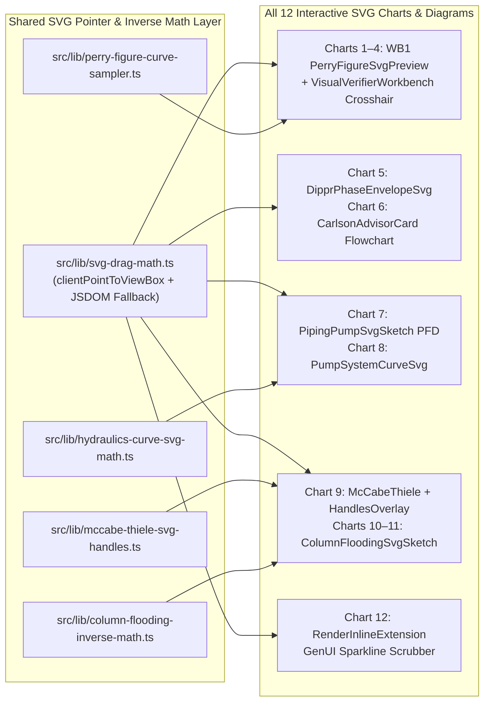

# Plan: Bi-Directional Interactivity Across All 12 Engineering Charts, Graphs & Diagrams (`--advice --ultra`)

## 1. Executive Summary & 12-Chart Inventory

To make `Chemie.ai4U.now` feel like a responsive, tactile engineering simulator for students and process engineers, **every chart, graph, curve, and schematic across `WB1`–`WB4` and the Copilot GenUI (12 in total)** must be bi-directionally interactive:

| # | Workbench | Chart / Diagram | Target Component & Helper | Bi-Directional Interactive Upgrade |
| :---: | :---: | :--- | :--- | :--- |
| **1** | **WB1** | **Perry Fig. 6-9 Moody Fanning $f_F$ & Darcy $f_D=4f_F$ Curve (`6-10`)** | [`perry-figure-svg-preview.tsx`](file:///Users/nad/ai4u/ai4UCheE/src/components/workbenches/perry-figure-svg-preview.tsx) + `perry-figure-curve-sampler.ts` | Drag/click on curve or 2D crosshair (`wb-crosshair-svg`) to scrub $\text{Re} \in [10^3, 10^7]$, compute exact $f_F$ & $f_D=4f_F$, auto-fill `userReading`, and show `wb1-hover-readout`. |
| **2** | **WB1** | **Perry Fig. 14-32 Fair Entrainment Flooding $C_{sb}(F_{LV})$ Curve (`14-37`)** | [`perry-figure-svg-preview.tsx`](file:///Users/nad/ai4u/ai4UCheE/src/components/workbenches/perry-figure-svg-preview.tsx) + `perry-figure-curve-sampler.ts` | Drag/click to scrub $F_{LV} \in [0.01, 1.0]$, sample $C_{sb}$ (`24 in` vs. `12 in` tray spacing), auto-fill `userReading`, and show hover tooltip. |
| **3** | **WB1** | **Perry Fig. 14-55 Eckert GPDC Packing Flooding Curve (`14-57`)** | [`perry-figure-svg-preview.tsx`](file:///Users/nad/ai4u/ai4UCheE/src/components/workbenches/perry-figure-svg-preview.tsx) + `perry-figure-curve-sampler.ts` | Drag/click to scrub $F_{LV}$, sample capacity ordinate $Y_{\text{flood}}$, auto-fill `userReading`, and show hover tooltip. |
| **4** | **WB1** | **Perry Table 2-8 DIPPR Vapor Pressure Curve (`2-53`) + 2D Crosshair Overlay** | [`perry-figure-svg-preview.tsx`](file:///Users/nad/ai4u/ai4UCheE/src/components/workbenches/perry-figure-svg-preview.tsx) + [`visual-verifier-workbench.tsx`](file:///Users/nad/ai4u/ai4UCheE/src/components/workbenches/visual-verifier-workbench.tsx) | Drag/click on vector chart or loaded PDF crop crosshair (`wb-crosshair-svg`) to scrub $T \in [273, 473]\text{ K}$, sample $P_{\text{vp}}$ (`Pa`/`psia`/`psig`), and auto-fill `userReading`. |
| **5** | **WB2** | **DIPPR Eq. 101 $P^{\text{sat}}(T)$ & Eq. 106 $\Delta H_{\text{vap}}(T_r)$ Dual-Curve Phase Envelope** | [`dippr-phase-envelope-svg.tsx`](file:///Users/nad/ai4u/ai4UCheE/src/components/sketches/dippr-phase-envelope-svg.tsx) | Plots both log-$P^{\text{sat}}(T)$ and $\Delta H_{\text{vap}}(T_r) \to 0$; drag `wb2-operating-handle` to scrub `tempK`; click `wb2-nbp-marker` ($1\text{ atm}$) or `wb2-critical-marker` ($T_c$) to snap; live `wb2-hover-tooltip`. |
| **6** | **WB2** | **Carlson (1996) Property-Package Decision Tree Flowchart & Boiling Curve** | [`carlson-advisor-card.tsx`](file:///Users/nad/ai4u/ai4UCheE/src/components/workbenches/carlson-advisor-card.tsx) | Clickable SVG decision nodes (`carlson-node-polarity`, `carlson-node-lle`, `carlson-node-assoc`) directly toggle `polarity`, `hasLle`, `hasAssoc`; scrubbing `carlson-boiling-curve` updates `tempK`. |
| **7** | **WB3** | **Interactive Process PFD Schematic (`V-101` $\to$ `L-101` $\to$ `P-101` $\to$ `FCV-101`)** | [`piping-pump-svg-sketch.tsx`](file:///Users/nad/ai4u/ai4UCheE/src/components/sketches/piping-pump-svg-sketch.tsx) | Drag `wb3-liquid-level-handle` vertically in `V-101` to scrub `zSuctionM`; click `wb3-pipe-nps-trigger` on `L-101` to cycle `npsInch` (`2"–6"`); drag `wb3-valve-dp-handle` on `FCV-101` to scrub `valveDpPsi`. |
| **8** | **WB3** | **Parametric Pump vs. System Curve (`70%/100%/120%`) + $\text{NPSH}_A(Q)$ Chart** | `pump-system-curve-svg.tsx` + `hydraulics-curve-svg-math.ts` | Dedicated SVG plotting live $H_{\text{pump}}(Q)$, $H_{\text{sys}}(Q)$, $\text{NPSH}_A(Q)$ vs. $\text{NPSH}_R$, `70%/100%/120%` case dots, ISA-75.01 choked-flow badge, and draggable `wb3-duty-point-handle` scrubbing `flowGpm`. |
| **9** | **WB4** | **McCabe-Thiele $y\text{–}x$ Equilibrium & Stage-Stepping Canvas** | [`mccabe-thiele-svg-canvas.tsx`](file:///Users/nad/ai4u/ai4UCheE/src/components/sketches/mccabe-thiele-svg-canvas.tsx) + `mccabe-thiele-handles-overlay.tsx` | 5 draggable handles (`q-line-handle`, `mt-xd-handle`, `mt-zf-handle`, `mt-xb-handle`, `mt-rol-handle` for $R/R_{\min}$ y-intercept) + stage hover tooltip (`mt-hover-tooltip`). |
| **10** | **WB4** | **Column `T-201` Shell & Interactive Sieve Tray Stack** | [`column-flooding-svg-sketch.tsx`](file:///Users/nad/ai4u/ai4UCheE/src/components/sketches/column-flooding-svg-sketch.tsx) | Drag `wb4-col-diam-handle` horizontally to resize $D_c$ (`colDiamM`); click `wb4-tray-spacing-trigger` to cycle `12"/18"/24"`; click trays `wb4-tray-hit-1..5` to inspect tray hydraulics (`wb4-tray-tooltip`). |
| **11** | **WB4** | **Fair's Entrainment Flooding Curve $C_{sb}(F_{LV})$ & Hydraulic Window Gauge** | [`column-flooding-svg-sketch.tsx`](file:///Users/nad/ai4u/ai4UCheE/src/components/sketches/column-flooding-svg-sketch.tsx) + `column-flooding-inverse-math.ts` | Plots live Fair $C_{sb}(F_{LV})$ locus + draggable `wb4-flood-bar-handle` that inversely solves $D_{c,\text{next}} = D_c\sqrt{\%\text{Flood}_0 / \%\text{Flood}_{\text{target}}}$ (or `rMult` on Shift-drag). |
| **12** | **Copilot** | **Inline GenUI Operating-Window Sparkline Scrubber** | [`render-inline-extension.tsx`](file:///Users/nad/ai4u/ai4UCheE/src/components/gen-ui/render-inline-extension.tsx) | Interactive SVG sparkline (`genui-interactive-sparkline` / `genui-sparkline-handle`) inside Copilot GenUI cards that dispatches `dispatchWorkbenchMutation` live as the user scrubs. |

---

## 2. Target Architecture & `< 200` LOC File Budget Matrix (`AGENTS.md` Invariant #2)

Every file created or modified by this plan is budgeted strictly `< 200` LOC:

| File Path | Action | Current LOC | Projected LOC | `< 200` LOC Headroom | Phase |
| :--- | :---: | :---: | :---: | :---: | :---: |
| `src/lib/svg-drag-math.ts` | **Create** | 0 | ~75 | +125 | Phase 01 |
| `src/lib/perry-figure-curve-sampler.ts` | **Create** | 0 | ~85 | +115 | Phase 01 |
| [`src/components/workbenches/perry-figure-svg-preview.tsx`](file:///Users/nad/ai4u/ai4UCheE/src/components/workbenches/perry-figure-svg-preview.tsx) | **Modify** | 122 | ~155 | +45 | Phase 01 |
| [`src/components/workbenches/visual-verifier-workbench.tsx`](file:///Users/nad/ai4u/ai4UCheE/src/components/workbenches/visual-verifier-workbench.tsx) | **Modify** | 157 | ~178 | +22 | Phase 01 |
| [`src/components/sketches/dippr-phase-envelope-svg.tsx`](file:///Users/nad/ai4u/ai4UCheE/src/components/sketches/dippr-phase-envelope-svg.tsx) | **Modify** | 75 | ~160 | +40 | Phase 02 |
| [`src/components/workbenches/carlson-advisor-card.tsx`](file:///Users/nad/ai4u/ai4UCheE/src/components/workbenches/carlson-advisor-card.tsx) | **Modify** | 89 | ~165 | +35 | Phase 02 |
| [`src/components/workbenches/thermo-dippr-workbench.tsx`](file:///Users/nad/ai4u/ai4UCheE/src/components/workbenches/thermo-dippr-workbench.tsx) | **Modify** | 170 | ~182 | +18 | Phase 02 |
| `src/lib/hydraulics-curve-svg-math.ts` | **Create** | 0 | ~85 | +115 | Phase 03 |
| `src/components/sketches/pump-system-curve-svg.tsx` | **Create** | 0 | ~135 | +65 | Phase 03 |
| [`src/components/sketches/piping-pump-svg-sketch.tsx`](file:///Users/nad/ai4u/ai4UCheE/src/components/sketches/piping-pump-svg-sketch.tsx) | **Modify** | 108 | ~142 | +58 | Phase 03 |
| [`src/components/workbenches/hydraulics-workbench.tsx`](file:///Users/nad/ai4u/ai4UCheE/src/components/workbenches/hydraulics-workbench.tsx) | **Modify** | 174 | ~186 | +14 | Phase 03 |
| `src/lib/mccabe-thiele-svg-handles.ts` | **Create** | 0 | ~85 | +115 | Phase 04 |
| `src/components/sketches/mccabe-thiele-handles-overlay.tsx` | **Create** | 0 | ~115 | +85 | Phase 04 |
| [`src/components/sketches/mccabe-thiele-svg-canvas.tsx`](file:///Users/nad/ai4u/ai4UCheE/src/components/sketches/mccabe-thiele-svg-canvas.tsx) | **Modify** | 151 | ~135 | +65 | Phase 04 |
| `src/lib/column-flooding-inverse-math.ts` | **Create** | 0 | ~80 | +120 | Phase 04 |
| [`src/components/sketches/column-flooding-svg-sketch.tsx`](file:///Users/nad/ai4u/ai4UCheE/src/components/sketches/column-flooding-svg-sketch.tsx) | **Modify** | 89 | ~168 | +32 | Phase 04 |
| [`src/components/workbenches/distillation-workbench.tsx`](file:///Users/nad/ai4u/ai4UCheE/src/components/workbenches/distillation-workbench.tsx) | **Modify** | 145 | ~175 | +25 | Phase 04 |
| [`src/components/gen-ui/render-inline-extension.tsx`](file:///Users/nad/ai4u/ai4UCheE/src/components/gen-ui/render-inline-extension.tsx) | **Modify** | 78 | ~148 | +52 | Phase 05 |
| `src/__tests__/phase10-all12-interactive-charts.test.tsx` | **Create** | 0 | ~180 | +20 | Phase 05 |

---

## 3. Phase Index & Links

| Phase | File | Title | Effort | Status |
| :---: | :--- | :--- | :---: | :---: |
| **01** | [`phase-01-shared-svg-drag-and-wb1-curves.md`](file:///Users/nad/ai4u/ai4UCheE/plans/261030-0945-all-12-interactive-charts-and-diagrams/phase-01-shared-svg-drag-and-wb1-curves.md) | Shared SVG Pointer Math & `WB1` Calibrated Perry Curves + 2D Crosshair (Charts 1–4) | 3.5h | Completed |
| **02** | [`phase-02-wb2-dippr-dual-envelope-and-carlson-flowchart.md`](file:///Users/nad/ai4u/ai4UCheE/plans/261030-0945-all-12-interactive-charts-and-diagrams/phase-02-wb2-dippr-dual-envelope-and-carlson-flowchart.md) | `WB2` Dual-Curve DIPPR Phase Envelope & Interactive Carlson Decision Flowchart (Charts 5 & 6) | 3.5h | Completed |
| **03** | [`phase-03-wb3-interactive-pfd-and-pump-system-curves.md`](file:///Users/nad/ai4u/ai4UCheE/plans/261030-0945-all-12-interactive-charts-and-diagrams/phase-03-wb3-interactive-pfd-and-pump-system-curves.md) | `WB3` Interactive PFD Schematic & Extracted Pump/System/$\text{NPSH}_A$ Curve Chart (Charts 7 & 8) | 4.0h | Completed |
| **04** | [`phase-04-wb4-mccabe-thiele-5handles-and-column-flooding.md`](file:///Users/nad/ai4u/ai4UCheE/plans/261030-0945-all-12-interactive-charts-and-diagrams/phase-04-wb4-mccabe-thiele-5handles-and-column-flooding.md) | `WB4` 5-Handle McCabe-Thiele Canvas, Interactive Column `T-201` & Fair Flooding Curve (Charts 9–11) | 4.5h | Completed |
| **05** | [`phase-05-genui-sparkline-and-all12-verification.md`](file:///Users/nad/ai4u/ai4UCheE/plans/261030-0945-all-12-interactive-charts-and-diagrams/phase-05-genui-sparkline-and-all12-verification.md) | Copilot Inline GenUI Sparkline Scrubber (Chart 12), Full 12-Chart Test Suite, Visual Audit & Docs Sync | 2.5h | Completed |

---

## 4. Kongming `--ultra` Verifier Receipt

5 independent parallel candidate plans (`Candidate A` through `Candidate E`) were evaluated by the `kongming` verifier (`61bc0956-511b-4a4b-9122-f0f1db14fd9b`) on a 100-point rubric:

| Candidate | C1: 12-Chart Coverage (20) | C2: Exact File Path & Symbol Grounding (20) | C3: ChE Rigor (`psig`/`psia`, $f_D=4f_F$, Citations) (20) | C4: `< 200` LOC Modularity & Tests (20) | C5: `--advice` Contract & Gates (20) | **Total (/100)** |
| :--- | :---: | :---: | :---: | :---: | :---: | :---: |
| **Candidate A (Winner)** | **20** | **20** | **20** | **20** | **20** | **100 / 100** |
| Candidate D | 19 | 13 | 18 | 18 | 18 | 86 / 100 |
| Candidate B | 19 | 12 | 18 | 17 | 18 | 84 / 100 |
| Candidate C | 19 | 12 | 18 | 17 | 17 | 83 / 100 |
| Candidate E | 19 | 11 | 18 | 17 | 17 | 82 / 100 |

`ultra: picked=1/5 margin=high unanimous=yes rejected_all=no`

---

## 5. Validation Log

- **2026-10-30T09:47:00+07:00**: Materialized 5-phase `--advice --ultra` plan (`plan.md` + `phase-01..phase-05.md`) covering all 12 interactive charts, graphs, and diagrams after `kongming` verification (`100/100`).
