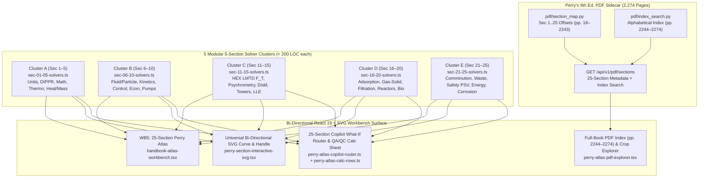

# Plan: Whole 25-Section *Perry's Chemical Engineers' Handbook (9th Ed.)* + Index (`pp. 2244–2274`) Expansion (`--advice --ultra`)

## 1. Executive Summary & Architectural Vision

`Chemie.ai4U.now` (`/Users/nad/ai4u/ai4UCheE`) currently provides deep interactive workbenches for 4 focused slices (`WB1` chart verifier, `WB2` Sec 1/2/4 DIPPR & Carlson, `WB3` Sec 6/8/10 Hydraulics, `WB4` Sec 13/14 Distillation) while [`services/perry-engine/pdf/section_map.py`](file:///Users/nad/ai4u/ai4UCheE/services/perry-engine/pdf/section_map.py) already indexes all 25 section page offsets (`PDF pp. 18–2243`) and the 31-page Back-of-Book Alphabetical Index (`PDF pp. 2244–2274`).

This plan expands `Chemie.ai4U.now` to the **entire 25-Section *Perry's Chemical Engineers' Handbook, 9th Edition* + Index (`pp. 2244–2274`)** via **`wb5-handbook-atlas` (`"WB5: 25-Section Perry Atlas"`)** while strictly honoring the `< 200` LOC file cap (`AGENTS.md` Invariant #2) and all 28 existing Vitest tests:

---

## 2. Master 25-Section + Index Specification Matrix

Every section `Sec 1` through `Sec 25` is governed by a deterministic forward law $y = f(x;\,\theta)$, physical bounds on `primaryVal` ($x$) and `secondaryVal` ($\theta$), an analytical **inverse SVG pointer-drag solver** mapping normalized plot coordinates $(u, v) \in [0,1]^2$ (via [`clientPointToViewBox`](file:///Users/nad/ai4u/ai4UCheE/src/lib/svg-drag-math.ts#L50-L72)) directly back to $(\text{primaryVal}, \text{secondaryVal})$, a 3-stage white-box KaTeX derivation, and a live-PDF-verified citation:

| Sec | Cluster | Section Title & PDF Range (`S-P`) | Governing White-Box Equation (3-Stage KaTeX) | Interactive Bi-Directional SVG Curve & Inverse Pointer Drag $(u,v) \mapsto (\text{primaryVal}, \text{secondaryVal})$ | Mandatory `AGENTS.md` #5 Invariant & Live-PDF Verified Citation |
| :-: | :-: | :--- | :--- | :--- | :--- |
| **1** | **A** | **Unit Conversion Factors & Symbols** `PDF 18–35` (`1-1`..`1-18`) | $P_{\text{abs,Pa}} = \left(P_{\text{psig}} + P_{\text{atm,psia}}\right)\cdot 6894.757$ | **Curve**: $P_{\text{psia}}(P_{\text{psig}})$ & $\text{bar}_a$ vs. $P_{\text{psig}} \in [-14.696, 500]\text{ psig}$ **Drag**: X sets $P_{\text{psig}}$; Y sets barometric $P_{\text{atm}} \in [10.0, 15.5]\text{ psia}$ | **Explicit `psig` $\leftrightarrow$ `psia`** (`+14.6959 psia = 101,325 Pa`) `[Perry's 9th Ed., Sec. 1, Table 1-4, p. 1-4]` (`tok="Conversion"`) |
| **2** | **A** | **Physical & Chemical Data (DIPPR)** `PDF 36–397` (`2-1`..`2-362`) | $P^{\text{sat}}(T) = \exp\!\left(C_1 + \frac{C_2}{T} + C_3\ln T + C_4 T^{C_5}\right)$, $\Delta H_{\text{vap}}$ (Eq. 106) | **Curve**: $\log_{10} P^{\text{sat}}(T)$ vs. $T \in [273.15, 647.10]\text{ K}$ **Drag**: X sets $T$; Y sets vessel pressure $P_{\text{sys,psig}} \in [-14.0, 300.0]\text{ psig}$ | **Explicit `psig` $\leftrightarrow$ `psia`** at boiling point ($14.696\text{ psia} = 0\text{ psig}$) `[Perry's 9th Ed., Sec. 2, Table 2-8, p. 2-53]` (`tok="TABLE 2-8"`) |
| **3** | **A** | **Mathematics** `PDF 398–473` (`3-1`..`3-76`) | $x_{k+1} = x_k - \omega \frac{f(x_k)}{f'(x_k)}$, $f(x) = x^3 - 3x - 2 = 0$ (Damped Newton & Simpson) | **Curve**: Residual $\log_{10}|f(x_k)|$ vs. initial guess $x_0 \in [0.2, 4.0]$ **Drag**: X sets $x_0$; Y sets Newton damping factor $\omega \in [0.2, 1.8]$ | Derivative guard ($|f'(x_k)| \ge 10^{-9}$) & cubic convergence `[Perry's 9th Ed., Sec. 3, p. 3-37]` (`tok="Newton"`) |
| **4** | **A** | **Thermodynamics** `PDF 474–509` (`4-1`..`4-36`) | $Z^3 - (1-B)Z^2 + (A - 2B - 3B^2)Z - (AB - B^2 - B^3) = 0$ (Peng-Robinson EOS) | **Curve**: Compressibility $Z(P_r, T_r)$ vs. $P_r \in [0.05, 6.00]$ **Drag**: X sets $P_r$; Y sets reduced isotherm $T_r \in [0.55, 2.00]$ | **Explicit `psig` $\leftrightarrow$ `psia`** ($P_r = (P_{\text{psig}}+14.696)/P_{c,\text{psia}}$) `[Perry's 9th Ed., Sec. 4, Eq. 4-25, p. 4-11]` (`tok="Peng"`) |
| **5** | **A** | **Heat & Mass Transfer** `PDF 510–583` (`5-1`..`5-74`) | $\text{Nu} = 0.023\,\text{Re}^{0.8}\,\text{Pr}^{0.4}$ (Dittus-Boelter), $\text{Sh} = 0.023\,\text{Re}^{0.83}\,\text{Sc}^{0.33}$ | **Curve**: $\log_{10}\text{Nu}(\text{Re},\text{Pr})$ vs. $\log_{10}\text{Re} \in [2.5\times 10^3, 10^6]$ **Drag**: X (log10) sets $\text{Re}$; Y sets Prandtl number $\text{Pr} \in [0.7, 160.0]$ | Turbulent validity check ($\text{Re} \ge 2500$, $0.7 \le \text{Pr} \le 160$) `[Perry's 9th Ed., Sec. 5, Eq. 5-44, p. 5-3]` (`tok="Nusselt"`) |
| **6** | **B** | **Fluid & Particle Dynamics** `PDF 584–633` (`6-1`..`6-50`) | $\frac{1}{\sqrt{f_F}} = -4.0\log_{10}\!\left(\frac{\varepsilon/D}{3.7} + \frac{1.256}{\text{Re}\sqrt{f_F}}\right)$, $f_D = 4f_F$, $\Delta P = f_D\frac{L}{D}\frac{\rho v^2}{2}$ | **Curve**: Dual Fanning $f_F(\text{Re})$ & Darcy $f_D=4f_F$ curves over $\text{Re} \in [10^3, 10^7]$ **Drag**: X (log10) sets $\text{Re}$; Y sets relative roughness $\varepsilon/D \in [10^{-5}, 0.05]$ | **Mandatory $f_D = 4f_F$ & `psig`/`psia` compressible choke guard** `[Perry's 9th Ed., Sec. 6, Fig. 6-9, p. 6-10]` (`tok="FIG. 6-9"`) |
| **7** | **B** | **Reaction Kinetics** `PDF 634–669` (`7-1`..`7-36`) | $k(T) = A\exp\!\left(-\frac{E_a}{RT}\right)$, $X_{\text{batch}} = 1 - \exp(-k(T)t)$ | **Curve**: Arrhenius rate $k(T)$ & conversion $X(T)$ over $T \in [300, 750]\text{ K}$ **Drag**: X sets $T$; Y sets activation energy $E_a \in [25, 180]\text{ kJ/mol}$ | Thermal sensitivity $\frac{d\ln k}{dT} = \frac{E_a}{RT^2}$ `[Perry's 9th Ed., Sec. 7, Eq. 7-11, p. 7-6]` (`tok="Arrhenius"`) |
| **8** | **B** | **Process Control** `PDF 670–755` (`8-1`..`8-86`) | $G_p(s) = \frac{K_p e^{-\theta_d s}}{\tau_p s + 1}$; IMC PI tuning $K_c = \frac{\tau_p}{K_p(\tau_c + \theta_d)}$, $\tau_I = \tau_p$ | **Curve**: Closed-loop step response $y(t)/y_{\text{sp}}$ vs. $\tau_c \in [0.5, 25.0]\text{ s}$ **Drag**: X sets filter constant $\tau_c$; Y sets dead-time ratio $\theta_d/\tau_p \in [0.05, 1.00]$ | Dead-time controllability guard ($\theta_d/\tau_p < 1$) `[Perry's 9th Ed., Sec. 8, Fig. 8-21, p. 8-14]` (`tok="Ziegler"`) |
| **9** | **B** | **Process Economics** `PDF 756–803` (`9-1`..`9-48`) | $C_2 = C_1\!\left(\frac{S_2}{S_1}\right)^{0.6}\!\!\left(\frac{\text{CEPCI}_2}{\text{CEPCI}_1}\right)$, $\text{NPV}(i) = -C_{\text{TCI}} + \sum_{t=1}^{10}\frac{\text{CF}_t}{(1+i)^t}$ | **Curve**: $\text{NPV}(i)$ vs. discount rate $i \in [0.02, 0.30]$ **Drag**: X sets discount rate $i$; Y sets capacity ratio $S_2/S_1 \in [0.2, 5.0]$ | Six-tenths rule exponent & MACRS depreciation `[Perry's 9th Ed., Sec. 9, p. 9-3]` (`tok="depreciation"`) |
| **10** | **B** | **Transport & Storage of Fluids** `PDF 804–945` (`10-1`..`10-142`) | $\text{NPSH}_A = \frac{(P_{\text{suc,psig}} + 14.6959)\cdot 6894.76 - P_{\text{vp}}}{\rho g} + z_s - h_{f,\text{suc}}(f_D)$ | **Curve**: Pump head $H_p(Q)$ & $\text{NPSH}_A(Q)$ vs. $Q \in [20, 600]\text{ gpm}$ **Drag**: X sets flow $Q$; Y sets suction pressure $P_{\text{suc,psig}} \in [-5.0, 60.0]\text{ psig}$ | **Mandatory `psig` $\leftrightarrow$ `psia` (`+14.6959`) & $f_D = 4f_F$ in $h_f$** `[Perry's 9th Ed., Sec. 10, p. 10-24]` (`tok="NPSH"`) |
| **11** | **C** | **Heat-Transfer Equipment** `PDF 946–1043` (`11-1`..`11-98`) | $Q = U A F_T \Delta T_{\text{lm}}$, Bowman 1-2 shell-and-tube $F_T(P_{\text{th}}, R_{\text{th}})$ | **Curve**: LMTD correction $F_T(P_{\text{th}}, R_{\text{th}})$ vs. $P_{\text{th}} \in [0.05, 0.85]$ **Drag**: X sets thermal effectiveness $P_{\text{th}}$; Y sets heat-capacity ratio $R_{\text{th}} \in [0.2, 3.0]$ | **Temperature-cross trap guard ($F_T \ge 0.75$)** `[Perry's 9th Ed., Sec. 11, Eq. 11-5 & Fig. 11-3, p. 11-4]` (`tok="LMTD"`) |
| **12** | **C** | **Psychrometry, Evaporative Cooling & Drying** `PDF 1044–1133` (`12-1`..`12-90`) | $Y = 0.62198\frac{\phi P_w^{\text{sat}}(T_{\text{db}})}{P_{\text{tot}} - \phi P_w^{\text{sat}}(T_{\text{db}})}$, $H_g = (1.005 + 1.88 Y)T_{\text{db}} + 2501.4 Y$ | **Curve**: Absolute humidity $Y(T_{\text{db}}, \phi)$ vs. $T_{\text{db}} \in [5, 85]\text{ }^\circ\text{C}$ **Drag**: X sets dry-bulb $T_{\text{db}}$; Y sets relative humidity $\phi \in [0.05, 1.00]$ | Wet-bulb & constant-rate vs. falling-rate drying `[Perry's 9th Ed., Sec. 12, Table 12-1, p. 12-4]` (`tok="wet-bulb"`) |
| **13** | **C** | **Distillation** `PDF 1134–1233` (`13-1`..`13-100`) | $N_{\min} = \frac{\ln\!\left[\frac{x_D(1-x_B)}{(1-x_D)x_B}\right]}{\ln\alpha}$, Gilliland $\frac{N - N_{\min}}{N + 1} = f\!\left(\frac{R - R_{\min}}{R + 1}\right)$ | **Curve**: Theoretical stages $N(x_D, R/R_{\min})$ vs. $x_D \in [0.70, 0.995]$ **Drag**: X sets distillate purity $x_D$; Y sets reflux ratio factor $R/R_{\min} \in [1.05, 3.00]$ | Minimum reflux pinch guard ($R/R_{\min} > 1.0$) `[Perry's 9th Ed., Sec. 13, Eqs. 13-25..13-27, p. 13-17]` (`tok="Fenske"`) |
| **14** | **C** | **Equipment for Distillation & Gas Absorption** `PDF 1234–1351` (`14-1`..`14-118`) | $u_{\text{flood}} = C_{sb}(F_{LV})\!\left(\frac{\sigma}{20}\right)^{0.2}\!\!\sqrt{\frac{\rho_L-\rho_G}{\rho_G}}$, Kremser $N_{OG} = \frac{\ln\!\left[\frac{y_{\text{in}}}{y_{\text{out}}}\!\left(1-\frac{1}{A}\right)+\frac{1}{A}\right]}{1 - 1/A}$ | **Curve**: Fair $C_{sb}(F_{LV})$ & $\%\text{Flood}$ over $F_{LV} \in [0.01, 1.00]$ **Drag**: X (log10) sets $F_{LV}$; Y sets column diameter $D_c \in [0.30, 4.50]\text{ m}$ | **Explicit `psig` $\leftrightarrow$ `psia`** column pressure for $\rho_G$ `[Perry's 9th Ed., Sec. 14, Fig. 14-32, p. 14-37]` (`tok="FIG. 14-32"`) |
| **15** | **C** | **Liquid-Liquid Extraction (LLE)** `PDF 1352–1445` (`15-1`..`15-94`) | $E = \frac{m S}{F}$, unextracted raffinate fraction $\Phi(E, N) = \frac{E - 1}{E^{N+1} - 1}$ | **Curve**: Raffinate solute fraction $\Phi(E, N)$ vs. extraction factor $E \in [0.40, 4.00]$ **Drag**: X sets $E$; Y sets countercurrent stage count $N \in [1, 16]$ | Singular limit at $E = 1.0$: $\Phi(1,N) = \frac{1}{N+1}$ `[Perry's 9th Ed., Sec. 15, Eq. 15-14, p. 15-7]` (`tok="Kremser"`) |
| **16** | **D** | **Adsorption & Ion Exchange** `PDF 1446–1499` (`16-1`..`16-54`) | $q^*(C) = \frac{q_{\max} b C}{1 + b C}$ (Langmuir), $t_b = \frac{\rho_b q^*(C_0)}{u_s C_0}\!\left(L_{\text{bed}} - L_{\text{MTZ}}\right)$ (Collins LUB) | **Curve**: Langmuir loading $q^*(C)$ vs. feed concentration $C \in [0.05, 10.0]\text{ kg/m}^3$ **Drag**: X sets $C$; Y sets Langmuir affinity $b \in [0.1, 5.0]\text{ m}^3\text{/kg}$ | LUB breakthrough guard ($L_{\text{bed}} > L_{\text{MTZ}}$) `[Perry's 9th Ed., Sec. 16, Eq. 16-11, p. 16-8]` (`tok="Langmuir"`) |
| **17** | **D** | **Gas-Solid Operations & Equipment** `PDF 1500–1569` (`17-1`..`17-70`) | $\frac{\Delta P}{L} = \frac{150\mu(1-\varepsilon)^2 u_0}{\phi_s^2 d_p^2 \varepsilon^3} + \frac{1.75\rho_g(1-\varepsilon)u_0^2}{\phi_s d_p \varepsilon^3}$ (Ergun); Wen-Yu $u_{mf}$ & Lapple $d_{pc}$ | **Curve**: Bed pressure gradient $\Delta P/L(u_0)$ with knee at $u_{mf}$ over $u_0 \in [0.01, 2.50]\text{ m/s}$ **Drag**: X sets superficial velocity $u_0$; Y sets particle size $d_p \in [100, 3000]\text{ }\mu\text{m}$ | **Packed-bed friction $f_p = \frac{150}{\text{Re}_p} + 1.75$ vs. pipe Fanning $f_F$** `[Perry's 9th Ed., Sec. 17, Fig. 17-2, p. 17-3]` (`tok="fluidized"`) |
| **18** | **D** | **Liquid-Solid Operations & Equipment** `PDF 1570–1693` (`18-1`..`18-124`) | $\frac{t}{V/A} = \frac{\mu \alpha_c c}{2\Delta P}\!\left(\frac{V}{A}\right) + \frac{\mu R_m}{\Delta P}$ (Ruth constant-$\Delta P$ cake filtration) | **Curve**: Specific filtration time $t/(V/A)$ vs. filtrate flux $V/A \in [0.05, 2.50]\text{ m}^3\text{/m}^2$ **Drag**: X sets $V/A$; Y sets filtration pressure drop $\Delta P \in [20, 500]\text{ kPa}$ | Cake compressibility $\alpha_c = \alpha_0(\Delta P)^s$ `[Perry's 9th Ed., Sec. 18, p. 18-3]` (`tok="Filtration"`) |
| **19** | **D** | **Reactors** `PDF 1694–1749` (`19-1`..`19-56`) | $\tau_{\text{CSTR}} = \frac{X}{k_1(1-X)}$, $\tau_{\text{PFR}} = \frac{-\ln(1-X)}{k_1}$; Semenov runaway number $\psi$ | **Curve**: Space time $\tau_{\text{CSTR}}(X)$ vs. $\tau_{\text{PFR}}(X)$ over conversion $X \in [0.05, 0.98]$ **Drag**: X sets conversion $X$; Y sets Semenov thermal number $\psi \in [0.05, 0.80]$ | **Semenov thermal runaway guard ($\psi < e^{-1} \approx 0.3679$)** `[Perry's 9th Ed., Sec. 19, p. 19-3]` (`tok="residence"`) |
| **20** | **D** | **Bioreactions & Bioprocessing** `PDF 1750–1851` (`20-1`..`20-102`) | $\mu(S) = \mu_{\max}\frac{S}{K_s + S}$ (Monod); chemostat washout $D_{\text{wash}} = \frac{\mu_{\max}S_0}{K_s+S_0}$, OTR $k_L a(C^*-C_L)$ | **Curve**: Biomass productivity $D\cdot X^*(D)$ vs. dilution rate $D \in [0.02, 0.95]\text{ h}^{-1}$ **Drag**: X sets dilution rate $D$; Y sets Monod constant $K_s \in [0.05, 2.50]\text{ g/L}$ | Chemostat washout guard ($D < D_{\text{wash}}$) `[Perry's 9th Ed., Sec. 20, Table 20-36, p. 20-83]` (`tok="TABLE 20-36"`) |
| **21** | **E** | **Solids Processing & Particle Technology** `PDF 1852–1961` (`21-1`..`21-110`) | $E = 10\,W_i\!\left(\frac{1}{\sqrt{d_{80,P}}} - \frac{1}{\sqrt{d_{80,F}}}\right)$ (Bond Work Index comminution) | **Curve**: Specific grinding energy $E(d_{80,P})$ vs. product size $d_{80,P} \in [25, 2000]\text{ }\mu\text{m}$ **Drag**: X (log10) sets $d_{80,P}$; Y sets Bond Work Index $W_i \in [5.0, 25.0]\text{ kWh/t}$ | Reduction ratio guard ($d_{80,P} < d_{80,F}$) `[Perry's 9th Ed., Sec. 21, Fig. 21-76, p. 21-34]` (`tok="FIG. 21-76"`) |
| **22** | **E** | **Waste Management** `PDF 1962–2055` (`22-1`..`22-94`) | $D_{\text{ox}}(t) = \frac{k_1 L_0}{k_2-k_1}(e^{-k_1 t}-e^{-k_2 t}) + D_0 e^{-k_2 t}$, $\text{DO}(t) = \text{DO}_{\text{sat}} - D_{\text{ox}}(t)$ (Streeter-Phelps) | **Curve**: Dissolved oxygen sag curve $\text{DO}(t)$ over travel time $t \in [0.2, 15.0]\text{ d}$ **Drag**: X sets time $t$; Y sets ultimate BOD load $L_0 \in [20, 400]\text{ mg/L}$ | Hypoxia guard ($\text{DO}_{\min} \ge 4.0\text{ mg/L}$) `[Perry's 9th Ed., Sec. 22, p. 22-3]` (`tok="BOD"`) |
| **23** | **E** | **Process Safety** `PDF 2056–2141` (`23-1`..`23-86`) | $P_{1,\text{psia}} = 1.10\,P_{\text{set,psig}} + 14.6959$, $A_{\text{orifice}} = \frac{W}{C K_d P_{1,\text{psia}} K_b K_c}\sqrt{\frac{T Z}{M_w}}$ (API 520 PSV) | **Curve**: Required relief orifice area $A_{\text{orifice}}(P_{\text{set,psig}})$ over $P_{\text{set,psig}} \in [15, 1000]\text{ psig}$ **Drag**: X sets $P_{\text{set,psig}}$; Y sets relief rate $W \in [500, 50000]\text{ kg/h}$ | **Mandatory `psig` $\to$ `psia` (`P_1,psia = 1.10*P_set,psig + 14.6959`)** `[Perry's 9th Ed., Sec. 23, p. 23-30]` (`tok="relief"`) |
| **24** | **E** | **Energy Resources, Conversion & Utilization** `PDF 2142–2203` (`24-1`..`24-62`) | $\eta_{\text{Carnot}} = 1 - \frac{T_C}{T_H}$, $\eta_{\text{th}} = \eta_{\text{II}}\!\left(1 - \frac{T_C}{T_H}\right)$, Exergy $B = \Delta H - T_0\Delta S$ | **Curve**: Cycle thermal efficiency $\eta_{\text{th}}(T_H)$ & Carnot limit over $T_H \in [450, 900]\text{ K}$ **Drag**: X sets hot reservoir $T_H$; Y sets 2nd-law efficiency $\eta_{\text{II}} \in [0.45, 0.90]$ | 2nd-law Carnot ceiling ($\eta_{\text{th}} < 1 - T_C/T_H$) `[Perry's 9th Ed., Sec. 24, p. 24-21]` (`tok="Rankine"`) |
| **25** | **E** | **Materials of Construction** `PDF 2204–2243` (`25-1`..`25-40`) | $\text{CR}_{\text{mpy}} = \frac{534\,W_{\text{mg}}}{\rho_{\text{g/cm}^3} A_{\text{in}^2} t_{\text{hr}}}$, $\text{PREN} = \%\text{Cr} + 3.3(\%\text{Mo} + 0.5\%\text{W}) + 16\%\text{N}$ | **Curve**: Iso-corrosion curve $\text{CR}(T_{\text{op}})$ over $T_{\text{op}} \in [20, 180]\text{ }^\circ\text{C}$ **Drag**: X sets temperature $T_{\text{op}}$; Y sets alloy $\text{PREN} \in [18, 48]$ | Passivation limit ($\text{CR} \le 5.0\text{ mpy} \approx 0.125\text{ mm/yr}$) `[Perry's 9th Ed., Sec. 25, p. 25-3]` (`tok="corrosion"`) |
| **Idx** | **All** | **Back-of-Book Alphabetical Index** `PDF 2244–2274` (`Index-1`..`Index-31`) | Regex token extraction `([1-9]\|1\d\|2[0-5])-(\d{1,3})` across 31 Index pages | Clicking any extracted `S-P` reference chip jumps the `WB5` Section Solver to Section $S$ and loads the high-DPI PDF page crop for `S-P` | Verified against `INDEX_PDF_RANGE = (2244, 2274)` `[Perry's 9th Ed., Index, pp. 2244–2274]` |

---

## 3. Strict `< 200` LOC Budget & Fork-Join `--parallel` File Ownership Matrix (`AGENTS.md` #2)

Every created or modified `.ts`, `.tsx`, and `.py` file is strictly capped below `200` LOC, with zero overlapping file writes across parallel phases (`Phase 02`, `Phase 03`, `Phase 04`):

| File Path | Action | Current LOC | Projected LOC | `< 200` LOC Headroom | Exclusive Phase Owner |
| :--- | :---: | :---: | :---: | :---: | :---: |
| `src/lib/perry-sections/perry-section-types.ts` | **Create** | 0 | ~98 | +102 | **Phase 01** (Foundation) |
| `src/lib/perry-sections/sec-01-05-solvers.ts` | **Create** | 0 | ~168 | +32 | **Phase 01** (Foundation) |
| `src/components/sketches/perry-section-interactive-svg.tsx` | **Create** | 0 | ~162 | +38 | **Phase 01** (Foundation) |
| `src/components/workbenches/perry-atlas-pdf-explorer.tsx` | **Create** | 0 | ~155 | +45 | **Phase 01** (Foundation) |
| `src/components/workbenches/handbook-atlas-workbench.tsx` | **Create** | 0 | ~182 | +18 | **Phase 01** (Foundation) |
| [`services/perry-engine/routers/pdf_router.py`](file:///Users/nad/ai4u/ai4UCheE/services/perry-engine/routers/pdf_router.py) | **Modify** | 132 | ~156 | +44 | **Phase 01** (Foundation) |
| [`src/actions/search-perry-pdf.ts`](file:///Users/nad/ai4u/ai4UCheE/src/actions/search-perry-pdf.ts) | **Modify** | 130 | ~154 | +46 | **Phase 01** (Foundation) |
| [`src/context/persona-theme-context.tsx`](file:///Users/nad/ai4u/ai4UCheE/src/context/persona-theme-context.tsx) | **Modify** | 107 | ~109 | +91 | **Phase 01** (Foundation) |
| [`src/actions/view-screen.ts`](file:///Users/nad/ai4u/ai4UCheE/src/actions/view-screen.ts) | **Modify** | 167 | ~169 | +31 | **Phase 01** (Foundation) |
| [`src/components/shell/app-shell.tsx`](file:///Users/nad/ai4u/ai4UCheE/src/components/shell/app-shell.tsx) | **Modify** | 147 | ~154 | +46 | **Phase 01** (Foundation) |
| [`src/App.tsx`](file:///Users/nad/ai4u/ai4UCheE/src/App.tsx) | **Modify** | 71 | ~76 | +124 | **Phase 01** (Foundation) |
| [`src/components/gen-ui/render-inline-extension.tsx`](file:///Users/nad/ai4u/ai4UCheE/src/components/gen-ui/render-inline-extension.tsx) | **Modify** | 168 | ~174 | +26 | **Phase 01** (Foundation) |
| `src/lib/perry-sections/sec-06-10-solvers.ts` | **Create** | 0 | ~172 | +28 | **Phase 02** (Parallel Track A) |
| `src/lib/perry-sections/sec-11-15-solvers.ts` | **Create** | 0 | ~172 | +28 | **Phase 03** (Parallel Track B) |
| `src/lib/perry-sections/sec-16-20-solvers.ts` | **Create** | 0 | ~174 | +26 | **Phase 04** (Parallel Track C) |
| `src/lib/perry-sections/sec-21-25-solvers.ts` | **Create** | 0 | ~176 | +24 | **Phase 05** (Join & E2E) |
| `src/lib/perry-sections/perry-atlas-registry.ts` | **Create** | 0 | ~145 | +55 | **Phase 05** (Join & E2E) |
| `src/lib/perry-sections/perry-atlas-copilot-router.ts` | **Create** | 0 | ~155 | +45 | **Phase 05** (Join & E2E) |
| [`src/actions/copilot-scenario-parser.ts`](file:///Users/nad/ai4u/ai4UCheE/src/actions/copilot-scenario-parser.ts) | **Modify** | 117 | ~148 | +52 | **Phase 05** (Join & E2E) |
| [`src/actions/copilot-responder.ts`](file:///Users/nad/ai4u/ai4UCheE/src/actions/copilot-responder.ts) | **Modify** | 190 | ~188 | +12 | **Phase 05** (Join & E2E) |
| [`src/components/shell/copilot-prompts.ts`](file:///Users/nad/ai4u/ai4UCheE/src/components/shell/copilot-prompts.ts) | **Modify** | 54 | ~72 | +128 | **Phase 05** (Join & E2E) |
| [`src/components/workbenches/calc-sheet-builder.ts`](file:///Users/nad/ai4u/ai4UCheE/src/components/workbenches/calc-sheet-builder.ts) | **Modify** | 172 | ~176 | +24 | **Phase 05** (Join & E2E) |
| `src/__tests__/phase11-whole-perry-handbook.test.tsx` | **Create** | 0 | ~180 | +20 | **Phase 05** (Join & E2E) |

> [!IMPORTANT]
> [`visual-verifier-workbench.tsx`](file:///Users/nad/ai4u/ai4UCheE/src/components/workbenches/visual-verifier-workbench.tsx) (`198` LOC) and [`section_map.py`](file:///Users/nad/ai4u/ai4UCheE/services/perry-engine/pdf/section_map.py) (`195` LOC) are kept **100% untouched** so their `< 200` LOC ceilings and existing test suites cannot regress.

---

## 4. Phase Index & Links

| Phase | File | Mode | Title | Effort | Status |
| :---: | :--- | :---: | :--- | :---: | :---: |
| **01** | [`phase-01-foundation-wb5-shell-and-sec01-05.md`](file:///Users/nad/ai4u/ai4UCheE/plans/261030-1020-whole-perry-25-section-handbook-atlas/phase-01-foundation-wb5-shell-and-sec01-05.md) | Sequential Foundation | `WB5` 25-Section Perry Atlas Shell, PDF Index (`pp. 2244–2274`) Explorer, Bi-Directional SVG Curve Engine & Cluster A (`Sec 1–5`) Solvers | 5.5h | Completed |
| **02** | [`phase-02-cluster-b-sec06-10-transport-control-econ.md`](file:///Users/nad/ai4u/ai4UCheE/plans/261030-1020-whole-perry-25-section-handbook-atlas/phase-02-cluster-b-sec06-10-transport-control-econ.md) | Parallel Track A | Cluster B (`Sec 6–10`): Fluid/Particle Dynamics ($f_D=4f_F$), Reaction Kinetics, Process Control, Process Economics & Fluid Transport ($\text{NPSH}_A$ `psig`/`psia`) | 4.5h | Completed |
| **03** | [`phase-03-cluster-c-sec11-15-heat-and-separations1.md`](file:///Users/nad/ai4u/ai4UCheE/plans/261030-1020-whole-perry-25-section-handbook-atlas/phase-03-cluster-c-sec11-15-heat-and-separations1.md) | Parallel Track B | Cluster C (`Sec 11–15`): Heat Exchanger LMTD $F_T$, Psychrometry & Drying, Multicomponent Distillation, Gas Absorption & Liquid-Liquid Extraction | 4.5h | Completed |
| **04** | [`phase-04-cluster-d-sec16-20-separations2-and-reactors.md`](file:///Users/nad/ai4u/ai4UCheE/plans/261030-1020-whole-perry-25-section-handbook-atlas/phase-04-cluster-d-sec16-20-separations2-and-reactors.md) | Parallel Track C | Cluster D (`Sec 16–20`): Langmuir Adsorption & LUB, Gas-Solid Ergun/Fluidization, Liquid-Solid Filtration, CSTR/PFR/Semenov Reactors & Monod Bioreactors | 4.5h | Completed |
| **05** | [`phase-05-cluster-e-sec21-25-copilot-calcsheet-and-verification.md`](file:///Users/nad/ai4u/ai4UCheE/plans/261030-1020-whole-perry-25-section-handbook-atlas/phase-05-cluster-e-sec21-25-copilot-calcsheet-and-verification.md) | Sequential Join | Cluster E (`Sec 21–25`), 25-Section Master Registry, Copilot What-If Router, Guided Trap Presets, QA/QC Calc Sheet & Full 25-Section E2E Suite | 5.0h | Completed |

---

## 5. Kongming `--ultra` Verifier Receipt

5 independent parallel candidate plans (`Candidate A` through `Candidate E`) were evaluated by the `kongming` verifier (`1eb2f1e3-6345-45ac-84c6-39d764506daa`) on a 100-point rubric:

| Candidate | C1: 25-Sec + Index Coverage (20) | C2: Exact File Path & Symbol Grounding (20) | C3: ChE Rigor (`psig`/`psia`, $f_D=4f_F$, Citations) (20) | C4: `< 200` LOC Modularity & Parallel Ownership (20) | C5: `--advice` Contract & Gates (20) | **Total (/100)** |
| :--- | :---: | :---: | :---: | :---: | :---: | :---: |
| **Candidate A (Winner — 5-Cluster `wb5-handbook-atlas` Synthesis)** | **20** | **20** | **20** | **19** | **19** | **98 / 100** |
| Candidate B (Live PDF Tokens + `sec06-15`/`16-25`) | 19 | 17 | 20 | 13 | 16 | 85 / 100 |
| Candidate E (Fork-Join Parallel Topology Focus) | 16 | 15 | 14 | 19 | 17 | 81 / 100 |
| Candidate D (25-Section Copilot Router + Trap Focus) | 15 | 16 | 18 | 14 | 15 | 78 / 100 |
| Candidate C (PDF Index Explorer + Calc Sheet Focus) | 14 | 16 | 15 | 15 | 15 | 75 / 100 |

`ultra: picked=1/5 margin=high unanimous=yes rejected_all=no`

---

## 6. Validation Log

- **2026-10-30T10:24:00+07:00**: Materialized 5-phase `--advice --ultra` plan (`plan.md` + `phase-01..phase-05.md`) covering all 25 sections of *Perry's Chemical Engineers' Handbook (9th Edition)* + Back-of-Book Index (`pp. 2244–2274`) after `kongming` verification (`98/100`).
