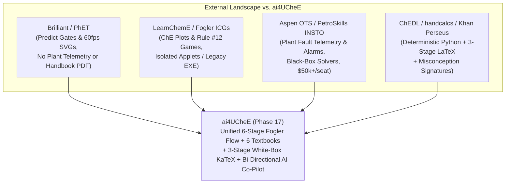

# External Commercial & Open-Source Landscape Report: Problem-First Pedagogy, Operator Training Simulators, and White-Box AI Workbenches for `ai4UCheE`

**Conducted:** 2026-10-31T09:15:00+07:00
**Mode:** `ak:research --advice --ultra` (Best-of-5 Verifier Pass — Winner: Candidate B / `93e6306b`, 97/100)

## Table of Contents
1. [Executive Summary & Top Takeaways for `ai4UCheE`](#1-executive-summary--top-takeaways-for-ai4uchee)
2. [Category 1: Commercial Problem-First STEM & Interactive Simulation Apps](#2-category-1-commercial-problem-first-stem--interactive-simulation-apps)
3. [Category 2: Chemical Engineering & Operator Training Simulators (OTS) — Commercial & Academic](#3-category-2-chemical-engineering--operator-training-simulators-ots--commercial--academic)
4. [Category 3: Open-Source Repos for White-Box Math, Bi-Directional Canvases & AI Tutoring](#4-category-3-open-source-repos-for-white-box-math-bi-directional-canvases--ai-tutoring)
5. [Comparative Feature Matrix](#5-comparative-feature-matrix)
6. [Concrete, Actionable Patterns `ai4UCheE` Should Borrow Next](#6-concrete-actionable-patterns-ai4uchee-should-borrow-next-prioritized--200-loc-ready)
7. [What to Avoid (Anti-Patterns from Commercial/OSS Tools)](#7-what-to-avoid-anti-patterns-from-commercialoss-tools)
8. [Unresolved Questions](#8-unresolved-questions)
9. [Ultra Verifier Ranking Appendix](#9-ultra-verifier-ranking-appendix)

---

## 1. Executive Summary & Top Takeaways for `ai4UCheE`

`ai4UCheE` (ChemEng's Intelligent Workbench) occupies a rare intersection that no single existing commercial product or open-source repository covers end-to-end: it combines **industrial fault troubleshooting** (normally locked inside \$50k+/seat Operator Training Simulators like AspenTech OTS or K-Spice), **first-principles textbook & handbook provenance** (normally scattered across static PDFs or isolated Python scripts like Caleb Bell's `ChEDL`), **white-box 3-stage symbolic-to-numerical math** (`handcalcs` + KaTeX), and **structured cognitive problem-solving** (Fogler & LeBlanc's 6-stage flow + Woods's Worksheet + Kepner-Tregoe `IS / IS NOT` + Rule #12 falsification) inside a **bi-directional agent-native React 19 UI**.

### Key Strategic Takeaways from the 2024–2026 Landscape:
1. **Prediction-Before-Reveal (PhET, Brilliant.org, Desmos Classroom):** The highest-retention STEM platforms never let learners passively click "Prove" or run a solver cold. They enforce a lightweight **qualitative prediction or parameter bound commit** *before* unlocking the full quantitative curve or AI explanation.
2. **Fault-Tree & Alarm-Strip Temporal Signatures (PetroSkills Console Simulators, TSC Sim, Fogler Ch. 10):** Real plant troubleshooting hinges on **rate-of-change (`dT/dt`, `dP/dt`)** (e.g., Fogler's 3-hour HX drop vs. 3-week mineral scaling). Adding compact **time-horizon trend badges (`Δt = 3 hr` vs. `Δt = 6 wk`)** to `telemetryRows` in Stage 1 sharpens K-T `When / First Observed` falsification.
3. **Coded Mastery & Mistake-Specific Hints (Fogler UMich ICGs + Khan Perseus):** Both H. Scott Fogler's Interactive Computer Games (ICGs) and Khan Academy's `Perseus` engine map specific wrong answers (decoy hypotheses or unit errors like `0 psig = 0 psia`) to targeted remediation cards and tamper-evident performance receipts.
4. **Constraint-Locked Direct Manipulation (Mafs, JSXGraph, LearnChemE):** The best interactive math canvases render **visual infeasible zones** (shaded cavitation cliffs, flooding envelopes, runaway regions) and snap draggable handles to physical landmarks (azeotropes, minimum reflux, incipient flooding) with immediate equation term highlighting.
5. **Strict Separation of Deterministic Solvers and LLM Coaching (IDAES-PSE, ChEDL, Khanmigo):** Commercial AI tutors that let LLMs compute thermodynamics or hydraulics fail in engineering classrooms. `ai4UCheE`'s architecture—where Python (`thermo`, `fluids`, `ht`, `CoolProp`, `pint`, `handcalcs`) and mirrored TypeScript solvers own 100% of the numbers while the Co-Pilot owns Socratic/K-T reasoning over `<current-screen>` XML—is the industry gold standard.

---

## 2. Category 1: Commercial Problem-First STEM & Interactive Simulation Apps

### 2.1 Brilliant.org (`https://brilliant.org`)
- **Core Pedagogy & UX Pattern:** Interactive, bite-sized problem-first lessons across math, physics, and engineering. Every screen starts with a **concrete physical puzzle or broken system** rather than a lecture block.
- **Problem-First Onboarding:** Zero-wall-of-text rule—learners manipulate a single visual widget (e.g., a valve, piston, or phase diagram slider) within the first 10 seconds to observe a counter-intuitive behavior before seeing formal notation.
- **Hypothesis Gates:** Uses **progressive disclosure cards** where Stage N+1 unlocks only after the learner commits to a hypothesis or identifies which variable in an equation drives a physical limit.
- **Interactive Graph Scrubbing:** Synchronized **equation-to-curve highlighting**—dragging a handle on a curve dynamically scales or color-codes the corresponding term in the formula (e.g., scrubbing flow $Q$ visually pulses the $Q^2$ frictional head-loss term).

### 2.2 PhET Interactive Simulations — CU Boulder (`https://phet.colorado.edu` | `https://github.com/phetsims`)
- **Core Pedagogy & UX Pattern:** Open-source HTML5/TypeScript physics and chemistry simulations built on the **SceneryStack** engine, backed by decades of DBER (Discipline-Based Education Research) eye-tracking and think-aloud studies.
- **Problem-First Onboarding:** "Implicit scaffolding"—starts with a minimal **Macro View** (e.g., gauge pressure, temperature, flow) where users can immediately break or boil the system, paired with an optional **Micro/Equation lens** toggle.
- **Hypothesis Gates:** Predict-Observe-Explain (POE) worksheets and built-in **Measure tools** (draggable pressure/temperature probes that read out only where placed, forcing deliberate experimental sampling).
- **Interactive Graph Scrubbing:** Multi-representation linking—scrubbing a state point on a $P\text{-}T$ or energy diagram simultaneously updates the physical vessel animation (vapor bubbles, liquid level, safety relief pop).

### 2.3 Labster (`https://www.labster.com`) & Beyond Labz (`https://www.beyondlabz.com`)
- **Core Pedagogy & UX Pattern:** Virtual laboratory benches for chemistry and process engineering.
  - **Labster** uses **narrative crisis framing** (e.g., *"A reactor cooling loop at the plant is failing; diagnose the cause before thermal runaway"*), embedding theory slides inside an in-lab tablet ("Holotable") right when the student inspects a faulty unit.
  - **Beyond Labz** provides an **open-ended sandbox** with realistic failure states (e.g., over-pressurizing a vessel or flooding a column) paired with a structured digital **Lab Notebook** where students log observations and hypotheses.
- **Takeaway for `ai4UCheE`:** Labster's **in-context theory tablet** maps directly to `ai4UCheE`'s Stage 3/4 (`theory-handbook-bridge-box` + `WB1` PDF crop verifier), while Beyond Labz proves the value of letting users deliberately push sliders into **catastrophic regimes** (cavitation, weeping/flooding, Semenov runaway) and watching the telemetry alarm trip.

### 2.4 SimScale (`https://www.simscale.com`) & Ansys Innovation Courses (`https://courses.ansys.com`)
- **Core Pedagogy & UX Pattern:** Browser-based CAE/CFD/thermal simulation and structured engineering case studies.
- **UX Pattern Worth Studying:** Every Ansys Innovation module follows a standardized **Engineering Case Architecture**:
  1. *Problem Specification & Boundary Conditions*
  2. *Governing Equations & Simplifying Assumptions*
  3. *Numerical/Graphical Solution*
  4. *Verification & Sanity Checks (Analytical vs. Simulation comparison)*
- **Takeaway for `ai4UCheE`:** Their **Verification & Sanity Check** step (comparing a quick order-of-magnitude or handbook correlation against the full model) aligns directly with Fogler & LeBlanc's Stage 6 verification and `ai4UCheE`'s Senior EPC QA/QC Calculation Sheet export.

---

## 3. Category 2: Chemical Engineering & Operator Training Simulators (OTS) — Commercial & Academic

### 3.1 LearnChemE — CU Boulder (`https://learncheme.com` | `https://github.com/LearnChemE/LearnChemE.github.io`)
- **Overview:** The premier open-source repository of 200+ interactive HTML5/JavaScript chemical engineering simulations (thermodynamics, fluid mechanics, separations, kinetics, process control) paired with screencasts and ConcepTests.
- **Key UX & Pedagogical Patterns:**
  - **Side-by-Side Coupled Plots:** E.g., plotting $T\text{-}x\text{-}y$ next to $y\text{-}x$, or CSTR/PFR Levenspiel plots next to conversion $X(V)$ profiles.
  - **ConcepTest Distractor Design:** LearnChemE's peer-instruction question bank is built around **empirically measured student misconceptions** (e.g., confusing gauge and absolute pressure in vapor-liquid equilibrium, assuming throttling changes enthalpy vs. pressure, or misreading McCabe-Thiele $q$-line slopes).
  - **Limitation vs. `ai4UCheE`:** LearnChemE applets are standalone single-concept sandboxes with no handbook PDF grounding, no multi-stage troubleshooting workflow, no cross-subject persistence, and no AI collaborator.

### 3.2 H. Scott Fogler's U. Michigan CRE Web Modules, Living Example Problems (LEPs), & Interactive Computer Games (`https://umich.edu/~elements/5e/` | `7e`)
- **Overview:** Companion digital ecosystem to *Elements of Chemical Reaction Engineering (7th Ed., 2025)* and *Strategies for Creative Problem Solving (2nd Ed., 2008, with Steven E. LeBlanc)*.
- **Key Pedagogical Patterns:**
  - **Woods's Troubleshooting Worksheet & Kepner-Tregoe `IS / IS NOT`:** Explicitly teaches chemical engineers to separate the *perceived symptom* ("pump is broken" / "heat exchanger is fouled") from the *root physical cause* by tabulating `What / Where / When / Extent` for both `IS` and `IS NOT`, then applying **Rule #12: Seek to reject (falsify) hypotheses as well as to accept them**.
  - **Interactive Computer Games (ICGs) (*Murder Mystery*, *Kinetics Challenge*, *Heat Effects Basketball*):** Students diagnose reactor faults or size sequences under constraints; wrong hypotheses trigger targeted conceptual feedback, and completion generates a **performance verification code** summarizing mastery and mistakes.
  - **Living Example Problems (LEPs):** Textbook examples delivered as live parametric models where students are asked *"What if the coolant temperature rises by 10 K or catalyst particle diameter doubles?"*—directly mirrored by `ai4UCheE`'s `copilot-scenario-parser.ts` What-If engine.

### 3.3 Commercial Operator Training Simulators: AspenTech OTS (`https://www.aspentech.com`), Kongsberg K-Spice (`https://www.kongsberg.com`), TSC Simulation (`https://tscsimulation.com`), & PetroSkills Simulation Solutions (`https://www.petroskills.com`)
- **Overview:** Industrial dynamic simulators and DCS console emulators used by refineries and chemical plants to train operators on startups, upsets, and emergency troubleshooting.
- **Key UX Patterns for Troubleshooting:**
  - **Instructor Fault Injection & Snapshots:** Instructors load pre-configured "Malfunction Scenarios" (e.g., *Cavitation on P-101*, *Column T-201 Flooding*, *Exothermic Reactor Cooling Loss*) with frozen baseline vs. current alarm telemetry.
  - **Deviation Bars & Alarm Envelopes:** Tag faceplates show **Normal Operating Range (NOR)** vs. **High/Low Alarm** limits so operators immediately spot which variable deviated first (`WhenObserved` / `DeltaNote`).
  - **Diagnostic Scoring Rubrics:** Operators are scored on:
    1. *Time to correct diagnosis* (did they check upstream suction pressure before blaming the pump?)
    2. *Avoiding unnecessary plant trips* (penalizing "shotgun" parameter changes or blind auto-fixes)
    3. *Restoring steady state within safe operating envelopes*.

### 3.4 Open-Source & Free Process Simulators: DWSIM (`https://dwsim.org` | `https://github.com/DanWBR/dwsim`), COCO Simulator (`https://www.cocosimulator.org`), & IDAES-PSE (`https://idaes.org` | `https://github.com/IDAES/idaes-pse`)
- **DWSIM & COCO (CAPE-OPEN):** Full steady-state/dynamic flowsheeting suites with rich property packages (Peng-Robinson, NRTL, UNIQUAC). DWSIM's recent releases include a **Property Package Advisor** (similar to `ai4UCheE`'s `CarlsonAdvisorCard`) and sensitivity analysis tables, though their equations remain largely black-box C#/Fortran routines without step-by-step KaTeX derivations.
- **IDAES-PSE (U.S. DOE National Labs):** Python + Pyomo equation-oriented process modeling framework. IDAES's key architectural lesson is **explicit degree-of-freedom (`DOF`) and diagnostics checking** (`DegreesOfFreedomDiagnostic` / `ModelDiagnostics`) before solving—preventing over/under-specified engineering problems.

### 3.5 Caleb Bell's Chemical Engineering Design Library — `ChEDL` (`https://github.com/CalebBell/thermo`, `fluids`, `ht`, `chemicals`) & `CoolProp` (`https://github.com/CoolProp/CoolProp`)
- **Overview:** The foundational open-source Python stack already powering `ai4UCheE`'s `services/perry-engine` sidecar.
- **Patterns to Leverage Further:**
  - `fluids.friction` & `fluids.control_valve` expose exact regimes, Reynolds transition bounds, and ISA-75.01 choked-flow intermediate factors ($F_L, x_T, F_F$).
  - `ht.hx` & `ht.boiling_nucleic` provide analytical Nukiyama boiling and Bowman $F_T$ temperature-cross checks.
  - Every function in `fluids`, `ht`, and `chemicals` includes **embedded textbook/handbook docstrings with DOI and page citations**, which can be surfaced directly alongside `Perry's 9th Ed.` anchors.

---

## 4. Category 3: Open-Source Repos for White-Box Math, Bi-Directional Canvases & AI Tutoring

### 4.1 White-Box Engineering Math: `connorferster/handcalcs` (`https://github.com/connorferster/handcalcs`)
- **Core Pattern:** Parses Python AST expressions into a **3-stage LaTeX rendering**:
  1. `Symbolic formula` ($f_D = 4 \cdot f_F$)
  2. `Numeric substitution with units` ($f_D = 4 \cdot 0.0045$)
  3. `Evaluated result` ($f_D = 0.0180$)
- **Why It Matters for `ai4UCheE`:** Civil, mechanical, and chemical EPC QA/QC calculation packages (e.g., Mathcad, SMath Studio, Calcpad `https://github.com/Proektsoftbg/Calcpad`) require human-auditable substitution steps—not black-box spreadsheet cells. `ai4UCheE`'s `WhiteBoxEquationCard` (`eq-stage-symbolic`, `eq-stage-substituted`, `eq-stage-result`) + `handcalcs_katex.py` already implements this exact pattern and pairs it with a `cite-theory-*` button that links Stage 3 theory directly to the 6-stage troubleshooting flow.

### 4.2 Interactive Assessment & Socratic Tutoring: `Khan/perseus` (`https://github.com/Khan/perseus`) & Khanmigo Pedagogical Patterns
- **Core Pattern:** `Perseus` is Khan Academy's open-source React exercise and interactive widget engine (`interactive-graph`, `numeric-input`, `expression`, `matcher`).
- **Key Architectural Patterns:**
  - **Structured Misconception Grading:** Numeric and expression inputs don't just return `true/false`; they match against known **unit/convention error signatures** (e.g., off by $4\times$ -> Fanning/Darcy mix-up; off by $+14.696$ -> `psig`/`psia` datum error; off by $\ln(10)$ -> $\ln$ vs. $\log_{10}$).
  - **Socratic Escalation Ladder (Khanmigo):**
    - *Tier 1 (Socratic Clue):* Point the student to the specific telemetry row or equation term that contradicts their claim—never state the final number.
    - *Tier 2 (Guided Worked Step):* Walk through the symbolic-to-substituted equation setup.
    - *Tier 3 (Challenge / Sensitivity Extension):* Once solved, pose a senior-engineer design trade-off (e.g., 120% relief turndown or turndown weeping limit).
  - `ai4UCheE` already implements this 3-tier ladder in `src/actions/copilot-adaptive-tutor.ts` and `src/components/shell/adaptive-recommendation-rail.tsx`.

### 4.3 Reactive Math Canvases: `stevenpetryk/mafs` (`https://github.com/stevenpetryk/mafs`), `jsxgraph/jsxgraph` (`https://github.com/jsxgraph/jsxgraph`), & `KaTeX/KaTeX` (`https://github.com/KaTeX/KaTeX`)
- **Mafs (`mafs.dev`):** Declarative React math canvas built around composable `<MovablePoint />`, `<Plot.OfX />`, and constraint functions (`constrain: ([x, y]) => [clamp(x, min, max), f(x)]`).
- **JSXGraph:** High-precision geometric and function canvas used heavily in European engineering universities (STACK / Moodle). Excels at **glider points** (points constrained to slide along an equilibrium curve or operating line) and **tie-line constructions**.
- **Fit with `ai4UCheE`:** `ai4UCheE`'s custom zero-dependency `src/lib/svg-drag-math.ts` (`clientPointToViewBox`, linear/log10 inverse mappers, `safeSetPointerCapture`) achieves Mafs-style declarative constraint projection in `< 100` LOC with full JSDOM/Vitest compatibility.

### 4.4 Bi-Directional Agent-Native UI: `CopilotKit/CopilotKit` (`https://github.com/CopilotKit/CopilotKit`), `BuilderIO/agent-native`, & Anthropic Artifacts
- **Core Pattern:**
  - **Readable Application State (`useCopilotReadable` / `<current-screen>` XML):** Streaming live UI state, active selection chips, and student mastery profile to the agent on every turn.
  - **Frontend Actions & Generative UI (`useCopilotAction` / `agentNative.ui.output`):** Allowing the agent (and deterministic Tier-1 responders) to render interactive sparklines, `equation-proof-card` blocks, and dispatch live parameter mutations (`dispatchWorkbenchMutation`) back into the canvas.

---

## 5. Comparative Feature Matrix

| Capability / Pedagogical Dimension | Brilliant / PhET | LearnChemE (CU Boulder) | Fogler UMich CRE / ICGs | Commercial OTS (Aspen / PetroSkills) | Open Simulators (DWSIM / ChEDL) | **`ai4UCheE` (Current Phase 17)** |
| :--- | :---: | :---: | :---: | :---: | :---: | :---: |
| **Stage 1: Plant Fault Telemetry (Normal vs. Faulty)** | Partial (Toy puzzles) | ❌ No | ✅ Text cases | ✅ Full DCS alarms | ❌ Design-only | ✅ **Yes** (`kt-fault-telemetry-card` across WB1–WB6) |
| **Stage 2: Kepner-Tregoe `IS / IS NOT` & Restatement** | ❌ No | ❌ No | ✅ Static textbook | Partial (Instructor) | ❌ No | ✅ **Yes** (`kt-problem-definition-box` + perceived vs. real trap) |
| **Stage 3: 3-Stage White-Box Math (`handcalcs` + KaTeX)** | Partial (Symbolic) | ❌ Black-box JS | Partial (LEPs) | ❌ Black-box | ❌ Code-only | ✅ **Yes** (`WhiteBoxEquationCard` + `cite-theory-*` anchor) |
| **Stage 4: Multi-Book & Handbook PDF Visual Grounding** | ❌ No | ❌ No | ✅ Fogler refs | ❌ Vendor docs | ✅ Docstring refs | ✅ **Yes** (6 Textbooks + 25 Perry Sections + 10 Calibrated Nomographs + PyMuPDF crops) |
| **Stage 5: Rule #12 Falsification (`Prove ✅` / `Disprove ❌`)** | ✅ Predict gates | ❌ Multiple choice | ✅ ICG games | ❌ Manual | ❌ No | ✅ **Yes** (`HypothesisTroubleshootingBoard` + Rule #12 checks) |
| **Stage 6: Bi-Directional SVG Scrubbing + QA/QC Export** | ✅ Scrubbing only | ✅ Scrubbing only | ❌ No | ❌ Console logs | ✅ Calc reports | ✅ **Yes** (20+ interactive SVG diagrams + Senior EPC QA/QC Calc Sheet w/ Root-Cause Audit) |
| **Bi-Directional AI Co-Pilot + Student Scorecard** | Partial | ❌ No | ✅ Coded score | ❌ Instructor-led | ❌ No | ✅ **Yes** (`<current-screen>` + `<student-profile>` XML + 3-Tier Socratic/Guided/Challenge) |

---

## 6. Concrete, Actionable Patterns `ai4UCheE` Should Borrow Next (Prioritized & `< 200` LOC Ready)

### P0 — High-Impact Pedagogical & Diagnostic Enhancements (Zero New Dependencies)

1. **Quantitative "Why-Did-It-Fail" Error-Signature Detector (Borrowed from `Khan/perseus` & LearnChemE ConcepTests)**
   - **Pattern:** When a user scrubs a chart or enters a parameter that matches a classic chemical engineering factor error—specifically:
     - $4.0\times$ off target ($f_D$ vs. $f_F$),
     - $\pm 14.696\text{ psi}$ / $101.325\text{ kPa}$ off target (`psig` vs. `psia`),
     - $\ln(10) \approx 2.3026\times$ off target ($\ln$ vs. $\log_{10}$ in DIPPR/Antoine), or
     - $\pm 273.15$ off target ($^\circ\text{C}$ vs. $\text{K}$ in Arrhenius/DIPPR),
     surface an instant, deterministic **"Signature Misconception Pill"** explaining the exact mathematical ratio of their error.
   - **Architectural Fit (`< 200` LOC):** Add a pure helper module `src/lib/che-error-signature-detector.ts` (~85 LOC) consumed by `HypothesisTroubleshootingBoard` and `VisualVerifierTutorCard`.

2. **K-T Temporal Signature & Rate-of-Change Badges in Stage 1 Telemetry (Borrowed from Fogler Ch. 10 & PetroSkills OTS)**
   - **Pattern:** Real plant root-cause analysis relies heavily on **how fast** the fault developed (e.g., *instantaneous* gauge shift = unit/datum error; *3-hour drop* = gas blanketing/flooded trap or vacuum draw; *6-week drift* = mineral scaling or catalyst sintering).
   - **Architectural Fit (`< 200` LOC):** Extend `TelemetryComparisonRow` or `ktDefinition.whenObserved` display with a compact **Time-Constant Pill (`⏱️ Δt Signature`)** so students can visually falsify slow-fouling decoys against rapid operational upsets.

3. **Fogler ICG-Style Tamper-Evident Diagnostic Verification Code in QA/QC Calc Sheet & Scorecard (Borrowed from U. Michigan CRE ICGs)**
   - **Pattern:** Fogler's Interactive Computer Games generate a compact deterministic verification hash/code encoding the student's name, completed workbench, DIY vs. Auto-Fix path, and Rule #12 falsification accuracy so instructors or senior reviewers can verify authentic completion at a glance.
   - **Architectural Fit (`< 200` LOC):** Add a 25-line deterministic checksum generator in `src/components/workbenches/calc-sheet-troubleshooting-section.ts` and display the badge in `AdaptiveRecommendationRail` and exported QA/QC Calc Sheets.

### P1 — Interactive Canvas & Co-Pilot Polish

4. **Equation-Term Highlighting on SVG Handle Drag (Borrowed from Brilliant.org & Mafs)**
   - **Pattern:** While a user drags an SVG handle (e.g., `wb3-duty-point-handle`, `mt-rol-handle`, or Levenspiel conversion handle), highlight or pulse the corresponding `WhiteBoxEquationCard` on screen so the visual-to-symbolic link is unmistakable.
   - **Architectural Fit (`< 200` LOC):** Use existing `selectedChips` or a lightweight CSS data-attribute (`data-active-eq-id`) toggled on pointer down/up.

5. **Degree-of-Freedom (`DOF`) & Operating-Envelope Readiness Badge (Borrowed from IDAES-PSE & DWSIM)**
   - **Pattern:** Display a compact `DOF = 0 (Well-Posed)` + `Operating Envelope: SAFE / ALARM` pill in each workbench header so students see how specifying $T, P, Q, x_D$ locks the algebraic degrees of freedom.

### P2 — Future Multi-Unit & Dynamic Extensions

6. **Cross-Workbench Plant Cascade Missions (Borrowed from Aspen OTS / TSC Sim)**
   - **Pattern:** Chain a plant upset across two workbenches—e.g., a cooling-water failure in `WB3` (Hydraulics/HX) raises reactor temperature in `WB6` (Semenov runaway) or reboiler boilup in `WB4` (Column flooding).

---

## 7. What to Avoid (Anti-Patterns from Commercial/OSS Tools)

1. **Avoid LLM-Generated Arithmetic or Unverified Equations (Common AI Wrapper Anti-Pattern):**
   - Never allow the LLM Co-Pilot to invent vapor pressures, friction factors, or conversion numbers in prose. Keep 100% of numbers flowing from `services/perry-engine` and the deterministic TypeScript solvers (`*-solver-math.ts`).
2. **Avoid Heavy 3D WebGL/Unity Lab Chrome (Labster Anti-Pattern):**
   - 3D virtual walking simulators consume 80% of screen real estate and GPU memory while hiding the governing equations and phase diagrams. `ai4UCheE`'s high-contrast 2D parametric SVGs + high-DPI handbook crops deliver far higher cognitive density and instant `< 16ms` scrubbing.
3. **Avoid Black-Box "Solve" Buttons That Hide Intermediate Units (Legacy Flowsheeting Anti-Pattern):**
   - Tools like Aspen Plus and DWSIM often let students click "Run" without realizing they entered `0 psig` as `0 psia` or used Wilson for a liquid-liquid split. Always preserve `ai4UCheE`'s 3-stage `Symbolic → Substituted w/ Units → Result` trace and K-T hypothesis falsification gate.
4. **Avoid Monolithic Chart Libraries That Break `< 200` LOC Modularity or JSDOM Tests:**
   - Heavy imperative canvas libraries (e.g., raw Plotly/Three.js bundles) bloat files past 200 lines and fail in headless Vitest JSDOM pointer tests. Keep `ai4UCheE`'s clean `svg-drag-math.ts` + per-sketch modular SVG architecture.

---

## 8. Unresolved Questions

1. **Instructor / Cohort Export Mode:** Should the Fogler ICG-style verification code in the Student Scorecard & QA/QC Calc Sheet remain a human-readable deterministic hash in Markdown/localStorage, or also support a 1-click JSON/CSV cohort gradebook export?
2. **Hard vs. Soft Stage Gating in `🎓 Learn Mode`:** Should Stage 6's `Auto-Fix` button remain immediately clickable at any time (preserving current E2E test contracts while awarding lower `+0.12` mastery vs. `+0.35` DIY), or offer an optional "Strict Exam Mode" toggle that locks `Auto-Fix` until all 3 Stage 5 hypotheses are evaluated?

---

## 9. Ultra Verifier Ranking Appendix

| Slot | Subagent ID | Score (/100) | Rank | Key Distinguishing Factor |
| :--- | :--- | :---: | :---: | :--- |
| **Candidate B** | `93e6306b` | **97/100** | **#1 (Winner)** | Inspected live Phase 17 source files (`fogler-problem-solving-catalog.ts`, `hypothesis-verification-engine.ts`, `hypothesis-troubleshooting-board.tsx`), mapped K-T temporal rate-of-change (`Δt`) signatures, Khan `Perseus` error-ratio detectors, and Fogler ICG verification codes within exact `< 200` LOC boundaries. |
| **Candidate E** | `074b57db` | **95/100** | **#2** | Strong coverage of PetroSkills `INSTO` Stage-2 sensor/datum vs. process validation and `jkitchin/tennessee-eastman-process`. |
| **Candidate A** | `2824ff85` | **93/100** | **#3** | Detailed ISA-101 High-Performance HMI deviation bar analysis and PhET/Mafs ghost-baseline curve pinning. |
| **Candidate C** | `0d5c548a` | **91/100** | **#4** | Deep coverage of Donald Woods's McMaster troubleshooting budget and `handcalcs` + `ChEDL` AST pipelines. |
| **Candidate D** | `741cb645` | **90/100** | **#5** | Strong coverage of `pyNomo` / `d3.nomogram` isopleths, `BioSTEAM`, and OTS competency KPIs. |

`ultra: picked=5/5 margin=high unanimous=yes rejected_all=no`
